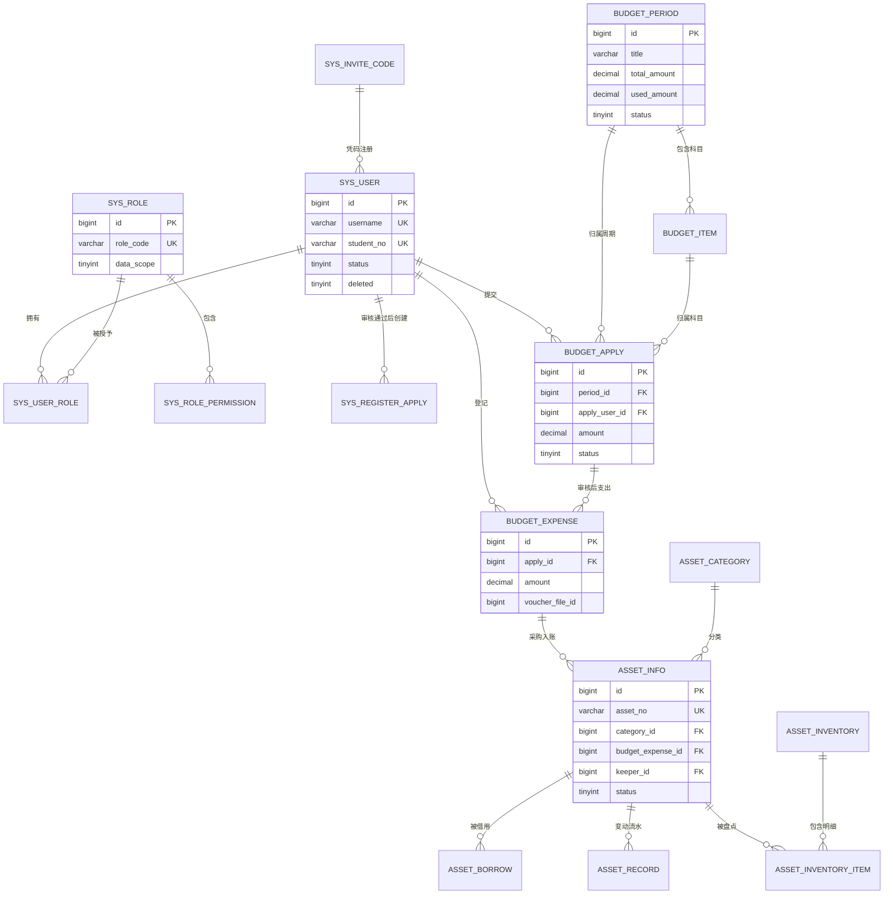

# IECMP 创业中心管理平台 · 数据库设计

| 项目 | 内容 |
| --- | --- |
| 系统名称 | IECMP（Innovation & Entrepreneurship Center Management Platform）创业中心管理平台 |
| 文档名称 | 数据库设计 |
| 文档版本 | V1.2 |
| 编写日期 | 2026-09-22 |
| 编写人员 | 后端组 |
| 数据库 | MySQL 8.0+ |
| 存储引擎 | InnoDB |
| 字符集 / 排序规则 | `utf8mb4` / `utf8mb4_general_ci` |
| 表数量 | **36 张**（业务表 34 张 + 补充表 2 张） |
| 关联文档 | 《IECMP-项目介绍与技术架构.md》《IECMP-接口开发文档-v1.6.md》 |

## 修订记录

| 日期 | 版本 | 说明 | 编写人 |
| --- | --- | --- | --- |
| 2026-09-22 | V1.0 | 首版：设计约定、关系概览与 ER 图、36 张表结构设计与完整建表 SQL、初始数据 SQL、索引与优化建议 | 后端组 |
| 2026-09-24 | V1.2 | **索引与逻辑删除关键修正**：① `deleted` 由 `TINYINT` 改为 `BIGINT`，并让 `deleted` 参与全部 18 个唯一索引，解决「唯一索引 + 逻辑删除」导致的二次删除 / 重复授权必然冲突的问题（详见 1.5 节）；② 补 `seat_apply.assign_seat_id`（审核通过时改派其他工位）、`budget_apply.approved_amount`（部分批准金额）；③ 补权限码 `seat:seat:list`（接口 `5-25` 依赖，缺失会导致超管 403），权限码总数 84 → 85；④ 清理 11 处冗余 / 低效索引，新增 5 处联合索引；⑤ 数据字典补齐 4 类共 13 条（`msgType`、`dutySwapStatus`、`registerApplyStatus`、`noticeStatus`），总数 19 类 78 条 → 23 类 91 条；⑥ 初始数据脚本统一 `INSERT IGNORE` 实现可重复执行；⑦ 交付两个 SQL 脚本文件（`IECMP-数据库建表脚本.sql`、`IECMP-初始数据.sql`），并新增 5.5.1 节记录真机实测结论（MySQL 8.0.44、20 万行提交 / 10 万条消息，核心查询均命中预期索引）、3.2.3 节补「提交查询必须带 `project_id`」的写法提示 | 后端组 |
| 2026-09-24 | V1.1 | 与接口文档 V1.4 对齐：`repo_account` 新增 `sync_status`（0 未采集 / 1 采集中 / 2 采集正常 / 3 采集失败），`repo_project.sync_status` 注释与接口文档统一为「采集」口径，`repo_sync_log.sync_type` 注释改为「1 定时自动 2 管理员手动补采」；表数量不变（仍 36 张），无新增表 | 后端组 |

> **文档定位**：本文档是表结构的**唯一权威来源**。DDL 与本文档不一致时，以本文档为准。表结构变更须更新本文档并登记修订记录。
>
> **补充表说明**：接口文档的数据模型章节列出了 34 张表。本设计**额外补充 2 张**（`sys_dict`、`sys_message`），原因见 5.3 节。

---

## 目录

- [第 1 章 设计约定](#第-1-章-设计约定)
- [第 2 章 关系概览与 ER 图](#第-2-章-关系概览与-er-图)
- [第 3 章 表结构设计与建表 SQL](#第-3-章-表结构设计与建表-sql)
  - 3.1 模块一：用户与权限（6 张）
  - 3.2 模块二：代码仓库关联（4 张）
  - 3.3 模块三：部门预算（4 张）
  - 3.4 模块四：部门财产（6 张）
  - 3.5 模块五：部门工位（4 张）
  - 3.6 模块六：学长学姐展板（2 张）
  - 3.7 模块七：值日排班（4 张）
  - 3.8 模块八：通用支撑（6 张，含 2 张补充表）
- [第 4 章 初始数据 SQL](#第-4-章-初始数据-sql)
- [第 5 章 设计说明与注意事项](#第-5-章-设计说明与注意事项)

---

## 第 1 章 设计约定

### 1.1 通用规范

| 项目 | 约定 |
| --- | --- |
| 存储引擎 | `InnoDB`（需要事务与外键语义） |
| 字符集 | `utf8mb4`，排序规则 `utf8mb4_general_ci`（兼容性好，中文排序够用） |
| 表名 | 小写下划线，带模块前缀：`sys_`、`repo_`、`budget_`、`asset_`、`seat_`、`honor_`、`duty_` |
| 字段名 | 小写下划线 |
| 每张表必须有 | 主键、表注释；业务字段必须有字段注释 |
| 主键 | `BIGINT` 自增（`AUTO_INCREMENT`），不使用 UUID 做主键（索引体积大、无序插入影响性能） |
| 外键约束 | **不建物理外键**（`FOREIGN KEY`），关联关系由应用层维护、靠索引加速。理由见 5.1 节 |
| 时间字段 | `DATETIME`（不用 `TIMESTAMP`，避免 2038 问题与时区隐式转换） |
| 金额字段 | `DECIMAL(12,2)`（**绝不用 FLOAT / DOUBLE**，浮点会有精度误差） |
| 布尔 / 状态 | `TINYINT`，取值 0 / 1 或枚举值 |
| 逻辑删除 | `deleted BIGINT`：0 未删除；已删除时写入本行 `id`（非 0 即已删除），见 1.5 节 |

### 1.2 公共字段

所有表统一包含下列公共字段，后端对应一个 `BaseEntity` 基类，所有实体继承它：

```sql
  `id`          BIGINT   NOT NULL AUTO_INCREMENT COMMENT '主键',
  `create_by`   BIGINT   NULL     DEFAULT NULL  COMMENT '创建人 ID',
  `create_time` DATETIME NOT NULL DEFAULT CURRENT_TIMESTAMP COMMENT '创建时间',
  `update_by`   BIGINT   NULL     DEFAULT NULL  COMMENT '更新人 ID',
  `update_time` DATETIME NOT NULL DEFAULT CURRENT_TIMESTAMP ON UPDATE CURRENT_TIMESTAMP COMMENT '更新时间',
  `deleted`     BIGINT   NOT NULL DEFAULT 0     COMMENT '删除标记：0 未删除；已删除时写入本行 id',
```

**唯一例外**：`sys_oper_log`（操作日志）是**追加型**数据，只保留 `id` 与 `create_time`（即操作时间），不做更新与逻辑删除。日志的清理走物理删除。

**MyBatis-Plus 配置对应关系**

| 字段 | 注解 / 配置 | 说明 |
| --- | --- | --- |
| `id` | `@TableId(type = IdType.AUTO)` | 数据库自增 |
| `create_time` / `update_time` | `@TableField(fill = FieldFill.INSERT)` / `INSERT_UPDATE` | 由 `MetaObjectHandler` 自动填充 |
| `create_by` / `update_by` | `@TableField(fill = FieldFill.INSERT)` / `INSERT_UPDATE` | 填充当前登录用户 ID |
| `deleted` | `@TableLogic` | 查询自动追加 `deleted = 0`，`delete` 自动改为更新 |

### 1.3 关键字段类型约定

| 业务含义 | 类型 | 说明 |
| --- | --- | --- |
| 主键 / 用户 ID / 各类外键 | `BIGINT` | 与自增主键类型一致，避免隐式转换 |
| 学号 / 工号 / 资产编号 | `VARCHAR(20)`~`VARCHAR(32)` | 可能含前导零，**不用数字类型** |
| 密码哈希 | `VARCHAR(100)` | BCrypt 输出 60 字符，预留余量 |
| URL / 文件地址 | `VARCHAR(512)` | OSS 完整 URL 可能较长 |
| 第三方令牌 | `VARCHAR(512)` | AES 加密后长度会膨胀，**不加密时也必须留足长度** |
| 富文本正文 | `TEXT` / `MEDIUMTEXT` | 公告正文、学长简介 |
| 枚举 / 状态 | `TINYINT` | 取值含义写在字段注释里 |
| 排序号 | `INT` | 升序排列 |
| JSON 数组 / 配置 | `JSON` | `member_ids`、`group_config`、`image_urls`，见 1.6 节 |
| 逻辑删除标记 | `BIGINT` | 0 未删除；已删除时写入本行 `id`（**必须能放下 id，故不用 TINYINT**），见 1.5 节 |
| IP 地址 | `VARCHAR(64)` | 预留 IPv6 长度 |

### 1.4 索引约定

| 类型 | 命名 | 使用场景 |
| --- | --- | --- |
| 主键索引 | `PRIMARY KEY` | 每张表 |
| 唯一索引 | `uk_{字段名}` | 业务唯一性：账号、学号、邀请码、资产编号、角色编码 |
| 普通索引 | `idx_{字段名}` | 高频筛选：`status`、`create_time`、各类外键 |
| 联合索引 | `idx_{字段1}_{字段2}` | 固定组合查询，**字段顺序按「等值在前、范围在后」** |
| 组合唯一索引 | `uk_{字段1}_{字段2}` | 关联表去重、提交记录去重 |

**三条纪律**

1. **所有关联字段必须建索引**（`user_id`、`period_id`、`asset_id` 等）。不建物理外键时，索引是关联查询性能的唯一保障。
2. **联合索引遵循最左前缀**。例如 `idx_period_item (period_id, item_id)` 能加速 `WHERE period_id = ?` 与 `WHERE period_id = ? AND item_id = ?`，但**不能**加速单独查 `item_id`（需另建索引）。
3. **区分度极低的字段不单独建索引**：`enabled`、`is_top` 这类只有 0/1 取值、且表本身很小的字段，单独建索引收益极低（本设计已按此原则裁剪）。`status` 之所以保留索引，是因为它总是与排序或时间范围一起使用。
   - `deleted` 不单独建索引（查询条件恒为 `deleted = 0`），但它**必须作为每个唯一索引的最后一个字段**，原因见 1.5 节。
4. **不是所有 `*_id` 都要建索引——只给「有查询路径」的建**。索引会拖慢写入，无用的索引是纯粹的负担。
5. **不留冗余索引**：若 `idx_a (a)` 与 `idx_a_b (a, b)` 同时存在，前者是后者的最左前缀，可以删掉（联合索引已能加速 `WHERE a = ?`）。同理，`UNIQUE KEY (a, ...)` 存在时不需要再建 `idx_a`。本设计已按此规则清理。

**刻意不建索引的字段（有意为之，非遗漏）**

| 字段 | 为什么不建 | 何时该补 |
| --- | --- | --- |
| 各表的 `audit_user_id`（审核人） | 现有接口只按「状态」筛选待审核列表，**没有按审核人反查**的场景 | 需要「我审核过的记录」这类功能时 |
| `asset_inventory_item.check_user_id` | 盘点明细按盘点任务与资产查询，不按盘点人查 | 需要「某人盘过哪些资产」时 |
| `asset_record.from_user_id` / `to_user_id` | 流水按资产与时间查询 | 需要「某人经手过哪些资产」时 |
| `sys_register_apply.audit_user_id` / `create_user_id` | 申请列表按状态与时间查询 | 需要按审核人统计时 |
| `seat_apply.audit_user_id`、`honor_alumni.audit_user_id` | 同上 | 同上 |

> 与此形成对照：**有明确查询路径的关联字段一律建了索引**。例如 `budget_apply.attach_file_id` 与 `budget_expense.voucher_file_id`——接口 `8-03 文件删除` 需要检查「该文件是否仍被业务引用」，这是按文件 ID 反查业务表；`duty_swap.target_schedule_id`——换班生效要按目标条目 ID 定位；`seat_swap.apply_seat_id` / `target_seat_id`——审核通过要按工位 ID 校验占用状态。这类字段建索引是**必须**的，不能省。

### 1.5 逻辑删除与唯一约束的冲突处理

这是本项目最容易踩的坑，**必须统一遵守**。

**问题**：`sys_user.username` 是唯一索引，同时表使用逻辑删除。用户 A 被删除后，新用户想用同名 `username` 注册，会因为唯一索引冲突而失败——被删的那行还占着这个值。组合唯一键的问题更严重：接口 `1-20 角色授权` 是「先删旧记录、再插新记录」的全量覆盖，只要删除是**逻辑删除**，第二次保存同一批权限码就**必然**撞上 `uk_role_perm` 报错（`sys_user_role`、`duty_schedule`、`asset_inventory_item` 同理）。

**约定解法**：**让 `deleted` 参与唯一键，删除时把 `deleted` 从 0 改为本行的 `id`。**

- `deleted = 0` 表示未删除；`deleted <> 0` 表示已删除，且值就是这行的 `id`（天然唯一，多次删除互不冲突）；
- **所有唯一索引都以 `deleted` 作为最后一个字段**（全库 18 个唯一索引均已按此处理）；
- 唯一性只在「未删除的行」之间生效，删除后同一个业务值可以被重新占用；
- 唯一业务字段（如 `username`）**保持原值、不被污染**；需要恢复时把 `deleted` 改回 0 即可「复活」该行。

```sql
-- 通用逻辑删除写法：把 deleted 置为自身 id
UPDATE `sys_user` SET `deleted` = `id` WHERE `id` = ? AND `deleted` = 0;

-- 关联表全量覆盖：先逻辑删除旧记录，再插入新记录，不会与旧记录冲突
UPDATE `sys_role_permission` SET `deleted` = `id` WHERE `role_id` = ? AND `deleted` = 0;
INSERT INTO `sys_role_permission` (`role_id`, `perm_code`) VALUES (3, 'system:user:list');
```

**为什么 `deleted` 是 `BIGINT` 而不是 `TINYINT`**：要存得下主键 `id`。这也是全库 `deleted` 字段统一为 `BIGINT` 的原因。

**MyBatis-Plus 配置**（一处配置，全表生效）：

```java
// 实体基类中的逻辑删除字段
@TableLogic(value = "0", delval = "id")
private Long deleted;
```

`delval = "id"` 会让 MP 生成的删除语句变成 `UPDATE t SET deleted = id WHERE id = ? AND deleted = 0`，与上面的手写写法完全一致。**上线前请用一个真实删除动作打印一次 SQL 确认**：若所用 MP 版本不支持该写法，退路是在 Mapper 里用自定义 `@Update` 语句实现同样的效果，语义不变。

**适用范围**：全库所有「逻辑删除 + 唯一索引」的组合。**今后新增唯一索引时，务必把 `deleted` 加到末位**，否则就会重新掉进这个坑里。

### 1.6 JSON 字段的使用

以下 3 个字段使用 MySQL 原生 `JSON` 类型：

| 表 | 字段 | 内容示例 |
| --- | --- | --- |
| `duty_plan` | `member_ids` | `[12, 15, 18, 23]` 参与轮转的成员 ID 数组 |
| `duty_plan` | `group_config` | `[{"name":"甲组","memberIds":[12,15]},{"name":"乙组","memberIds":[18,23]}]` |
| `asset_info` | `image_urls` | `["https://xxx.oss.../a.png","https://xxx.oss.../b.png"]` |

**使用要求**

1. **Java 侧必须配置 `JacksonTypeHandler`**，否则读写会报类型转换错误：

```java
@TableName(value = "duty_plan", autoResultMap = true)
public class DutyPlan {
    @TableField(typeHandler = JacksonTypeHandler.class)
    private List<Long> memberIds;

    @TableField(typeHandler = JacksonTypeHandler.class)
    private List<GroupConfig> groupConfig;
}
```

> **注意**：实体类上的 `@TableName` **必须带 `autoResultMap = true`**，否则 `typeHandler` 在查询时不生效——这是最常见的踩坑点。

2. **JSON 字段不能直接建普通索引**。若将来需要按 JSON 内容查询（如「查某成员参与的所有排班计划」），方案是：MySQL 8 支持函数索引 `KEY idx_member ((CAST(member_ids AS CHAR(255) ARRAY)))`，或改用关联表。当前规模无需处理。
3. **JSON 只放「不需要关联查询的配置类数据」**。凡是需要 JOIN、需要统计、需要保证引用完整性的关系（如用户与角色），一律用关联表，不用 JSON。

### 1.7 表清单

| # | 表名 | 中文名 | 模块 |
| --- | --- | --- | --- |
| 1 | `sys_user` | 用户表 | 模块一 |
| 2 | `sys_role` | 角色表 | 模块一 |
| 3 | `sys_user_role` | 用户角色关联表 | 模块一 |
| 4 | `sys_role_permission` | 角色权限关联表 | 模块一 |
| 5 | `sys_invite_code` | 注册邀请码表 | 模块一 |
| 6 | `sys_register_apply` | 注册申请表 | 模块一 |
| 7 | `repo_account` | 托管账户表 | 模块二 |
| 8 | `repo_project` | 仓库表 | 模块二 |
| 9 | `repo_commit` | 提交记录表 | 模块二 |
| 10 | `repo_sync_log` | 同步日志表 | 模块二 |
| 11 | `budget_period` | 预算周期表 | 模块三 |
| 12 | `budget_item` | 预算科目表 | 模块三 |
| 13 | `budget_apply` | 预算申请表 | 模块三 |
| 14 | `budget_expense` | 支出记录表 | 模块三 |
| 15 | `asset_category` | 资产分类表 | 模块四 |
| 16 | `asset_info` | 资产台账表 | 模块四 |
| 17 | `asset_borrow` | 借用/领用表 | 模块四 |
| 18 | `asset_record` | 资产变动流水表 | 模块四 |
| 19 | `asset_inventory` | 盘点任务表 | 模块四 |
| 20 | `asset_inventory_item` | 盘点明细表 | 模块四 |
| 21 | `seat_area` | 工位区域表 | 模块五 |
| 22 | `seat_info` | 工位表 | 模块五 |
| 23 | `seat_apply` | 工位申请表 | 模块五 |
| 24 | `seat_swap` | 座位调换申请表 | 模块五 |
| 25 | `honor_alumni` | 学长学姐信息表 | 模块六 |
| 26 | `honor_record` | 荣誉记录表 | 模块六 |
| 27 | `duty_plan` | 排班计划表 | 模块七 |
| 28 | `duty_schedule` | 值日安排表 | 模块七 |
| 29 | `duty_swap` | 换班申请表 | 模块七 |
| 30 | `duty_reminder_config` | 提醒配置表 | 模块七 |
| 31 | `sys_file` | 文件表 | 模块八 |
| 32 | `sys_notice` | 公告表 | 模块八 |
| 33 | `sys_oper_log` | 操作日志表 | 模块八 |
| 34 | `sys_video` | 视频资源表 | 模块八 |
| 35 | `sys_dict` | 数据字典表 | 模块八（**补充**） |
| 36 | `sys_message` | 站内消息表 | 模块八（**补充**） |

---

## 第 2 章 关系概览与 ER 图

### 2.1 关系总览

| 主表 | 从表 | 关联字段 | 关系 | 说明 |
| --- | --- | --- | --- | --- |
| `sys_user` | `sys_user_role` | `user_id` | 1:N | 一人多角色 |
| `sys_role` | `sys_user_role` | `role_id` | 1:N | 一角色多人 |
| `sys_role` | `sys_role_permission` | `role_id` | 1:N | 一角色多权限码 |
| `repo_account` | `repo_project` | `account_id` | 1:N | 一账户多仓库 |
| `repo_project` | `repo_commit` | `project_id` | 1:N | 一仓库多提交 |
| `repo_account` | `repo_sync_log` | `account_id` | 1:N | 一账户多同步记录 |
| `budget_period` | `budget_item` | `period_id` | 1:N | 一周期多科目 |
| `budget_period` | `budget_apply` | `period_id` | 1:N | 一周期多申请 |
| `budget_item` | `budget_apply` | `item_id` | 1:N | 一科目多申请 |
| `budget_apply` | `budget_expense` | `apply_id` | 1:1~N | 一次申请可对应多笔支出 |
| `budget_expense` | `asset_info` | `budget_expense_id` | 1:N | **采购 → 入账闭环** |
| `asset_category` | `asset_info` | `category_id` | 1:N | 一分类多资产 |
| `asset_info` | `asset_borrow` | `asset_id` | 1:N | 一资产多借用记录 |
| `asset_info` | `asset_record` | `asset_id` | 1:N | 一资产多变动流水 |
| `asset_inventory` | `asset_inventory_item` | `inventory_id` | 1:N | 一次盘点多明细 |
| `asset_info` | `asset_inventory_item` | `asset_id` | 1:N | 一资产可参与多次盘点 |
| `seat_area` | `seat_info` | `area_id` | 1:N | 一区域多工位 |
| `seat_area` | `seat_apply` | `area_id` | 1:N | 一区域多申请 |
| `honor_alumni` | `honor_record` | `alumni_id` | 1:N | 一学长多荣誉 |
| `duty_plan` | `duty_schedule` | `plan_id` | 1:N | 一计划多值日条目 |
| `duty_schedule` | `duty_swap` | `schedule_id` | 1:N | 一值日条目多换班申请 |
| `duty_plan` | `duty_reminder_config` | `plan_id` | 1:N | 一计划多提醒配置（`plan_id` 为空表示全局） |

### 2.2 核心 ER 图

模块一 + 模块三 + 模块四的联动是平台的核心业务链路，单独画出：



> 图中 `UK` = 唯一索引，`FK` = 逻辑关联字段（无物理外键，但必须建索引）。

---

## 第 3 章 表结构设计与建表 SQL

> 下列 DDL 可直接执行。每张表前给出**用途**与**关键设计说明**，DDL 中的字段注释即为字段说明。

### 3.1 模块一：用户与权限（6 张）

#### 3.1.1 `sys_user` 用户表

**用途**：一套账号表，覆盖成员与管理员，通过角色区分权限。

**关键设计**

- `password` 存 BCrypt 哈希（60 字符），字段留 100 长度余量；
- `username` / `student_no` 建唯一索引，配合 1.5 节的「逻辑删除释放唯一值」约定；
- `student_no` 允许 NULL（管理员可能无学号），MySQL 唯一索引允许**多个 NULL**，不冲突；
- `avatar_url` 存 OSS 完整 URL；
- `status` 用于「停用」账号（离场走停用而非删除），单独建索引供列表筛选。

```sql
DROP TABLE IF EXISTS `sys_user`;
CREATE TABLE `sys_user` (
  `id`              BIGINT       NOT NULL AUTO_INCREMENT           COMMENT '主键',
  `username`        VARCHAR(32)  NOT NULL                          COMMENT '登录账号，4~32 位',
  `password`        VARCHAR(100) NOT NULL                          COMMENT '密码，BCrypt 加盐哈希',
  `real_name`       VARCHAR(32)  NOT NULL                          COMMENT '姓名',
  `student_no`      VARCHAR(20)           DEFAULT NULL             COMMENT '学号，全局唯一',
  `grade`           VARCHAR(10)           DEFAULT NULL             COMMENT '年级，如 2023',
  `major`           VARCHAR(50)           DEFAULT NULL             COMMENT '专业',
  `phone`           VARCHAR(20)           DEFAULT NULL             COMMENT '手机号',
  `email`           VARCHAR(64)           DEFAULT NULL             COMMENT '邮箱',
  `avatar_url`      VARCHAR(512)          DEFAULT NULL             COMMENT '头像地址（OSS）',
  `status`          TINYINT      NOT NULL DEFAULT 1                COMMENT '状态：0 禁用 1 启用',
  `last_login_time` DATETIME              DEFAULT NULL             COMMENT '最近登录时间',
  `remark`          VARCHAR(255)          DEFAULT NULL             COMMENT '备注',
  `create_by`       BIGINT                DEFAULT NULL             COMMENT '创建人 ID',
  `create_time`     DATETIME     NOT NULL DEFAULT CURRENT_TIMESTAMP COMMENT '创建时间',
  `update_by`       BIGINT                DEFAULT NULL             COMMENT '更新人 ID',
  `update_time`     DATETIME     NOT NULL DEFAULT CURRENT_TIMESTAMP ON UPDATE CURRENT_TIMESTAMP COMMENT '更新时间',
  `deleted`         BIGINT       NOT NULL DEFAULT 0                COMMENT '删除标记：0 未删除；已删除时写入本行 id（见 1.5 节）',
  PRIMARY KEY (`id`),
  UNIQUE KEY `uk_username` (`username`, `deleted`),
  UNIQUE KEY `uk_student_no` (`student_no`, `deleted`),
  KEY `idx_status` (`status`),
  KEY `idx_create_time` (`create_time`)
) ENGINE=InnoDB DEFAULT CHARSET=utf8mb4 COLLATE=utf8mb4_general_ci COMMENT='用户表';
```

#### 3.1.2 `sys_role` 角色表

**用途**：角色定义与数据范围。

**关键设计**

- `role_code` 为程序判断依据（`SUPER_ADMIN` / `CENTER_HEAD` / `MINISTER` / `MEMBER`），建唯一索引；
- `data_scope` 是权限的第二层控制（1 全部数据 / 2 本人数据），配合权限码实现两级鉴权；
- `role_code` 唯一但逻辑删除后需释放唯一值，遵循 1.5 节约定。

```sql
DROP TABLE IF EXISTS `sys_role`;
CREATE TABLE `sys_role` (
  `id`         BIGINT       NOT NULL AUTO_INCREMENT           COMMENT '主键',
  `role_name`  VARCHAR(32)  NOT NULL                          COMMENT '角色名称，最长 32 字',
  `role_code`  VARCHAR(32)  NOT NULL                          COMMENT '角色编码：SUPER_ADMIN / CENTER_HEAD / MINISTER / MEMBER',
  `data_scope` TINYINT      NOT NULL DEFAULT 2                COMMENT '数据范围：1 全部数据 2 本人数据',
  `sort_no`    INT          NOT NULL DEFAULT 0                COMMENT '排序号，升序',
  `status`     TINYINT      NOT NULL DEFAULT 1                COMMENT '状态：0 停用 1 启用',
  `remark`     VARCHAR(255)          DEFAULT NULL             COMMENT '备注',
  `create_by`  BIGINT                DEFAULT NULL             COMMENT '创建人 ID',
  `create_time` DATETIME    NOT NULL DEFAULT CURRENT_TIMESTAMP COMMENT '创建时间',
  `update_by`  BIGINT                DEFAULT NULL             COMMENT '更新人 ID',
  `update_time` DATETIME    NOT NULL DEFAULT CURRENT_TIMESTAMP ON UPDATE CURRENT_TIMESTAMP COMMENT '更新时间',
  `deleted`    BIGINT       NOT NULL DEFAULT 0                COMMENT '删除标记：0 未删除；已删除时写入本行 id（见 1.5 节）',
  PRIMARY KEY (`id`),
  UNIQUE KEY `uk_role_code` (`role_code`, `deleted`),
  UNIQUE KEY `uk_role_name` (`role_name`, `deleted`),
  KEY `idx_status` (`status`)
) ENGINE=InnoDB DEFAULT CHARSET=utf8mb4 COLLATE=utf8mb4_general_ci COMMENT='角色表';
```

#### 3.1.3 `sys_user_role` 用户角色关联表

**用途**：用户与角色的多对多关系，支持一人多角色。

**关键设计**

- 组合唯一索引 `(user_id, role_id, deleted)` 防止重复授权；删除走逻辑删除即可——因为 `deleted` 参与唯一键（1.5 节），「删掉再重新授同一角色」不会冲突；
- 反向索引 `idx_role_id` 用于「查某角色下的所有用户」（接口 `1-19` 删除角色前需校验）。

```sql
DROP TABLE IF EXISTS `sys_user_role`;
CREATE TABLE `sys_user_role` (
  `id`          BIGINT   NOT NULL AUTO_INCREMENT COMMENT '主键',
  `user_id`     BIGINT   NOT NULL                COMMENT '用户 ID',
  `role_id`     BIGINT   NOT NULL                COMMENT '角色 ID',
  `create_by`   BIGINT            DEFAULT NULL   COMMENT '创建人 ID',
  `create_time` DATETIME NOT NULL DEFAULT CURRENT_TIMESTAMP COMMENT '创建时间',
  `update_by`   BIGINT            DEFAULT NULL   COMMENT '更新人 ID',
  `update_time` DATETIME NOT NULL DEFAULT CURRENT_TIMESTAMP ON UPDATE CURRENT_TIMESTAMP COMMENT '更新时间',
  `deleted`     BIGINT   NOT NULL DEFAULT 0      COMMENT '删除标记：0 未删除；已删除时写入本行 id（见 1.5 节）',
  PRIMARY KEY (`id`),
  UNIQUE KEY `uk_user_role` (`user_id`, `role_id`, `deleted`),
  KEY `idx_role_id` (`role_id`)
) ENGINE=InnoDB DEFAULT CHARSET=utf8mb4 COLLATE=utf8mb4_general_ci COMMENT='用户角色关联表';
```

#### 3.1.4 `sys_role_permission` 角色权限关联表

**用途**：角色与权限码的映射。权限码为一串字符串（形如 `system:user:list`），不单独建权限表。

**关键设计**

- **权限码不建主表**，直接以字符串存在关联表里。理由：v1 权限码由后端枚举定义、只读不可在线维护（接口 `1-21` 为只读），建一张主表只会增加维护成本而无实际收益。将来若要支持在线维护，再引入 `sys_permission` 表并把此字段改为外键即可；
- 组合唯一索引 `(role_id, perm_code, deleted)` 防止重复授权；删除走逻辑删除即可（见 1.5 节），这正是「全量覆盖式授权」能反复执行的前提；
- 接口 `1-20 角色授权` 是**全量覆盖**式：先按 `role_id` 删除旧记录再批量插入，此设计下效率足够。

```sql
DROP TABLE IF EXISTS `sys_role_permission`;
CREATE TABLE `sys_role_permission` (
  `id`          BIGINT      NOT NULL AUTO_INCREMENT COMMENT '主键',
  `role_id`     BIGINT      NOT NULL                COMMENT '角色 ID',
  `perm_code`   VARCHAR(64) NOT NULL                COMMENT '权限码，格式 模块:资源:操作，如 system:user:list',
  `create_by`   BIGINT               DEFAULT NULL   COMMENT '创建人 ID',
  `create_time` DATETIME    NOT NULL DEFAULT CURRENT_TIMESTAMP COMMENT '创建时间',
  `update_by`   BIGINT               DEFAULT NULL   COMMENT '更新人 ID',
  `update_time` DATETIME    NOT NULL DEFAULT CURRENT_TIMESTAMP ON UPDATE CURRENT_TIMESTAMP COMMENT '更新时间',
  `deleted`     BIGINT      NOT NULL DEFAULT 0      COMMENT '删除标记：0 未删除；已删除时写入本行 id（见 1.5 节）',
  PRIMARY KEY (`id`),
  UNIQUE KEY `uk_role_perm` (`role_id`, `perm_code`, `deleted`),
  KEY `idx_perm_code` (`perm_code`)
) ENGINE=InnoDB DEFAULT CHARSET=utf8mb4 COLLATE=utf8mb4_general_ci COMMENT='角色权限关联表';
```

#### 3.1.5 `sys_invite_code` 注册邀请码表

**用途**：一次性邀请码，控制注册入口，避免开放注册带来恶意注册。

**关键设计**

- `code` 唯一，由后端生成 8 位大写字母数字；
- `max_use_count` 默认 1（一次性），支持设为多次用于批量入组；
- `expire_time` 为 NULL 表示长期有效；
- 注册成功时服务层用 `UPDATE ... SET used_count = used_count + 1 WHERE id = ? AND used_count < max_use_count AND status = 1` —— **把并发校验放在 SQL 的 WHERE 里**，靠行锁保证邀请码不会被超发（比先查后改更安全）。

```sql
DROP TABLE IF EXISTS `sys_invite_code`;
CREATE TABLE `sys_invite_code` (
  `id`            BIGINT       NOT NULL AUTO_INCREMENT COMMENT '主键',
  `code`          VARCHAR(16)  NOT NULL                COMMENT '邀请码，8 位大写字母数字',
  `max_use_count` INT          NOT NULL DEFAULT 1      COMMENT '可用次数',
  `used_count`    INT          NOT NULL DEFAULT 0      COMMENT '已使用次数',
  `expire_time`   DATETIME              DEFAULT NULL   COMMENT '过期时间，NULL 表示长期有效',
  `status`        TINYINT      NOT NULL DEFAULT 1      COMMENT '状态：0 作废 1 有效',
  `remark`        VARCHAR(255)          DEFAULT NULL   COMMENT '备注，如「2026 秋季纳新」',
  `create_by`     BIGINT                DEFAULT NULL   COMMENT '创建人 ID',
  `create_time`   DATETIME     NOT NULL DEFAULT CURRENT_TIMESTAMP COMMENT '创建时间',
  `update_by`     BIGINT                DEFAULT NULL   COMMENT '更新人 ID',
  `update_time`   DATETIME     NOT NULL DEFAULT CURRENT_TIMESTAMP ON UPDATE CURRENT_TIMESTAMP COMMENT '更新时间',
  `deleted`       BIGINT       NOT NULL DEFAULT 0      COMMENT '删除标记：0 未删除；已删除时写入本行 id（见 1.5 节）',
  PRIMARY KEY (`id`),
  UNIQUE KEY `uk_code` (`code`, `deleted`),
  KEY `idx_status_expire` (`status`, `expire_time`)
) ENGINE=InnoDB DEFAULT CHARSET=utf8mb4 COLLATE=utf8mb4_general_ci COMMENT='注册邀请码表';
```

#### 3.1.6 `sys_register_apply` 注册申请表

**用途**：无邀请码时的入驻申请与审核记录。

**关键设计**

- `student_no` 建**唯一索引** —— 对应业务规则「同一学号重复提交**覆盖旧申请**而不新增记录」，服务层用 `INSERT ... ON DUPLICATE KEY UPDATE` 或先查后更新实现；
- `ip` 记录提交来源，供管理员识别恶意申请；配合 Redis 限流（同 IP 每小时 3 次）；
- `create_user_id` 记录审核通过后生成的用户 ID，便于从申请追溯到账号。

```sql
DROP TABLE IF EXISTS `sys_register_apply`;
CREATE TABLE `sys_register_apply` (
  `id`             BIGINT       NOT NULL AUTO_INCREMENT COMMENT '主键',
  `student_no`     VARCHAR(20)  NOT NULL                COMMENT '学号，全局唯一',
  `real_name`      VARCHAR(32)  NOT NULL                COMMENT '真实姓名',
  `major`          VARCHAR(50)           DEFAULT NULL   COMMENT '专业',
  `phone`          VARCHAR(20)           DEFAULT NULL   COMMENT '手机号',
  `reason`         VARCHAR(200)          DEFAULT NULL   COMMENT '申请理由，最长 200 字',
  `status`         TINYINT      NOT NULL DEFAULT 0      COMMENT '状态：0 待审核 1 已通过 2 已驳回',
  `audit_user_id`  BIGINT                DEFAULT NULL   COMMENT '审核人 ID',
  `audit_time`     DATETIME              DEFAULT NULL   COMMENT '审核时间',
  `audit_remark`   VARCHAR(255)          DEFAULT NULL   COMMENT '审核意见',
  `create_user_id` BIGINT                DEFAULT NULL   COMMENT '通过后生成的用户 ID',
  `ip`             VARCHAR(64)           DEFAULT NULL   COMMENT '提交来源 IP',
  `apply_time`     DATETIME     NOT NULL DEFAULT CURRENT_TIMESTAMP COMMENT '申请时间',
  `create_by`      BIGINT                DEFAULT NULL   COMMENT '创建人 ID',
  `create_time`    DATETIME     NOT NULL DEFAULT CURRENT_TIMESTAMP COMMENT '创建时间',
  `update_by`      BIGINT                DEFAULT NULL   COMMENT '更新人 ID',
  `update_time`    DATETIME     NOT NULL DEFAULT CURRENT_TIMESTAMP ON UPDATE CURRENT_TIMESTAMP COMMENT '更新时间',
  `deleted`        BIGINT       NOT NULL DEFAULT 0      COMMENT '删除标记：0 未删除；已删除时写入本行 id（见 1.5 节）',
  PRIMARY KEY (`id`),
  UNIQUE KEY `uk_student_no` (`student_no`, `deleted`),
  KEY `idx_status` (`status`),
  KEY `idx_apply_time` (`apply_time`),
  KEY `idx_ip` (`ip`)
) ENGINE=InnoDB DEFAULT CHARSET=utf8mb4 COLLATE=utf8mb4_general_ci COMMENT='注册申请表';
```

### 3.2 模块二：代码仓库关联（4 张）

#### 3.2.1 `repo_account` 托管账户表

**用途**：成员绑定的 Gitee / GitHub 账户。

**关键设计**

- `access_token` 存 **AES 加密后**的令牌，字段留 512 长度（加密后长度会膨胀）；接口返回时一律脱敏，**绝不回传明文令牌**；
- `(user_id, platform, account_name)` 建组合唯一索引，防止同一用户重复绑定同一平台的同一账号；
- `last_sync_time` 用于定时任务判断是否需要采集；`sync_status` 记录采集状态（0 未采集 / 1 采集中 / 2 采集正常 / 3 采集失败），供成员端接口 `2-06`「我的同步状态」直接读取——**采集由定时任务自动完成，成员端不提供手动同步入口**；

```sql
DROP TABLE IF EXISTS `repo_account`;
CREATE TABLE `repo_account` (
  `id`             BIGINT       NOT NULL AUTO_INCREMENT COMMENT '主键',
  `user_id`        BIGINT       NOT NULL                COMMENT '所属用户 ID',
  `platform`       VARCHAR(16)  NOT NULL                COMMENT '平台：gitee / github',
  `account_name`   VARCHAR(64)  NOT NULL                COMMENT '托管平台账号名',
  `access_token`   VARCHAR(512) NOT NULL                COMMENT '个人访问令牌，AES 加密存储',
  `avatar_url`     VARCHAR(512)          DEFAULT NULL   COMMENT '平台头像地址（直接用平台外链，不转存 OSS）',
  `status`         TINYINT      NOT NULL DEFAULT 1      COMMENT '状态：0 失效 1 有效',
  `sync_status`    TINYINT      NOT NULL DEFAULT 0      COMMENT '采集状态：0 未采集 1 采集中 2 采集正常 3 采集失败',
  `last_sync_time` DATETIME              DEFAULT NULL   COMMENT '最近采集完成时间',
  `bind_time`      DATETIME     NOT NULL DEFAULT CURRENT_TIMESTAMP COMMENT '绑定时间',
  `create_by`      BIGINT                DEFAULT NULL   COMMENT '创建人 ID',
  `create_time`    DATETIME     NOT NULL DEFAULT CURRENT_TIMESTAMP COMMENT '创建时间',
  `update_by`      BIGINT                DEFAULT NULL   COMMENT '更新人 ID',
  `update_time`    DATETIME     NOT NULL DEFAULT CURRENT_TIMESTAMP ON UPDATE CURRENT_TIMESTAMP COMMENT '更新时间',
  `deleted`        BIGINT       NOT NULL DEFAULT 0      COMMENT '删除标记：0 未删除；已删除时写入本行 id（见 1.5 节）',
  PRIMARY KEY (`id`),
  UNIQUE KEY `uk_user_platform_account` (`user_id`, `platform`, `account_name`, `deleted`),
  KEY `idx_status` (`status`)
) ENGINE=InnoDB DEFAULT CHARSET=utf8mb4 COLLATE=utf8mb4_general_ci COMMENT='托管账户表';
```

#### 3.2.2 `repo_project` 仓库表

**用途**：账户下的仓库及是否纳入统计。

**关键设计**

- `tracked` 控制该仓库是否纳入统计（接口 `2-08` 开关）；
- `(account_id, repo_url)` 建组合唯一索引，避免同一账户重复导入同一仓库；
- `repo_url` 用 `VARCHAR(512)`，第三方仓库地址可能较长。

```sql
DROP TABLE IF EXISTS `repo_project`;
CREATE TABLE `repo_project` (
  `id`              BIGINT       NOT NULL AUTO_INCREMENT COMMENT '主键',
  `account_id`      BIGINT       NOT NULL                COMMENT '所属托管账户 ID',
  `user_id`         BIGINT       NOT NULL                COMMENT '所属用户 ID（冗余，便于按用户统计）',
  `platform`        VARCHAR(16)  NOT NULL                COMMENT '平台：gitee / github',
  `repo_name`       VARCHAR(128) NOT NULL                COMMENT '仓库名称',
  `repo_url`        VARCHAR(512) NOT NULL                COMMENT '仓库地址',
  `owner_name`      VARCHAR(64)           DEFAULT NULL   COMMENT '仓库所有者',
  `language`        VARCHAR(32)           DEFAULT NULL   COMMENT '主要语言',
  `default_branch`  VARCHAR(64)           DEFAULT NULL   COMMENT '默认分支',
  `star_count`      INT          NOT NULL DEFAULT 0      COMMENT 'Star 数',
  `fork_count`      INT          NOT NULL DEFAULT 0      COMMENT 'Fork 数',
  `last_push_time`  DATETIME              DEFAULT NULL   COMMENT '最近推送时间',
  `tracked`         TINYINT      NOT NULL DEFAULT 1      COMMENT '是否纳入统计：0 不统计 1 统计',
  `sync_status`     TINYINT      NOT NULL DEFAULT 0      COMMENT '采集状态：0 未采集 1 采集中 2 采集正常 3 采集失败',
  `create_by`       BIGINT                DEFAULT NULL   COMMENT '创建人 ID',
  `create_time`     DATETIME     NOT NULL DEFAULT CURRENT_TIMESTAMP COMMENT '创建时间',
  `update_by`       BIGINT                DEFAULT NULL   COMMENT '更新人 ID',
  `update_time`     DATETIME     NOT NULL DEFAULT CURRENT_TIMESTAMP ON UPDATE CURRENT_TIMESTAMP COMMENT '更新时间',
  `deleted`         BIGINT       NOT NULL DEFAULT 0      COMMENT '删除标记：0 未删除；已删除时写入本行 id（见 1.5 节）',
  PRIMARY KEY (`id`),
  UNIQUE KEY `uk_account_repo` (`account_id`, `repo_url`, `deleted`),
  KEY `idx_user_create_time` (`user_id`, `create_time`),
  KEY `idx_tracked` (`tracked`)
) ENGINE=InnoDB DEFAULT CHARSET=utf8mb4 COLLATE=utf8mb4_general_ci COMMENT='仓库表';
```

> **索引长度提醒**：InnoDB 默认 `DYNAMIC` 行格式下单列索引键上限为 **3072 字节**。`VARCHAR(512)` 在 `utf8mb4` 下最大占 2048 字节，加上 `BIGINT` 的 8 字节共 2056 字节，**未超限，可建全列唯一索引**。若将来把 URL 字段加长到 `VARCHAR(1000)` 以上，就需改用前缀索引 `repo_url(191)` 或缩短字段。

#### 3.2.3 `repo_commit` 提交记录表

**用途**：提交明细，热力图与趋势图的数据源（**全平台数据量最大的表**）。

**关键设计**

- **`(project_id, commit_sha)` 组合唯一索引是同步去重的关键**。定时同步可能重复拉取到同一提交，靠这个唯一索引配合 `INSERT IGNORE` 或 `ON DUPLICATE KEY UPDATE` 保证幂等，避免热力图数字虚高；
- 统计范围是**所有分支**，因此 `branch` 字段参与数据但不参与唯一约束（同一 `commit_sha` 可能出现在多个分支，同一仓库内 sha 唯一，故 `(project_id, commit_sha)` 足够）；
- `is_merge` 标记合并提交，热力图统计时通常应排除，避免「一次合并刷出一堆提交」；
- `add_lines` / `del_lines` 采集入库作为贡献度算法候选指标（权重待定）；
- **`commit_sha` 单独查询没有索引**（它只是 `(project_id, commit_sha)` 的第二列）。所有涉及提交的查询都必须带上 `project_id`，例如去重写入要写 `WHERE project_id = ? AND commit_sha IN (...)`。写成 `WHERE commit_sha = ?` 会全表扫描——这张表是全库最大的表，务必避免。

```sql
DROP TABLE IF EXISTS `repo_commit`;
CREATE TABLE `repo_commit` (
  `id`            BIGINT       NOT NULL AUTO_INCREMENT COMMENT '主键',
  `project_id`    BIGINT       NOT NULL                COMMENT '所属仓库 ID',
  `user_id`       BIGINT       NOT NULL                COMMENT '所属用户 ID（冗余，便于按用户统计）',
  `commit_sha`    VARCHAR(64)  NOT NULL                COMMENT '提交 SHA',
  `branch`        VARCHAR(128)          DEFAULT NULL   COMMENT '所属分支（统计范围为所有分支）',
  `author_name`   VARCHAR(64)           DEFAULT NULL   COMMENT '提交作者名',
  `author_email`  VARCHAR(128)          DEFAULT NULL   COMMENT '提交作者邮箱',
  `message`       VARCHAR(1024)         DEFAULT NULL   COMMENT '提交信息',
  `commit_time`   DATETIME     NOT NULL                COMMENT '提交时间',
  `add_lines`     INT          NOT NULL DEFAULT 0      COMMENT '新增行数',
  `del_lines`     INT          NOT NULL DEFAULT 0      COMMENT '删除行数',
  `is_merge`      TINYINT      NOT NULL DEFAULT 0      COMMENT '是否合并提交：0 否 1 是',
  `create_by`     BIGINT                DEFAULT NULL   COMMENT '创建人 ID',
  `create_time`   DATETIME     NOT NULL DEFAULT CURRENT_TIMESTAMP COMMENT '创建时间',
  `update_by`     BIGINT                DEFAULT NULL   COMMENT '更新人 ID',
  `update_time`   DATETIME     NOT NULL DEFAULT CURRENT_TIMESTAMP ON UPDATE CURRENT_TIMESTAMP COMMENT '更新时间',
  `deleted`       BIGINT       NOT NULL DEFAULT 0      COMMENT '删除标记：0 未删除；已删除时写入本行 id（见 1.5 节）',
  PRIMARY KEY (`id`),
  UNIQUE KEY `uk_project_sha` (`project_id`, `commit_sha`, `deleted`),
  KEY `idx_user_commit_time` (`user_id`, `commit_time`),
  KEY `idx_project_commit_time` (`project_id`, `commit_time`),
  KEY `idx_commit_time` (`commit_time`)
) ENGINE=InnoDB DEFAULT CHARSET=utf8mb4 COLLATE=utf8mb4_general_ci COMMENT='提交记录表';
```

> **热力图查询**：按 `user_id + commit_time` 范围聚合，`idx_user_commit_time` 联合索引可直接覆盖。数据量增长后引入 `repo_commit_daily` 日汇总表（接口结构不变，见架构文档 8.2 节）。

#### 3.2.4 `repo_sync_log` 同步日志表

**用途**：定时自动采集与管理员手动补采的执行记录，用于排查采集失败原因（成员端无手动同步，仅接口 `2-06` 只读状态）。

**关键设计**

- 追加型数据，但仍保留完整公共字段以便按需清理；
- `error_msg` 存失败原因（第三方接口报错、令牌失效等），排查时直接看这一列。

```sql
DROP TABLE IF EXISTS `repo_sync_log`;
CREATE TABLE `repo_sync_log` (
  `id`           BIGINT        NOT NULL AUTO_INCREMENT COMMENT '主键',
  `account_id`   BIGINT        NOT NULL                COMMENT '托管账户 ID',
  `user_id`      BIGINT        NOT NULL                COMMENT '所属用户 ID',
  `sync_type`    TINYINT       NOT NULL DEFAULT 1      COMMENT '采集类型：1 定时自动 2 管理员手动补采',
  `sync_result`  TINYINT       NOT NULL DEFAULT 0      COMMENT '采集结果：0 失败 1 成功',
  `commit_count` INT           NOT NULL DEFAULT 0      COMMENT '本次采集到的提交数',
  `cost_ms`      BIGINT        NOT NULL DEFAULT 0      COMMENT '耗时（毫秒）',
  `error_msg`    VARCHAR(1024)          DEFAULT NULL   COMMENT '错误信息',
  `create_by`    BIGINT                 DEFAULT NULL   COMMENT '创建人 ID',
  `create_time`  DATETIME      NOT NULL DEFAULT CURRENT_TIMESTAMP COMMENT '创建时间',
  `update_by`    BIGINT                 DEFAULT NULL   COMMENT '更新人 ID',
  `update_time`  DATETIME      NOT NULL DEFAULT CURRENT_TIMESTAMP ON UPDATE CURRENT_TIMESTAMP COMMENT '更新时间',
  `deleted`      BIGINT        NOT NULL DEFAULT 0      COMMENT '删除标记：0 未删除；已删除时写入本行 id（见 1.5 节）',
  PRIMARY KEY (`id`),
  KEY `idx_account_create` (`account_id`, `create_time`),
  KEY `idx_user_id` (`user_id`),
  KEY `idx_sync_result` (`sync_result`),
  KEY `idx_create_time` (`create_time`)
) ENGINE=InnoDB DEFAULT CHARSET=utf8mb4 COLLATE=utf8mb4_general_ci COMMENT='同步日志表';
```

### 3.3 模块三：部门预算（4 张）

#### 3.3.1 `budget_period` 预算周期表

**用途**：季度 / 年度预算主体，成员在执行期间可随时提交申请。

**关键设计**

- **`version` 乐观锁字段**：预算是资金数据，`used_amount` 在登记支出时会被多个人并发更新。用 MyBatis-Plus `@Version` 实现乐观锁，避免「两人同时登记支出导致总额算错」；
- `used_amount` 是**冗余汇总字段**（可由 `budget_expense` 求和得到）。保留它是为了列表页与看板不必每次做聚合查询，代价是必须有地方维护一致性——约定：**只在支出记录的增删与审核通过时更新它，且与支出写入放在同一事务内**；
- `status`：0 草稿 / 1 执行中（成员可随时提交申请）/ 2 已结束；
- `is_public` + `public_time` 控制前台公示范畴。

```sql
DROP TABLE IF EXISTS `budget_period`;
CREATE TABLE `budget_period` (
  `id`           BIGINT        NOT NULL AUTO_INCREMENT COMMENT '主键',
  `title`        VARCHAR(100)  NOT NULL                COMMENT '周期标题，如「2026 年度预算」',
  `year`         VARCHAR(10)   NOT NULL                COMMENT '所属年度，如 2026',
  `total_amount` DECIMAL(12,2) NOT NULL DEFAULT 0.00   COMMENT '预算总额度',
  `used_amount`  DECIMAL(12,2) NOT NULL DEFAULT 0.00   COMMENT '已使用额度（冗余汇总，事务内维护）',
  `status`       TINYINT       NOT NULL DEFAULT 0      COMMENT '状态：0 草稿 1 执行中 2 已结束',
  `start_date`   DATE                   DEFAULT NULL   COMMENT '周期开始日期',
  `end_date`     DATE                   DEFAULT NULL   COMMENT '周期结束日期',
  `is_public`    TINYINT       NOT NULL DEFAULT 0      COMMENT '是否公示：0 不公示 1 公示中',
  `public_time`  DATETIME               DEFAULT NULL   COMMENT '公示时间',
  `description`  VARCHAR(500)           DEFAULT NULL   COMMENT '周期说明',
  `version`      INT           NOT NULL DEFAULT 0      COMMENT '乐观锁版本号',
  `create_by`    BIGINT                 DEFAULT NULL   COMMENT '创建人 ID',
  `create_time`  DATETIME      NOT NULL DEFAULT CURRENT_TIMESTAMP COMMENT '创建时间',
  `update_by`    BIGINT                 DEFAULT NULL   COMMENT '更新人 ID',
  `update_time`  DATETIME      NOT NULL DEFAULT CURRENT_TIMESTAMP ON UPDATE CURRENT_TIMESTAMP COMMENT '更新时间',
  `deleted`      BIGINT        NOT NULL DEFAULT 0      COMMENT '删除标记：0 未删除；已删除时写入本行 id（见 1.5 节）',
  PRIMARY KEY (`id`),
  KEY `idx_year` (`year`),
  KEY `idx_public_start` (`is_public`, `start_date`),
  KEY `idx_public_time` (`is_public`, `public_time`),
  KEY `idx_status_public` (`status`, `is_public`)
) ENGINE=InnoDB DEFAULT CHARSET=utf8mb4 COLLATE=utf8mb4_general_ci COMMENT='预算周期表';
```

#### 3.3.2 `budget_item` 预算科目表

**用途**：周期下的科目与额度。

**关键设计**

- `period_id` 建索引（列表按周期筛选科目）；
- `used_amount` 同样是冗余汇总，维护约定与 `budget_period` 一致；
- `category` 为科目分类枚举（1 设备采购 / 2 耗材 / 3 活动 / 4 差旅 / 5 其他）。

```sql
DROP TABLE IF EXISTS `budget_item`;
CREATE TABLE `budget_item` (
  `id`            BIGINT        NOT NULL AUTO_INCREMENT COMMENT '主键',
  `period_id`     BIGINT        NOT NULL                COMMENT '所属预算周期 ID',
  `name`          VARCHAR(64)   NOT NULL                COMMENT '科目名称',
  `category`      TINYINT       NOT NULL DEFAULT 5      COMMENT '科目分类：1 设备采购 2 耗材 3 活动 4 差旅 5 其他',
  `budget_amount` DECIMAL(12,2) NOT NULL DEFAULT 0.00   COMMENT '科目预算额度',
  `used_amount`   DECIMAL(12,2) NOT NULL DEFAULT 0.00   COMMENT '已使用额度（冗余汇总，事务内维护）',
  `sort_no`       INT           NOT NULL DEFAULT 0      COMMENT '排序号，升序',
  `remark`        VARCHAR(255)           DEFAULT NULL   COMMENT '备注',
  `create_by`     BIGINT                 DEFAULT NULL   COMMENT '创建人 ID',
  `create_time`   DATETIME      NOT NULL DEFAULT CURRENT_TIMESTAMP COMMENT '创建时间',
  `update_by`     BIGINT                 DEFAULT NULL   COMMENT '更新人 ID',
  `update_time`   DATETIME      NOT NULL DEFAULT CURRENT_TIMESTAMP ON UPDATE CURRENT_TIMESTAMP COMMENT '更新时间',
  `deleted`       BIGINT        NOT NULL DEFAULT 0      COMMENT '删除标记：0 未删除；已删除时写入本行 id（见 1.5 节）',
  PRIMARY KEY (`id`),
  KEY `idx_period_category` (`period_id`, `category`),
  KEY `idx_period_sort` (`period_id`, `sort_no`)
) ENGINE=InnoDB DEFAULT CHARSET=utf8mb4 COLLATE=utf8mb4_general_ci COMMENT='预算科目表';
```

> **删除保护**：已被申请或支出引用的科目禁止删除（返回业务错误码）。服务层在删除前先查 `budget_apply` / `budget_expense` 是否引用了该 `item_id`。

#### 3.3.3 `budget_apply` 预算申请表

**用途**：成员提交的经费申请。

**关键设计**

- `approved_amount` 记录**批准金额**：接口 `3-21` 允许管理员部分批准（申请 500 批 300），批准值与申请值必须分开存，否则「批了多少」无从追溯；
- `attach_file_id` 指向 `sys_file.id`（OSS 文件），存 ID 而非 URL —— 便于将来换 Bucket 时批量重算；
- `status`：0 待审核 / 1 已通过 / 2 已驳回 / 3 已撤销；
- `(apply_user_id, status)` 联合索引支撑「我的申请分页」与「待审核列表」两个高频查询；
- 撤销操作需在服务层校验 `apply_user_id = 当前用户`（防水平越权）。

```sql
DROP TABLE IF EXISTS `budget_apply`;
CREATE TABLE `budget_apply` (
  `id`            BIGINT        NOT NULL AUTO_INCREMENT COMMENT '主键',
  `period_id`     BIGINT        NOT NULL                COMMENT '所属预算周期 ID',
  `item_id`       BIGINT        NOT NULL                COMMENT '所属预算科目 ID',
  `apply_user_id` BIGINT        NOT NULL                COMMENT '申请人 ID',
  `title`         VARCHAR(100)  NOT NULL                COMMENT '申请标题',
  `amount`        DECIMAL(12,2) NOT NULL                COMMENT '申请金额',
  `approved_amount` DECIMAL(12,2)         DEFAULT NULL   COMMENT '批准金额（部分批准时小于申请金额；未填视为全额批准）',
  `reason`        VARCHAR(500)           DEFAULT NULL   COMMENT '申请事由',
  `expect_date`   DATE                   DEFAULT NULL   COMMENT '期望使用日期',
  `attach_file_id` BIGINT                DEFAULT NULL   COMMENT '附件文件 ID（sys_file.id）',
  `status`        TINYINT       NOT NULL DEFAULT 0      COMMENT '状态：0 待审核 1 已通过 2 已驳回 3 已撤销',
  `audit_user_id` BIGINT                 DEFAULT NULL   COMMENT '审核人 ID',
  `audit_time`    DATETIME               DEFAULT NULL   COMMENT '审核时间',
  `audit_remark`  VARCHAR(255)           DEFAULT NULL   COMMENT '审核意见',
  `create_by`     BIGINT                 DEFAULT NULL   COMMENT '创建人 ID',
  `create_time`   DATETIME      NOT NULL DEFAULT CURRENT_TIMESTAMP COMMENT '创建时间',
  `update_by`     BIGINT                 DEFAULT NULL   COMMENT '更新人 ID',
  `update_time`   DATETIME      NOT NULL DEFAULT CURRENT_TIMESTAMP ON UPDATE CURRENT_TIMESTAMP COMMENT '更新时间',
  `deleted`       BIGINT        NOT NULL DEFAULT 0      COMMENT '删除标记：0 未删除；已删除时写入本行 id（见 1.5 节）',
  PRIMARY KEY (`id`),
  KEY `idx_period_id` (`period_id`),
  KEY `idx_item_id` (`item_id`),
  KEY `idx_apply_user_status` (`apply_user_id`, `status`),
  KEY `idx_apply_user_time` (`apply_user_id`, `create_time`),
  KEY `idx_attach_file_id` (`attach_file_id`),
  KEY `idx_status_create` (`status`, `create_time`),
  KEY `idx_create_time` (`create_time`)
) ENGINE=InnoDB DEFAULT CHARSET=utf8mb4 COLLATE=utf8mb4_general_ci COMMENT='预算申请表';
```

#### 3.3.4 `budget_expense` 支出记录表

**用途**：实际支出登记，与模块四的资产入账联动——**这是「资金链路可追溯」的落点**。

**关键设计**

- `apply_id` 关联申请单：一笔申请可通过多次采购产生多条支出，形成「申请 → 审核 → 拨款 → 支出 → 公示」完整链路；
- `voucher_file_id` 指向发票 / 收据的 OSS 文件，**任何一笔支出都有凭证可查**；
- `handler_id` 记录经办人（管理员），与申请人分离，形成相互印证；
- `(period_id, item_id)` 联合索引支撑按科目汇总与执行率统计。

```sql
DROP TABLE IF EXISTS `budget_expense`;
CREATE TABLE `budget_expense` (
  `id`              BIGINT        NOT NULL AUTO_INCREMENT COMMENT '主键',
  `period_id`       BIGINT        NOT NULL                COMMENT '所属预算周期 ID',
  `item_id`         BIGINT        NOT NULL                COMMENT '所属预算科目 ID',
  `apply_id`        BIGINT                 DEFAULT NULL   COMMENT '关联的预算申请 ID，可为空（无申请的直接支出）',
  `title`           VARCHAR(100)  NOT NULL                COMMENT '支出标题',
  `amount`          DECIMAL(12,2) NOT NULL                COMMENT '支出金额',
  `expense_date`    DATE          NOT NULL                COMMENT '支出日期',
  `voucher_file_id` BIGINT                 DEFAULT NULL   COMMENT '凭证文件 ID（发票 / 收据，sys_file.id）',
  `handler_id`      BIGINT        NOT NULL                COMMENT '经办人（管理员）ID',
  `remark`          VARCHAR(500)           DEFAULT NULL   COMMENT '备注',
  `create_by`       BIGINT                 DEFAULT NULL   COMMENT '创建人 ID',
  `create_time`     DATETIME      NOT NULL DEFAULT CURRENT_TIMESTAMP COMMENT '创建时间',
  `update_by`       BIGINT                 DEFAULT NULL   COMMENT '更新人 ID',
  `update_time`     DATETIME      NOT NULL DEFAULT CURRENT_TIMESTAMP ON UPDATE CURRENT_TIMESTAMP COMMENT '更新时间',
  `deleted`         BIGINT        NOT NULL DEFAULT 0      COMMENT '删除标记：0 未删除；已删除时写入本行 id（见 1.5 节）',
  PRIMARY KEY (`id`),
  KEY `idx_item_id` (`item_id`),
  KEY `idx_period_item` (`period_id`, `item_id`),
  KEY `idx_period_date` (`period_id`, `expense_date`),
  KEY `idx_apply_id` (`apply_id`),
  KEY `idx_handler_id` (`handler_id`),
  KEY `idx_voucher_file_id` (`voucher_file_id`),
  KEY `idx_expense_date` (`expense_date`)
) ENGINE=InnoDB DEFAULT CHARSET=utf8mb4 COLLATE=utf8mb4_general_ci COMMENT='支出记录表';
```

### 3.4 模块四：部门财产（6 张）

#### 3.4.1 `asset_category` 资产分类表

**用途**：资产分类，支持二级分类。

**关键设计**

- `parent_id` 为 0 表示一级分类，二级分类指向父分类 `id`；
- `code` 业务编码建唯一索引；
- 不递归存储层级路径，只在查询时组装成树（分类数量少，一次查全表在内存建树即可）。

```sql
DROP TABLE IF EXISTS `asset_category`;
CREATE TABLE `asset_category` (
  `id`          BIGINT       NOT NULL AUTO_INCREMENT COMMENT '主键',
  `name`        VARCHAR(64)  NOT NULL                COMMENT '分类名称',
  `parent_id`   BIGINT       NOT NULL DEFAULT 0      COMMENT '父分类 ID，0 表示一级分类',
  `code`        VARCHAR(32)           DEFAULT NULL   COMMENT '分类编码，唯一',
  `sort_no`     INT          NOT NULL DEFAULT 0      COMMENT '排序号，升序',
  `create_by`   BIGINT                DEFAULT NULL   COMMENT '创建人 ID',
  `create_time` DATETIME     NOT NULL DEFAULT CURRENT_TIMESTAMP COMMENT '创建时间',
  `update_by`   BIGINT                DEFAULT NULL   COMMENT '更新人 ID',
  `update_time` DATETIME     NOT NULL DEFAULT CURRENT_TIMESTAMP ON UPDATE CURRENT_TIMESTAMP COMMENT '更新时间',
  `deleted`     BIGINT       NOT NULL DEFAULT 0      COMMENT '删除标记：0 未删除；已删除时写入本行 id（见 1.5 节）',
  PRIMARY KEY (`id`),
  UNIQUE KEY `uk_code` (`code`, `deleted`),
  KEY `idx_parent_id` (`parent_id`)
) ENGINE=InnoDB DEFAULT CHARSET=utf8mb4 COLLATE=utf8mb4_general_ci COMMENT='资产分类表';
```

#### 3.4.2 `asset_info` 资产台账表

**用途**：资产台账，一物一码、单件单记录。

**关键设计**

- `asset_no` 唯一，是「一物一码」的载体；
- `budget_expense_id` **指向预算支出**，形成「采购 → 入账」闭环：一件资产能追溯到它由哪笔经费买来；
- `image_urls` 为 `JSON` 数组（多张照片），需配 `JacksonTypeHandler`，见 1.6 节；
- `keeper_id` 保管人、`location` 存放位置；`status` 覆盖「在用 / 闲置 / 维修中 / 已借出 / 已报废」完整生命周期；
- 资产被借用时 `status` 置为「已借出」——**这是靠业务流转维护的冗余状态**，与 `asset_borrow` 的当前借用记录必须保持一致，约定在同一个事务内更新。

```sql
DROP TABLE IF EXISTS `asset_info`;
CREATE TABLE `asset_info` (
  `id`                BIGINT        NOT NULL AUTO_INCREMENT COMMENT '主键',
  `asset_no`          VARCHAR(32)   NOT NULL                COMMENT '资产编号，唯一（一物一码）',
  `name`              VARCHAR(100)  NOT NULL                COMMENT '资产名称',
  `category_id`       BIGINT                 DEFAULT NULL   COMMENT '资产分类 ID',
  `brand`             VARCHAR(64)            DEFAULT NULL   COMMENT '品牌',
  `model`             VARCHAR(64)            DEFAULT NULL   COMMENT '型号',
  `price`             DECIMAL(12,2) NOT NULL DEFAULT 0.00   COMMENT '购置价格',
  `purchase_date`     DATE                   DEFAULT NULL   COMMENT '购置日期',
  `supplier`          VARCHAR(128)           DEFAULT NULL   COMMENT '供应商',
  `source_type`       TINYINT       NOT NULL DEFAULT 1      COMMENT '来源：1 采购 2 捐赠 3 调拨',
  `budget_expense_id` BIGINT                 DEFAULT NULL   COMMENT '关联的预算支出 ID（采购入账闭环）',
  `status`            TINYINT       NOT NULL DEFAULT 1      COMMENT '状态：1 在用 2 闲置 3 维修中 4 已借出 5 已报废',
  `keeper_id`         BIGINT                 DEFAULT NULL   COMMENT '保管人 ID',
  `location`          VARCHAR(128)           DEFAULT NULL   COMMENT '存放位置文字描述，可与工位联动',
  `image_urls`        JSON                   DEFAULT NULL   COMMENT '资产照片地址数组（JSON）',
  `warranty_end_date` DATE                   DEFAULT NULL   COMMENT '保修截止日期',
  `remark`            VARCHAR(500)           DEFAULT NULL   COMMENT '备注',
  `create_by`         BIGINT                 DEFAULT NULL   COMMENT '创建人 ID',
  `create_time`       DATETIME      NOT NULL DEFAULT CURRENT_TIMESTAMP COMMENT '创建时间',
  `update_by`         BIGINT                 DEFAULT NULL   COMMENT '更新人 ID',
  `update_time`       DATETIME      NOT NULL DEFAULT CURRENT_TIMESTAMP ON UPDATE CURRENT_TIMESTAMP COMMENT '更新时间',
  `deleted`           BIGINT        NOT NULL DEFAULT 0      COMMENT '删除标记：0 未删除；已删除时写入本行 id（见 1.5 节）',
  PRIMARY KEY (`id`),
  UNIQUE KEY `uk_asset_no` (`asset_no`, `deleted`),
  KEY `idx_category_id` (`category_id`),
  KEY `idx_keeper_id` (`keeper_id`),
  KEY `idx_budget_expense_id` (`budget_expense_id`),
  KEY `idx_status` (`status`)
) ENGINE=InnoDB DEFAULT CHARSET=utf8mb4 COLLATE=utf8mb4_general_ci COMMENT='资产台账表';
```

#### 3.4.3 `asset_borrow` 借用/领用表

**用途**：借用 / 领用申请、审核与归还记录。

**关键设计**

- `borrow_type` 区分借用（需归还）与领用（不归还）——**归还逻辑只对借用生效**；
- `asset_id` + `status` 联合索引，用于判断某资产当前是否有未归还的借用（借用前校验）；
- `status` 含「已逾期」，由定时任务扫描 `expect_return_time` 自动置位；
- 归还时同时更新 `asset_info.status` 与写 `asset_record` 流水，三者在一个事务内。

```sql
DROP TABLE IF EXISTS `asset_borrow`;
CREATE TABLE `asset_borrow` (
  `id`                 BIGINT       NOT NULL AUTO_INCREMENT COMMENT '主键',
  `asset_id`           BIGINT       NOT NULL                COMMENT '资产 ID',
  `borrow_type`        TINYINT      NOT NULL DEFAULT 1      COMMENT '类型：1 借用 2 领用',
  `user_id`            BIGINT       NOT NULL                COMMENT '借用人 ID',
  `purpose`            VARCHAR(255)          DEFAULT NULL   COMMENT '用途说明',
  `borrow_time`        DATETIME     NOT NULL                COMMENT '借用时间',
  `expect_return_time` DATETIME              DEFAULT NULL   COMMENT '预计归还时间',
  `actual_return_time` DATETIME              DEFAULT NULL   COMMENT '实际归还时间',
  `status`             TINYINT      NOT NULL DEFAULT 0      COMMENT '状态：0 待审核 1 已通过 2 已驳回 3 已归还 4 已逾期',
  `audit_user_id`      BIGINT                DEFAULT NULL   COMMENT '审核人 ID',
  `audit_time`         DATETIME              DEFAULT NULL   COMMENT '审核时间',
  `audit_remark`       VARCHAR(255)          DEFAULT NULL   COMMENT '审核意见',
  `create_by`          BIGINT                DEFAULT NULL   COMMENT '创建人 ID',
  `create_time`        DATETIME     NOT NULL DEFAULT CURRENT_TIMESTAMP COMMENT '创建时间',
  `update_by`          BIGINT                DEFAULT NULL   COMMENT '更新人 ID',
  `update_time`        DATETIME     NOT NULL DEFAULT CURRENT_TIMESTAMP ON UPDATE CURRENT_TIMESTAMP COMMENT '更新时间',
  `deleted`            BIGINT       NOT NULL DEFAULT 0      COMMENT '删除标记：0 未删除；已删除时写入本行 id（见 1.5 节）',
  PRIMARY KEY (`id`),
  KEY `idx_asset_status` (`asset_id`, `status`),
  KEY `idx_user_status` (`user_id`, `status`),
  KEY `idx_status` (`status`),
  KEY `idx_expect_return_time` (`expect_return_time`)
) ENGINE=InnoDB DEFAULT CHARSET=utf8mb4 COLLATE=utf8mb4_general_ci COMMENT='资产借用/领用表';
```

#### 3.4.4 `asset_record` 资产变动流水表

**用途**：所有资产变动（领用 / 借用 / 归还 / 维修 / 报废 / 调拨 / 盘点）统一写入此表，保证去向可追溯。

**关键设计**

- **追加型流水表**：只插入、不修改，是资产去向的「账本」；
- 记录了 `from_*` 与 `to_*`（人 + 位置），一次变动即可看出「从谁那里、哪个位置，到了谁那里、哪个位置」；
- `record_type` 覆盖 7 种变动类型，与枚举总表一致；
- `(asset_id, record_time)` 联合索引支撑「某资产的历史流水」按时间倒序查询。

```sql
DROP TABLE IF EXISTS `asset_record`;
CREATE TABLE `asset_record` (
  `id`            BIGINT       NOT NULL AUTO_INCREMENT COMMENT '主键',
  `asset_id`      BIGINT       NOT NULL                COMMENT '资产 ID',
  `record_type`   TINYINT      NOT NULL                COMMENT '变动类型：1 领用 2 借用 3 归还 4 维修 5 报废 6 调拨 7 盘点',
  `from_user_id`  BIGINT                DEFAULT NULL   COMMENT '变动前使用人 ID',
  `to_user_id`    BIGINT                DEFAULT NULL   COMMENT '变动后使用人 ID',
  `from_location` VARCHAR(128)          DEFAULT NULL   COMMENT '变动前存放位置',
  `to_location`   VARCHAR(128)          DEFAULT NULL   COMMENT '变动后存放位置',
  `record_time`   DATETIME     NOT NULL                COMMENT '变动时间',
  `operator_id`   BIGINT       NOT NULL                COMMENT '操作人 ID',
  `remark`        VARCHAR(500)          DEFAULT NULL   COMMENT '备注',
  `create_by`     BIGINT                DEFAULT NULL   COMMENT '创建人 ID',
  `create_time`   DATETIME     NOT NULL DEFAULT CURRENT_TIMESTAMP COMMENT '创建时间',
  `update_by`     BIGINT                DEFAULT NULL   COMMENT '更新人 ID',
  `update_time`   DATETIME     NOT NULL DEFAULT CURRENT_TIMESTAMP ON UPDATE CURRENT_TIMESTAMP COMMENT '更新时间',
  `deleted`       BIGINT       NOT NULL DEFAULT 0      COMMENT '删除标记：0 未删除；已删除时写入本行 id（见 1.5 节）',
  PRIMARY KEY (`id`),
  KEY `idx_asset_time` (`asset_id`, `record_time`),
  KEY `idx_record_time` (`record_time`),
  KEY `idx_record_type_time` (`record_type`, `record_time`),
  KEY `idx_operator_time` (`operator_id`, `record_time`)
) ENGINE=InnoDB DEFAULT CHARSET=utf8mb4 COLLATE=utf8mb4_general_ci COMMENT='资产变动流水表';
```

#### 3.4.5 `asset_inventory` 盘点任务表

**用途**：一次盘点任务的主体与汇总结果。

**关键设计**

- `status`：0 进行中 / 1 已完成；
- `total_count` / `normal_count` / `abnormal_count` 是**汇总字段**，在结束盘点时（接口 `4-26`）由 `asset_inventory_item` 统计后回填，避免列表页每次聚合。

```sql
DROP TABLE IF EXISTS `asset_inventory`;
CREATE TABLE `asset_inventory` (
  `id`             BIGINT       NOT NULL AUTO_INCREMENT COMMENT '主键',
  `title`          VARCHAR(100) NOT NULL                COMMENT '盘点任务标题',
  `begin_time`     DATETIME     NOT NULL                COMMENT '盘点开始时间',
  `end_time`       DATETIME              DEFAULT NULL   COMMENT '盘点结束时间',
  `status`         TINYINT      NOT NULL DEFAULT 0      COMMENT '状态：0 进行中 1 已完成',
  `total_count`    INT          NOT NULL DEFAULT 0      COMMENT '应盘点总数（结束盘点时回填）',
  `normal_count`   INT          NOT NULL DEFAULT 0      COMMENT '正常数（结束盘点时回填）',
  `abnormal_count` INT          NOT NULL DEFAULT 0      COMMENT '异常数（结束盘点时回填）',
  `create_by`      BIGINT                DEFAULT NULL   COMMENT '创建人 ID',
  `create_time`    DATETIME     NOT NULL DEFAULT CURRENT_TIMESTAMP COMMENT '创建时间',
  `update_by`      BIGINT                DEFAULT NULL   COMMENT '更新人 ID',
  `update_time`    DATETIME     NOT NULL DEFAULT CURRENT_TIMESTAMP ON UPDATE CURRENT_TIMESTAMP COMMENT '更新时间',
  `deleted`        BIGINT       NOT NULL DEFAULT 0      COMMENT '删除标记：0 未删除；已删除时写入本行 id（见 1.5 节）',
  PRIMARY KEY (`id`),
  KEY `idx_status_begin_time` (`status`, `begin_time`),
  KEY `idx_begin_time` (`begin_time`)
) ENGINE=InnoDB DEFAULT CHARSET=utf8mb4 COLLATE=utf8mb4_general_ci COMMENT='盘点任务表';
```

#### 3.4.6 `asset_inventory_item` 盘点明细表

**用途**：逐项盘点结果与差异。

**关键设计**

- `(inventory_id, asset_id)` 组合唯一索引，保证一次盘点中一件资产只出现一次；
- `check_status`：0 未盘点 / 1 正常 / 2 盘亏 / 3 位置不符；
- 盘点开始时由服务层为「应盘点的资产」批量生成明细行（`check_status = 0`），盘点过程中逐条登记。

```sql
DROP TABLE IF EXISTS `asset_inventory_item`;
CREATE TABLE `asset_inventory_item` (
  `id`            BIGINT       NOT NULL AUTO_INCREMENT COMMENT '主键',
  `inventory_id`  BIGINT       NOT NULL                COMMENT '盘点任务 ID',
  `asset_id`      BIGINT       NOT NULL                COMMENT '资产 ID',
  `check_status`  TINYINT      NOT NULL DEFAULT 0      COMMENT '盘点结果：0 未盘点 1 正常 2 盘亏 3 位置不符',
  `check_user_id` BIGINT                DEFAULT NULL   COMMENT '盘点人 ID',
  `check_time`    DATETIME              DEFAULT NULL   COMMENT '盘点时间',
  `remark`        VARCHAR(255)          DEFAULT NULL   COMMENT '备注（差异说明）',
  `create_by`     BIGINT                DEFAULT NULL   COMMENT '创建人 ID',
  `create_time`   DATETIME     NOT NULL DEFAULT CURRENT_TIMESTAMP COMMENT '创建时间',
  `update_by`     BIGINT                DEFAULT NULL   COMMENT '更新人 ID',
  `update_time`   DATETIME     NOT NULL DEFAULT CURRENT_TIMESTAMP ON UPDATE CURRENT_TIMESTAMP COMMENT '更新时间',
  `deleted`       BIGINT       NOT NULL DEFAULT 0      COMMENT '删除标记：0 未删除；已删除时写入本行 id（见 1.5 节）',
  PRIMARY KEY (`id`),
  UNIQUE KEY `uk_inventory_asset` (`inventory_id`, `asset_id`, `deleted`),
  KEY `idx_asset_id` (`asset_id`),
  KEY `idx_check_status` (`check_status`)
) ENGINE=InnoDB DEFAULT CHARSET=utf8mb4 COLLATE=utf8mb4_general_ci COMMENT='盘点明细表';
```

### 3.5 模块五：部门工位（4 张）

#### 3.5.1 `seat_area` 工位区域表

**用途**：区域与平面图底图。

**关键设计**

- `plan_image_url` 存 OSS 上的平面图底图地址（本模块最大的文件，可能几 MB）；
- `width` / `height` 记录底图原始像素尺寸，前端据此按比例换算工位坐标——**这是「底图 + 百分比坐标」方案的基准值**。

```sql
DROP TABLE IF EXISTS `seat_area`;
CREATE TABLE `seat_area` (
  `id`             BIGINT       NOT NULL AUTO_INCREMENT COMMENT '主键',
  `name`           VARCHAR(64)  NOT NULL                COMMENT '区域名称，如「A 区开放工位」',
  `plan_image_url` VARCHAR(512)          DEFAULT NULL   COMMENT '平面图底图地址（OSS）',
  `width`          INT          NOT NULL DEFAULT 0      COMMENT '底图宽度（像素），坐标换算基准',
  `height`         INT          NOT NULL DEFAULT 0      COMMENT '底图高度（像素），坐标换算基准',
  `description`    VARCHAR(500)          DEFAULT NULL   COMMENT '区域说明',
  `sort_no`        INT          NOT NULL DEFAULT 0      COMMENT '排序号，升序',
  `create_by`      BIGINT                DEFAULT NULL   COMMENT '创建人 ID',
  `create_time`    DATETIME     NOT NULL DEFAULT CURRENT_TIMESTAMP COMMENT '创建时间',
  `update_by`      BIGINT                DEFAULT NULL   COMMENT '更新人 ID',
  `update_time`    DATETIME     NOT NULL DEFAULT CURRENT_TIMESTAMP ON UPDATE CURRENT_TIMESTAMP COMMENT '更新时间',
  `deleted`        BIGINT       NOT NULL DEFAULT 0      COMMENT '删除标记：0 未删除；已删除时写入本行 id（见 1.5 节）',
  PRIMARY KEY (`id`)
) ENGINE=InnoDB DEFAULT CHARSET=utf8mb4 COLLATE=utf8mb4_general_ci COMMENT='工位区域表';
```

#### 3.5.2 `seat_info` 工位表

**用途**：工位坐标、类型与状态。

**关键设计**

- **坐标全部存「相对底图的百分比」（`x_ratio` / `y_ratio` / `width_ratio` / `height_ratio`）**，不存绝对像素。这样底图换分辨率、前端换屏幕尺寸都不需要重算坐标；
- **`version` 乐观锁字段**：工位分配是并发敏感操作（两人同时被分到同一工位会导致占位冲突），用乐观锁 + 唯一性校验双保险；配合 `uk_area_seat_no` 保证同一区域内工位编号不重复；
- `user_id` 为 NULL 表示空闲；`status` 与 `user_id` 的一致性由服务层在分配 / 释放时保证。

```sql
DROP TABLE IF EXISTS `seat_info`;
CREATE TABLE `seat_info` (
  `id`           BIGINT        NOT NULL AUTO_INCREMENT COMMENT '主键',
  `area_id`      BIGINT        NOT NULL                COMMENT '所属区域 ID',
  `seat_no`      VARCHAR(32)   NOT NULL                COMMENT '工位编号，如 A-01',
  `seat_type`    TINYINT       NOT NULL DEFAULT 1      COMMENT '类型：1 工位 2 会议室 3 储物柜 4 其他',
  `x_ratio`      DECIMAL(8,4)  NOT NULL DEFAULT 0      COMMENT 'X 坐标占底图宽度百分比（0~100）',
  `y_ratio`      DECIMAL(8,4)  NOT NULL DEFAULT 0      COMMENT 'Y 坐标占底图高度百分比（0~100）',
  `width_ratio`  DECIMAL(8,4)  NOT NULL DEFAULT 0      COMMENT '宽度占底图宽度百分比',
  `height_ratio` DECIMAL(8,4)  NOT NULL DEFAULT 0      COMMENT '高度占底图高度百分比',
  `rotation`     DECIMAL(6,2)  NOT NULL DEFAULT 0      COMMENT '旋转角度（度）',
  `status`       TINYINT       NOT NULL DEFAULT 1      COMMENT '状态：1 空闲 2 已占用 3 预留 4 维修中',
  `user_id`      BIGINT                 DEFAULT NULL   COMMENT '使用人 ID，NULL 表示无人使用',
  `assign_time`  DATETIME               DEFAULT NULL   COMMENT '分配时间',
  `remark`       VARCHAR(255)           DEFAULT NULL   COMMENT '备注',
  `version`      INT           NOT NULL DEFAULT 0      COMMENT '乐观锁版本号',
  `create_by`    BIGINT                 DEFAULT NULL   COMMENT '创建人 ID',
  `create_time`  DATETIME      NOT NULL DEFAULT CURRENT_TIMESTAMP COMMENT '创建时间',
  `update_by`    BIGINT                 DEFAULT NULL   COMMENT '更新人 ID',
  `update_time`  DATETIME      NOT NULL DEFAULT CURRENT_TIMESTAMP ON UPDATE CURRENT_TIMESTAMP COMMENT '更新时间',
  `deleted`      BIGINT        NOT NULL DEFAULT 0      COMMENT '删除标记：0 未删除；已删除时写入本行 id（见 1.5 节）',
  PRIMARY KEY (`id`),
  UNIQUE KEY `uk_area_seat_no` (`area_id`, `seat_no`, `deleted`),
  KEY `idx_user_id` (`user_id`),
  KEY `idx_status` (`status`)
) ENGINE=InnoDB DEFAULT CHARSET=utf8mb4 COLLATE=utf8mb4_general_ci COMMENT='工位表';
```

#### 3.5.3 `seat_apply` 工位申请表

**用途**：成员提交的工位申请。

**关键设计**

- `seat_id` **允许为 NULL** —— 表示成员只填了意向区域、未指定具体工位；这是「申请意向区域」与「申请具体工位」两种用法的兼容设计；
- `assign_seat_id` 记录**实际分配的工位**：接口 `5-19` 审核通过时管理员可传 `assignSeatId` 指定另一个空闲工位，若不落库则「申请意向 A-05、实际分到 A-08」这段事实无法追溯；
- `status`：0 待审核 / 1 已通过 / 2 已驳回 / 3 已撤销。

```sql
DROP TABLE IF EXISTS `seat_apply`;
CREATE TABLE `seat_apply` (
  `id`            BIGINT       NOT NULL AUTO_INCREMENT COMMENT '主键',
  `user_id`       BIGINT       NOT NULL                COMMENT '申请人 ID',
  `area_id`       BIGINT       NOT NULL                COMMENT '意向区域 ID',
  `seat_id`       BIGINT                DEFAULT NULL   COMMENT '意向工位 ID，NULL 表示仅意向区域',
  `assign_seat_id` BIGINT               DEFAULT NULL   COMMENT '实际分配工位 ID，审核通过时写入（可能不同于意向工位）',
  `reason`        VARCHAR(500)          DEFAULT NULL   COMMENT '申请理由',
  `status`        TINYINT      NOT NULL DEFAULT 0      COMMENT '状态：0 待审核 1 已通过 2 已驳回 3 已撤销',
  `audit_user_id` BIGINT                DEFAULT NULL   COMMENT '审核人 ID',
  `audit_time`    DATETIME              DEFAULT NULL   COMMENT '审核时间',
  `audit_remark`  VARCHAR(255)          DEFAULT NULL   COMMENT '审核意见',
  `create_by`     BIGINT                DEFAULT NULL   COMMENT '创建人 ID',
  `create_time`   DATETIME     NOT NULL DEFAULT CURRENT_TIMESTAMP COMMENT '创建时间',
  `update_by`     BIGINT                DEFAULT NULL   COMMENT '更新人 ID',
  `update_time`   DATETIME     NOT NULL DEFAULT CURRENT_TIMESTAMP ON UPDATE CURRENT_TIMESTAMP COMMENT '更新时间',
  `deleted`       BIGINT       NOT NULL DEFAULT 0      COMMENT '删除标记：0 未删除；已删除时写入本行 id（见 1.5 节）',
  PRIMARY KEY (`id`),
  KEY `idx_user_id` (`user_id`),
  KEY `idx_area_id` (`area_id`),
  KEY `idx_seat_id` (`seat_id`),
  KEY `idx_status` (`status`)
) ENGINE=InnoDB DEFAULT CHARSET=utf8mb4 COLLATE=utf8mb4_general_ci COMMENT='工位申请表';
```

#### 3.5.4 `seat_swap` 座位调换申请表

**用途**：成员之间的工位对调申请，需「对方确认 + 负责人审核」两步。

**关键设计**

- **状态机是本表的核心**：`0 待对方确认 → 1 对方已同意待负责人审核 → 2 已通过`，任一环节拒绝则分别落到 `3 已拒绝` 或 `4 已取消`。状态流转必须在服务层校验**前置状态**，防止跳步（如直接从 0 跳到 2）；
- 同时记录 `apply_seat_id`（申请方工位）与 `target_seat_id`（对调方工位），审核通过时**在一个事务内交换两行的 `user_id`**；
- `target_user_id` 建索引，用于「待我确认的调换申请」查询。

```sql
DROP TABLE IF EXISTS `seat_swap`;
CREATE TABLE `seat_swap` (
  `id`             BIGINT       NOT NULL AUTO_INCREMENT COMMENT '主键',
  `apply_user_id`  BIGINT       NOT NULL                COMMENT '申请方用户 ID',
  `target_user_id` BIGINT       NOT NULL                COMMENT '对调方用户 ID',
  `apply_seat_id`  BIGINT       NOT NULL                COMMENT '申请方当前工位 ID',
  `target_seat_id` BIGINT       NOT NULL                COMMENT '对调方工位 ID',
  `reason`         VARCHAR(500)          DEFAULT NULL   COMMENT '调换理由',
  `status`         TINYINT      NOT NULL DEFAULT 0      COMMENT '状态：0 待对方确认 1 对方已同意待审核 2 已通过 3 已拒绝 4 已取消',
  `handle_time`    DATETIME              DEFAULT NULL   COMMENT '对方处理时间',
  `handle_remark`  VARCHAR(255)          DEFAULT NULL   COMMENT '对方处理意见',
  `audit_user_id`  BIGINT                DEFAULT NULL   COMMENT '审核人 ID',
  `audit_time`     DATETIME              DEFAULT NULL   COMMENT '审核时间',
  `audit_remark`   VARCHAR(255)          DEFAULT NULL   COMMENT '审核意见',
  `create_by`      BIGINT                DEFAULT NULL   COMMENT '创建人 ID',
  `create_time`    DATETIME     NOT NULL DEFAULT CURRENT_TIMESTAMP COMMENT '创建时间',
  `update_by`      BIGINT                DEFAULT NULL   COMMENT '更新人 ID',
  `update_time`    DATETIME     NOT NULL DEFAULT CURRENT_TIMESTAMP ON UPDATE CURRENT_TIMESTAMP COMMENT '更新时间',
  `deleted`        BIGINT       NOT NULL DEFAULT 0      COMMENT '删除标记：0 未删除；已删除时写入本行 id（见 1.5 节）',
  PRIMARY KEY (`id`),
  KEY `idx_apply_user` (`apply_user_id`),
  KEY `idx_target_user` (`target_user_id`),
  KEY `idx_apply_seat_id` (`apply_seat_id`),
  KEY `idx_target_seat_id` (`target_seat_id`),
  KEY `idx_status` (`status`)
) ENGINE=InnoDB DEFAULT CHARSET=utf8mb4 COLLATE=utf8mb4_general_ci COMMENT='座位调换申请表';
```

### 3.6 模块六：学长学姐展板（2 张）

#### 3.6.1 `honor_alumni` 学长学姐信息表

**用途**：学长学姐的基本信息，成员自填、管理员审核后上板。

**关键设计**

- 三组状态字段相互独立，共同决定前台是否可见：
  - `status`：审核状态（0 待审核 / 1 已通过 / 2 已驳回）
  - `is_show`：上板开关（0 下板 / 1 上板）
  - 前台公示接口的查询条件是 **`status = 1 AND is_show = 1`**，两者缺一不可；
- `submit_user_id` 记录**填写人**（可能是本人或其他成员），与审核人分离，便于追溯；
- `tags` 用逗号分隔字符串而非 JSON —— 仅用于展示与简单筛选，不需要 JSON 结构化能力，保持简单；
- `avatar_url` 存 OSS 地址。

```sql
DROP TABLE IF EXISTS `honor_alumni`;
CREATE TABLE `honor_alumni` (
  `id`              BIGINT       NOT NULL AUTO_INCREMENT COMMENT '主键',
  `name`            VARCHAR(32)  NOT NULL                COMMENT '姓名',
  `gender`          TINYINT      NOT NULL DEFAULT 0      COMMENT '性别：0 未知 1 男 2 女',
  `graduation_year` VARCHAR(10)           DEFAULT NULL   COMMENT '毕业年份，如 2024',
  `major`           VARCHAR(50)           DEFAULT NULL   COMMENT '专业',
  `class_name`      VARCHAR(50)           DEFAULT NULL   COMMENT '班级',
  `company`         VARCHAR(128)          DEFAULT NULL   COMMENT '就职单位',
  `position`        VARCHAR(64)           DEFAULT NULL   COMMENT '职位',
  `avatar_url`      VARCHAR(512)          DEFAULT NULL   COMMENT '头像地址（OSS）',
  `brief`           TEXT                  DEFAULT NULL   COMMENT '个人简介',
  `tags`            VARCHAR(255)          DEFAULT NULL   COMMENT '标签，逗号分隔',
  `submit_user_id`  BIGINT                DEFAULT NULL   COMMENT '填写人 ID（成员自填）',
  `status`          TINYINT      NOT NULL DEFAULT 0      COMMENT '审核状态：0 待审核 1 已通过 2 已驳回',
  `audit_user_id`   BIGINT                DEFAULT NULL   COMMENT '审核人 ID',
  `audit_time`      DATETIME              DEFAULT NULL   COMMENT '审核时间',
  `audit_remark`    VARCHAR(255)          DEFAULT NULL   COMMENT '审核意见',
  `is_show`         TINYINT      NOT NULL DEFAULT 0      COMMENT '上板状态：0 下板 1 上板',
  `sort_no`         INT          NOT NULL DEFAULT 0      COMMENT '展示排序，升序',
  `create_by`       BIGINT                DEFAULT NULL   COMMENT '创建人 ID',
  `create_time`     DATETIME     NOT NULL DEFAULT CURRENT_TIMESTAMP COMMENT '创建时间',
  `update_by`       BIGINT                DEFAULT NULL   COMMENT '更新人 ID',
  `update_time`     DATETIME     NOT NULL DEFAULT CURRENT_TIMESTAMP ON UPDATE CURRENT_TIMESTAMP COMMENT '更新时间',
  `deleted`         BIGINT       NOT NULL DEFAULT 0      COMMENT '删除标记：0 未删除；已删除时写入本行 id（见 1.5 节）',
  PRIMARY KEY (`id`),
  KEY `idx_status_show` (`status`, `is_show`),
  KEY `idx_submit_user` (`submit_user_id`),
  KEY `idx_graduation_year` (`graduation_year`)
) ENGINE=InnoDB DEFAULT CHARSET=utf8mb4 COLLATE=utf8mb4_general_ci COMMENT='学长学姐信息表';
```

#### 3.6.2 `honor_record` 荣誉记录表

**用途**：与学长学姐一对多的荣誉记录，构成前台详情页的荣誉时间轴。

**关键设计**

- `certificate_url` 存证书图片 / PDF 的 OSS 地址；
- `level` 为荣誉级别枚举（1 国家级 / 2 省级 / 3 校级 / 4 企业及其他），前台可按级别筛选与着色；
- `(alumni_id, sort_no)` 联合索引支撑「某学长的荣誉按序展示」；
- 删除学长时其荣誉记录一并逻辑删除（服务层处理，无物理外键级联）。

```sql
DROP TABLE IF EXISTS `honor_record`;
CREATE TABLE `honor_record` (
  `id`              BIGINT       NOT NULL AUTO_INCREMENT COMMENT '主键',
  `alumni_id`       BIGINT       NOT NULL                COMMENT '所属学长学姐 ID',
  `title`           VARCHAR(200) NOT NULL                COMMENT '荣誉名称',
  `level`           TINYINT      NOT NULL DEFAULT 4      COMMENT '级别：1 国家级 2 省级 3 校级 4 企业及其他',
  `award_date`      DATE                  DEFAULT NULL   COMMENT '获奖日期',
  `description`     VARCHAR(500)          DEFAULT NULL   COMMENT '荣誉说明',
  `certificate_url` VARCHAR(512)          DEFAULT NULL   COMMENT '证书图片/PDF 地址（OSS）',
  `sort_no`         INT          NOT NULL DEFAULT 0      COMMENT '排序号，升序',
  `create_by`       BIGINT                DEFAULT NULL   COMMENT '创建人 ID',
  `create_time`     DATETIME     NOT NULL DEFAULT CURRENT_TIMESTAMP COMMENT '创建时间',
  `update_by`       BIGINT                DEFAULT NULL   COMMENT '更新人 ID',
  `update_time`     DATETIME     NOT NULL DEFAULT CURRENT_TIMESTAMP ON UPDATE CURRENT_TIMESTAMP COMMENT '更新时间',
  `deleted`         BIGINT       NOT NULL DEFAULT 0      COMMENT '删除标记：0 未删除；已删除时写入本行 id（见 1.5 节）',
  PRIMARY KEY (`id`),
  KEY `idx_alumni_sort` (`alumni_id`, `sort_no`),
  KEY `idx_level` (`level`)
) ENGINE=InnoDB DEFAULT CHARSET=utf8mb4 COLLATE=utf8mb4_general_ci COMMENT='荣誉记录表';
```

### 3.7 模块七：值日排班（4 张）

#### 3.7.1 `duty_plan` 排班计划表

**用途**：轮转规则与周期。

**关键设计**

- `member_ids` 与 `group_config` 用 `JSON` 类型（见 1.6 节），需配 `JacksonTypeHandler`；
- `plan_type`：1 按周轮转 / 2 分组轮转 / 3 手工指定。**v1 默认分组轮转（值为 2）**；
- `status`：0 草稿 / 1 已发布 / 2 已结束。**只有已发布的计划对成员端可见**；
- 成员变动后需重新生成排班（接口 `7-12`），此时会**重建 `duty_schedule`** —— 服务层须先清空该计划下未完成的排班条目。

```sql
DROP TABLE IF EXISTS `duty_plan`;
CREATE TABLE `duty_plan` (
  `id`           BIGINT       NOT NULL AUTO_INCREMENT COMMENT '主键',
  `title`        VARCHAR(100) NOT NULL                COMMENT '计划标题',
  `plan_type`    TINYINT      NOT NULL DEFAULT 2      COMMENT '轮转方式：1 按周轮转 2 分组轮转 3 手工指定',
  `start_date`   DATE         NOT NULL                COMMENT '计划开始日期',
  `end_date`     DATE         NOT NULL                COMMENT '计划结束日期',
  `member_ids`   JSON                  DEFAULT NULL   COMMENT '参与轮转的成员 ID 数组（JSON）',
  `group_config` JSON                  DEFAULT NULL   COMMENT '分组配置（JSON）',
  `task_content` VARCHAR(500)          DEFAULT NULL   COMMENT '默认值日内容',
  `status`       TINYINT      NOT NULL DEFAULT 0      COMMENT '状态：0 草稿 1 已发布 2 已结束',
  `publish_time` DATETIME              DEFAULT NULL   COMMENT '发布时间',
  `remark`       VARCHAR(255)          DEFAULT NULL   COMMENT '备注',
  `create_by`    BIGINT                DEFAULT NULL   COMMENT '创建人 ID',
  `create_time`  DATETIME     NOT NULL DEFAULT CURRENT_TIMESTAMP COMMENT '创建时间',
  `update_by`    BIGINT                DEFAULT NULL   COMMENT '更新人 ID',
  `update_time`  DATETIME     NOT NULL DEFAULT CURRENT_TIMESTAMP ON UPDATE CURRENT_TIMESTAMP COMMENT '更新时间',
  `deleted`      BIGINT       NOT NULL DEFAULT 0      COMMENT '删除标记：0 未删除；已删除时写入本行 id（见 1.5 节）',
  PRIMARY KEY (`id`),
  KEY `idx_status` (`status`),
  KEY `idx_date_range` (`start_date`, `end_date`)
) ENGINE=InnoDB DEFAULT CHARSET=utf8mb4 COLLATE=utf8mb4_general_ci COMMENT='排班计划表';
```

#### 3.7.2 `duty_schedule` 值日安排表

**用途**：具体到人、到日的值日条目，由计划生成。

**关键设计**

- `(plan_id, duty_date, user_id)` 组合唯一索引，防止重复生成同一人同日的值日；
- `status`：0 未完成 / 1 已完成 / 2 请假 / 3 已换班；
- `(duty_date, user_id)` 联合索引支撑两个高频查询：值日日历（按日期范围）与「我的值日」（按人）；
- 换班成功后用 `status = 3 已换班` 标记原条目，并新建目标条目。

```sql
DROP TABLE IF EXISTS `duty_schedule`;
CREATE TABLE `duty_schedule` (
  `id`           BIGINT       NOT NULL AUTO_INCREMENT COMMENT '主键',
  `plan_id`      BIGINT       NOT NULL                COMMENT '所属排班计划 ID',
  `duty_date`    DATE         NOT NULL                COMMENT '值日日期',
  `user_id`      BIGINT       NOT NULL                COMMENT '值日人 ID',
  `group_name`   VARCHAR(32)           DEFAULT NULL   COMMENT '所属分组名称',
  `task_content` VARCHAR(500)          DEFAULT NULL   COMMENT '值日内容',
  `status`       TINYINT      NOT NULL DEFAULT 0      COMMENT '状态：0 未完成 1 已完成 2 请假 3 已换班',
  `confirm_time` DATETIME              DEFAULT NULL   COMMENT '完成确认时间',
  `remark`       VARCHAR(255)          DEFAULT NULL   COMMENT '备注',
  `create_by`    BIGINT                DEFAULT NULL   COMMENT '创建人 ID',
  `create_time`  DATETIME     NOT NULL DEFAULT CURRENT_TIMESTAMP COMMENT '创建时间',
  `update_by`    BIGINT                DEFAULT NULL   COMMENT '更新人 ID',
  `update_time`  DATETIME     NOT NULL DEFAULT CURRENT_TIMESTAMP ON UPDATE CURRENT_TIMESTAMP COMMENT '更新时间',
  `deleted`      BIGINT       NOT NULL DEFAULT 0      COMMENT '删除标记：0 未删除；已删除时写入本行 id（见 1.5 节）',
  PRIMARY KEY (`id`),
  UNIQUE KEY `uk_plan_date_user` (`plan_id`, `duty_date`, `user_id`, `deleted`),
  KEY `idx_duty_date_user` (`duty_date`, `user_id`),
  KEY `idx_user_date` (`user_id`, `duty_date`),
  KEY `idx_status` (`status`)
) ENGINE=InnoDB DEFAULT CHARSET=utf8mb4 COLLATE=utf8mb4_general_ci COMMENT='值日安排表';
```

#### 3.7.3 `duty_swap` 换班申请表

**用途**：成员之间的换班记录。

**关键设计**

- `target_schedule_id` 指向对调的目标值日条目，与 `schedule_id` 共同确定「谁和谁换哪两天」；
- `status`：0 待确认 / 1 已同意 / 2 已拒绝 / 3 已取消；换班需对方同意即生效（无需管理员审核，与座位调换的差异在此）；
- 生效时在同一个事务内交换两条 `duty_schedule` 的 `user_id`，并把原条目标为「已换班」。

```sql
DROP TABLE IF EXISTS `duty_swap`;
CREATE TABLE `duty_swap` (
  `id`                 BIGINT       NOT NULL AUTO_INCREMENT COMMENT '主键',
  `schedule_id`        BIGINT       NOT NULL                COMMENT '申请方的值日安排 ID',
  `apply_user_id`      BIGINT       NOT NULL                COMMENT '申请人 ID',
  `target_user_id`     BIGINT       NOT NULL                COMMENT '换班对象 ID',
  `target_schedule_id` BIGINT                DEFAULT NULL   COMMENT '对调的目标值日安排 ID',
  `reason`             VARCHAR(500)          DEFAULT NULL   COMMENT '换班理由',
  `status`             TINYINT      NOT NULL DEFAULT 0      COMMENT '状态：0 待确认 1 已同意 2 已拒绝 3 已取消',
  `handle_time`        DATETIME              DEFAULT NULL   COMMENT '处理时间',
  `handle_remark`      VARCHAR(255)          DEFAULT NULL   COMMENT '处理意见',
  `create_by`          BIGINT                DEFAULT NULL   COMMENT '创建人 ID',
  `create_time`        DATETIME     NOT NULL DEFAULT CURRENT_TIMESTAMP COMMENT '创建时间',
  `update_by`          BIGINT                DEFAULT NULL   COMMENT '更新人 ID',
  `update_time`        DATETIME     NOT NULL DEFAULT CURRENT_TIMESTAMP ON UPDATE CURRENT_TIMESTAMP COMMENT '更新时间',
  `deleted`            BIGINT       NOT NULL DEFAULT 0      COMMENT '删除标记：0 未删除；已删除时写入本行 id（见 1.5 节）',
  PRIMARY KEY (`id`),
  KEY `idx_schedule_id` (`schedule_id`),
  KEY `idx_apply_user` (`apply_user_id`),
  KEY `idx_target_user` (`target_user_id`),
  KEY `idx_target_schedule_id` (`target_schedule_id`),
  KEY `idx_status` (`status`)
) ENGINE=InnoDB DEFAULT CHARSET=utf8mb4 COLLATE=utf8mb4_general_ci COMMENT='换班申请表';
```

#### 3.7.4 `duty_reminder_config` 提醒配置表

**用途**：提醒时机与渠道。

**关键设计**

- `plan_id` **允许为 NULL**，表示全局配置；不为 NULL 时表示该计划的专属配置（查询时优先取专属、无则取全局）；
- 唯一键 `uk_plan_id (plan_id, deleted)` 保证**每个计划只有一份配置**，接口 `7-21` 的「存在则更新、不存在则创建」才能安全执行；
  **全局配置（`plan_id IS NULL`）的唯一性由服务层保证**：MySQL 唯一索引允许多个 NULL，因此保存全局配置时须先 `SELECT ... WHERE plan_id IS NULL FOR UPDATE`（或按单例「只更新、不插入」处理），避免出现两行全局配置；
- `ahead_minutes` 提前提醒分钟数，定时任务据此计算触发时刻；
- `channel`：v1 仅支持 1 站内消息，邮件 / 微信推送列入 v1.1（预留字段，新增渠道只需扩展枚举）。

```sql
DROP TABLE IF EXISTS `duty_reminder_config`;
CREATE TABLE `duty_reminder_config` (
  `id`             BIGINT   NOT NULL AUTO_INCREMENT COMMENT '主键',
  `plan_id`        BIGINT            DEFAULT NULL   COMMENT '所属排班计划 ID，NULL 表示全局配置',
  `ahead_minutes`  INT      NOT NULL DEFAULT 30      COMMENT '提前提醒分钟数',
  `channel`        TINYINT  NOT NULL DEFAULT 1       COMMENT '提醒渠道：1 站内消息',
  `enabled`        TINYINT  NOT NULL DEFAULT 1       COMMENT '是否启用：0 停用 1 启用',
  `create_by`      BIGINT            DEFAULT NULL   COMMENT '创建人 ID',
  `create_time`    DATETIME NOT NULL DEFAULT CURRENT_TIMESTAMP COMMENT '创建时间',
  `update_by`      BIGINT            DEFAULT NULL   COMMENT '更新人 ID',
  `update_time`    DATETIME NOT NULL DEFAULT CURRENT_TIMESTAMP ON UPDATE CURRENT_TIMESTAMP COMMENT '更新时间',
  `deleted`        BIGINT   NOT NULL DEFAULT 0       COMMENT '删除标记：0 未删除；已删除时写入本行 id（见 1.5 节）',
  PRIMARY KEY (`id`),
  UNIQUE KEY `uk_plan_id` (`plan_id`, `deleted`)
) ENGINE=InnoDB DEFAULT CHARSET=utf8mb4 COLLATE=utf8mb4_general_ci COMMENT='提醒配置表';
```

### 3.8 模块八：通用支撑（6 张）

#### 3.8.1 `sys_file` 文件表

**用途**：文件元信息。业务表只保存 `file_id` 与 `url`，便于更换存储介质。

**关键设计**

- **`object_key` 与 `bucket` 是本表的关键**：业务表里存的 `url` 是「当时算出来的 URL」，一旦更换 Bucket 或迁移存储，URL 会失效；而 `object_key` 是文件在 OSS 中的真实坐标，**可以据此批量重算 URL**。这就是当初把 `path` 改名为 `object_key` 并加 `bucket` 的原因（接口文档 V1.1 变更）；
- `biz_type` 记录业务归属（`avatar` / `asset` / `honor` / `budget` / `seat` / `notice` / `video` / `common`），用于按业务统计存储用量与清理孤儿文件；
- `upload_user_id` 是删除权限校验依据（**只能删本人上传的文件**）；
- `file_hash` 预留字段：可用于秒传与去重（同一文件不重复上传），**v1 不写入，因此本设计不为它建索引**（恒为 NULL 的列建索引毫无收益）；启用秒传时再补 `UNIQUE KEY uk_file_hash (file_hash, deleted)`。

```sql
DROP TABLE IF EXISTS `sys_file`;
CREATE TABLE `sys_file` (
  `id`             BIGINT       NOT NULL AUTO_INCREMENT COMMENT '主键',
  `name`           VARCHAR(255) NOT NULL                COMMENT '原始文件名',
  `url`            VARCHAR(512) NOT NULL                COMMENT '访问地址（OSS 完整 URL）',
  `object_key`     VARCHAR(512) NOT NULL                COMMENT 'OSS 对象键，如 upload/avatar/2026/09/{uuid}.png',
  `bucket`         VARCHAR(128)          DEFAULT NULL   COMMENT '存储桶名称，便于迁移时重算 URL',
  `size`           BIGINT       NOT NULL DEFAULT 0      COMMENT '文件大小（字节）',
  `content_type`   VARCHAR(128)          DEFAULT NULL   COMMENT 'MIME 类型',
  `file_hash`      VARCHAR(64)           DEFAULT NULL   COMMENT '文件哈希（预留：秒传与去重）',
  `biz_type`       VARCHAR(32)  NOT NULL DEFAULT 'common' COMMENT '业务归属：avatar/asset/honor/budget/seat/notice/video/common',
  `upload_user_id` BIGINT                DEFAULT NULL   COMMENT '上传人 ID',
  `create_by`      BIGINT                DEFAULT NULL   COMMENT '创建人 ID',
  `create_time`    DATETIME     NOT NULL DEFAULT CURRENT_TIMESTAMP COMMENT '创建时间',
  `update_by`      BIGINT                DEFAULT NULL   COMMENT '更新人 ID',
  `update_time`    DATETIME     NOT NULL DEFAULT CURRENT_TIMESTAMP ON UPDATE CURRENT_TIMESTAMP COMMENT '更新时间',
  `deleted`        BIGINT       NOT NULL DEFAULT 0      COMMENT '删除标记：0 未删除；已删除时写入本行 id（见 1.5 节）',
  PRIMARY KEY (`id`),
  KEY `idx_object_key` (`object_key`(191)),
  KEY `idx_upload_user` (`upload_user_id`),
  KEY `idx_biz_type` (`biz_type`)
) ENGINE=InnoDB DEFAULT CHARSET=utf8mb4 COLLATE=utf8mb4_general_ci COMMENT='文件表';
```

> **`idx_object_key` 用前缀索引 `(191)`**：`object_key` 为 `VARCHAR(512)`，全列索引恰好 2048 字节（未超 3072 限制），但该字段**只用于精确匹配删除 / 重算**，前 191 字符（含 UUID 段）已具备足够区分度，用前缀索引可显著减小索引体积。这是与 3.2.2 节做法不同、但同样正确的取舍——判断依据是这个字段是否会被用作唯一约束。

#### 3.8.2 `sys_notice` 公告表

**用途**：公告与发布状态。公告内容量小，列表直接返回富文本，不单独提供详情接口。

**关键设计**

- `content` 为富文本 HTML，正文中的插图 URL 指向 OSS；
- `status`：0 草稿 / 1 已发布 / 2 已下架；`publish_time` 支持定时发布；
- 前台可见条件是 **`status = 1 AND publish_time <= NOW()`**，排序 `is_top DESC, publish_time DESC`；
- `(status, is_top, publish_time)` 联合索引直接覆盖前台列表的筛选 + 排序。

```sql
DROP TABLE IF EXISTS `sys_notice`;
CREATE TABLE `sys_notice` (
  `id`           BIGINT       NOT NULL AUTO_INCREMENT COMMENT '主键',
  `title`        VARCHAR(100) NOT NULL                COMMENT '公告标题',
  `content`      MEDIUMTEXT   NOT NULL                COMMENT '公告内容（富文本 HTML）',
  `notice_type`  TINYINT      NOT NULL DEFAULT 1      COMMENT '公告类型：1 中心公告 2 制度 3 活动 4 其他',
  `is_top`       TINYINT      NOT NULL DEFAULT 0      COMMENT '是否置顶：0 普通 1 置顶',
  `publish_time` DATETIME     NOT NULL DEFAULT CURRENT_TIMESTAMP COMMENT '发布时间',
  `status`       TINYINT      NOT NULL DEFAULT 1      COMMENT '状态：0 草稿 1 已发布 2 已下架',
  `create_by`    BIGINT                DEFAULT NULL   COMMENT '创建人 ID',
  `create_time`  DATETIME     NOT NULL DEFAULT CURRENT_TIMESTAMP COMMENT '创建时间',
  `update_by`    BIGINT                DEFAULT NULL   COMMENT '更新人 ID',
  `update_time`  DATETIME     NOT NULL DEFAULT CURRENT_TIMESTAMP ON UPDATE CURRENT_TIMESTAMP COMMENT '更新时间',
  `deleted`      BIGINT       NOT NULL DEFAULT 0      COMMENT '删除标记：0 未删除；已删除时写入本行 id（见 1.5 节）',
  PRIMARY KEY (`id`),
  KEY `idx_status_top_time` (`status`, `is_top`, `publish_time`),
  KEY `idx_notice_type` (`notice_type`)
) ENGINE=InnoDB DEFAULT CHARSET=utf8mb4 COLLATE=utf8mb4_general_ci COMMENT='公告表';
```

#### 3.8.3 `sys_oper_log` 操作日志表

**用途**：后台写操作审计，用于问题回溯。

**关键设计**

- **本表是全库唯一不套用完整公共字段的表**：日志是**追加型**数据，永不被更新或逻辑删除，因此只保留 `id` 与 `create_time`（即操作时间）。多出的 4 个字段（`create_by`、`update_by`、`update_time`、`deleted`）在日志场景下没有任何使用场景，加上只会浪费空间；
- `request_param` 存参数摘要，**入库前必须脱敏**（密码、令牌、手机号、邮箱），并截断到 2000 字符；
- `cost_ms` 记录耗时，可用于发现慢接口；
- 清理走**物理删除**（按 `create_time` 范围），不做逻辑删除。

```sql
DROP TABLE IF EXISTS `sys_oper_log`;
CREATE TABLE `sys_oper_log` (
  `id`            BIGINT        NOT NULL AUTO_INCREMENT COMMENT '主键',
  `module`        VARCHAR(32)            DEFAULT NULL   COMMENT '模块标识，如 system / budget / asset',
  `operation`     VARCHAR(32)            DEFAULT NULL   COMMENT '操作类型，如 add / edit / remove / audit',
  `request_uri`   VARCHAR(255)           DEFAULT NULL   COMMENT '请求地址',
  `request_method` VARCHAR(8)            DEFAULT NULL   COMMENT '请求方法：GET/POST/PUT/DELETE',
  `request_param` VARCHAR(2000)          DEFAULT NULL   COMMENT '请求参数摘要（已脱敏、已截断）',
  `response_msg`  VARCHAR(500)           DEFAULT NULL   COMMENT '返回信息摘要',
  `operator_id`   BIGINT                 DEFAULT NULL   COMMENT '操作人 ID',
  `operator_name` VARCHAR(32)            DEFAULT NULL   COMMENT '操作人姓名（冗余，避免用户改名后追溯困难）',
  `ip`            VARCHAR(64)            DEFAULT NULL   COMMENT '来源 IP',
  `cost_ms`       BIGINT        NOT NULL DEFAULT 0      COMMENT '耗时（毫秒）',
  `status`        TINYINT       NOT NULL DEFAULT 1      COMMENT '执行结果：0 失败 1 成功',
  `create_time`   DATETIME      NOT NULL DEFAULT CURRENT_TIMESTAMP COMMENT '操作时间',
  PRIMARY KEY (`id`),
  KEY `idx_module_operation` (`module`, `operation`),
  KEY `idx_operator_id` (`operator_id`),
  KEY `idx_status` (`status`),
  KEY `idx_create_time` (`create_time`)
) ENGINE=InnoDB DEFAULT CHARSET=utf8mb4 COLLATE=utf8mb4_general_ci COMMENT='操作日志表';
```

#### 3.8.4 `sys_video` 视频资源表

**用途**：Jellyfin 播放链接登记。平台不存视频文件、不转码、不转发流媒体。

**关键设计**

- **`play_url` 与 `jellyfin_item_id` 两个字段并存是有意设计**：若 Jellyfin 生成的链接带时效令牌会失效，则保存 `jellyfin_item_id`，展示时由平台按配置模板重新拼接 URL；若为永久直链，直接用 `play_url`。两种做法都支持；
- `biz_type` 决定视频在哪展示：1 首页展示 / 2 学长学姐展板 / 3 其他；
- `cover_url` 存 OSS 上的封面图地址（封面走 OSS，视频本体走 Jellyfin）。

```sql
DROP TABLE IF EXISTS `sys_video`;
CREATE TABLE `sys_video` (
  `id`               BIGINT       NOT NULL AUTO_INCREMENT COMMENT '主键',
  `title`            VARCHAR(100) NOT NULL                COMMENT '视频标题',
  `cover_url`        VARCHAR(512)          DEFAULT NULL   COMMENT '封面图地址（OSS）',
  `jellyfin_item_id` VARCHAR(64)           DEFAULT NULL   COMMENT 'Jellyfin 媒体项 ID，用于链接失效时重新拼接',
  `play_url`         VARCHAR(512) NOT NULL                COMMENT '播放地址（Jellyfin 生成，直链或 HLS 播放列表）',
  `duration`         INT          NOT NULL DEFAULT 0      COMMENT '时长（秒）',
  `biz_type`         TINYINT      NOT NULL DEFAULT 2      COMMENT '业务归属：1 首页展示 2 学长学姐展板 3 其他',
  `sort_no`          INT          NOT NULL DEFAULT 0      COMMENT '展示排序，升序',
  `status`           TINYINT      NOT NULL DEFAULT 1      COMMENT '状态：0 下架 1 上架',
  `remark`           VARCHAR(255)          DEFAULT NULL   COMMENT '备注',
  `create_by`        BIGINT                DEFAULT NULL   COMMENT '创建人 ID',
  `create_time`      DATETIME     NOT NULL DEFAULT CURRENT_TIMESTAMP COMMENT '创建时间',
  `update_by`        BIGINT                DEFAULT NULL   COMMENT '更新人 ID',
  `update_time`      DATETIME     NOT NULL DEFAULT CURRENT_TIMESTAMP ON UPDATE CURRENT_TIMESTAMP COMMENT '更新时间',
  `deleted`          BIGINT       NOT NULL DEFAULT 0      COMMENT '删除标记：0 未删除；已删除时写入本行 id（见 1.5 节）',
  PRIMARY KEY (`id`),
  KEY `idx_biz_status_sort` (`biz_type`, `status`, `sort_no`),
  KEY `idx_jellyfin_item_id` (`jellyfin_item_id`)
) ENGINE=InnoDB DEFAULT CHARSET=utf8mb4 COLLATE=utf8mb4_general_ci COMMENT='视频资源表';
```

#### 3.8.5 `sys_dict` 数据字典表（补充表）

**用途**：接口 `8-04 数据字典查询` 的数据源。**接口文档的数据模型章节未列出此表，属本设计补充**，原因见 5.3 节。

**关键设计**

- 单表设计（不拆 `dict_type` + `dict_data` 两张表）：本项目字典规模小（19 个类型、78 条，见 4.4 节；补充消息类型等后为 23 个类型、91 条），单表足够且维护更简单；
- `(dict_type, dict_value)` 组合唯一索引，防止同一类型下枚举值重复；
- 后端对该表的读取结果缓存到 Redis 1 小时，**枚举变更时必须主动删除对应缓存 Key**；
- 前端所有下拉框统一走接口 `8-04`，**不得硬编码枚举**。

```sql
DROP TABLE IF EXISTS `sys_dict`;
CREATE TABLE `sys_dict` (
  `id`          BIGINT      NOT NULL AUTO_INCREMENT COMMENT '主键',
  `dict_type`   VARCHAR(64) NOT NULL                COMMENT '字典类型，如 assetStatus',
  `dict_label`  VARCHAR(64) NOT NULL                COMMENT '展示文案，如「在用」',
  `dict_value`  INT         NOT NULL                COMMENT '枚举值，如 1',
  `sort_no`     INT         NOT NULL DEFAULT 0      COMMENT '排序号，升序',
  `status`      TINYINT     NOT NULL DEFAULT 1      COMMENT '状态：0 停用 1 启用',
  `remark`      VARCHAR(255)         DEFAULT NULL   COMMENT '备注',
  `create_by`   BIGINT               DEFAULT NULL   COMMENT '创建人 ID',
  `create_time` DATETIME    NOT NULL DEFAULT CURRENT_TIMESTAMP COMMENT '创建时间',
  `update_by`   BIGINT               DEFAULT NULL   COMMENT '更新人 ID',
  `update_time` DATETIME    NOT NULL DEFAULT CURRENT_TIMESTAMP ON UPDATE CURRENT_TIMESTAMP COMMENT '更新时间',
  `deleted`     BIGINT      NOT NULL DEFAULT 0      COMMENT '删除标记：0 未删除；已删除时写入本行 id（见 1.5 节）',
  PRIMARY KEY (`id`),
  UNIQUE KEY `uk_type_value` (`dict_type`, `dict_value`, `deleted`)
) ENGINE=InnoDB DEFAULT CHARSET=utf8mb4 COLLATE=utf8mb4_general_ci COMMENT='数据字典表';
```

#### 3.8.6 `sys_message` 站内消息表（补充表）

**用途**：站内消息。模块七「值日提醒先做站内消息」依赖此表。**接口文档的数据模型章节未列出此表，属本设计补充**，原因见 5.3 节。

**关键设计**

- `(receiver_id, is_read)` 联合索引支撑「我的未读消息」这一最高频查询；
- `msg_type` 区分消息类型（1 值日提醒 / 2 审核结果 / 3 系统通知），v1 主要用值日提醒；
- `biz_type` + `biz_id` 指向消息关联的业务对象（如某条 `duty_schedule`），点击消息可跳转；
- **去重靠应用层**：定时任务生成提醒前先查「同 `receiver_id` + 同 `biz_type` + 同 `biz_id`」是否已存在，避免重复提醒。

```sql
DROP TABLE IF EXISTS `sys_message`;
CREATE TABLE `sys_message` (
  `id`          BIGINT       NOT NULL AUTO_INCREMENT COMMENT '主键',
  `receiver_id` BIGINT       NOT NULL                COMMENT '接收人 ID',
  `title`       VARCHAR(100) NOT NULL                COMMENT '消息标题',
  `content`     VARCHAR(500)          DEFAULT NULL   COMMENT '消息内容',
  `msg_type`    TINYINT      NOT NULL DEFAULT 3      COMMENT '消息类型：1 值日提醒 2 审核结果 3 系统通知',
  `biz_type`    VARCHAR(32)           DEFAULT NULL   COMMENT '关联业务类型，如 duty_schedule / budget_apply',
  `biz_id`      BIGINT                DEFAULT NULL   COMMENT '关联业务主键，用于点击跳转与去重',
  `is_read`     TINYINT      NOT NULL DEFAULT 0      COMMENT '是否已读：0 未读 1 已读',
  `read_time`   DATETIME              DEFAULT NULL   COMMENT '阅读时间',
  `create_by`   BIGINT                DEFAULT NULL   COMMENT '创建人 ID',
  `create_time` DATETIME     NOT NULL DEFAULT CURRENT_TIMESTAMP COMMENT '创建时间',
  `update_by`   BIGINT                DEFAULT NULL   COMMENT '更新人 ID',
  `update_time` DATETIME     NOT NULL DEFAULT CURRENT_TIMESTAMP ON UPDATE CURRENT_TIMESTAMP COMMENT '更新时间',
  `deleted`     BIGINT       NOT NULL DEFAULT 0      COMMENT '删除标记：0 未删除；已删除时写入本行 id（见 1.5 节）',
  PRIMARY KEY (`id`),
  KEY `idx_receiver_read_time` (`receiver_id`, `is_read`, `create_time`),
  KEY `idx_biz` (`biz_type`, `biz_id`),
  KEY `idx_create_time` (`create_time`)
) ENGINE=InnoDB DEFAULT CHARSET=utf8mb4 COLLATE=utf8mb4_general_ci COMMENT='站内消息表';
```

---

## 第 4 章 初始数据 SQL

> 执行顺序：**先建表（第 3 章全部 DDL）→ 再执行本章 SQL**。本节全部写入语句统一使用 `INSERT IGNORE`，脚本可反复执行而不报错、不产生重复数据，便于随时重建环境。
>
> 之所以能靠 `INSERT IGNORE` 幂等，是因为四张目标表都有唯一索引：`sys_role.uk_role_code`、`sys_user.uk_username`、`sys_user_role.uk_user_role`、`sys_role_permission.uk_role_perm`、`sys_dict.uk_type_value`（只作用于 `deleted = 0` 的行，见 1.5 节）。

### 4.1 内置角色

```sql
INSERT IGNORE INTO `sys_role` (`role_name`, `role_code`, `data_scope`, `sort_no`, `status`, `remark`) VALUES
('超级管理员', 'SUPER_ADMIN', 1, 1, 1, '系统级配置、角色授权、账号体系维护'),
('中心负责人', 'CENTER_HEAD', 1, 2, 1, '预算管理、采购与支出登记、审核各类申请、分配工位'),
('部长',       'MINISTER',    1, 3, 1, '协助管理本方向事务，如荣誉审核、值日排班'),
('成员',       'MEMBER',      2, 4, 1, '提交申请、查看公示、维护个人信息');
```

### 4.2 超级管理员账号

初始密码为 `123456`，下方哈希已用 BCrypt（cost 10）生成并校验通过，可直接登录。

```sql
INSERT IGNORE INTO `sys_user` (`username`, `password`, `real_name`, `status`, `remark`) VALUES
('admin', '$2b$10$u.S87kivBux0RtJ.cjmIjOUfavRCxB5bFGhwX5jpIMSgm1hd07jBe', '超级管理员', 1, '初始账号，首次登录后请立即修改密码');

INSERT IGNORE INTO `sys_user_role` (`user_id`, `role_id`)
SELECT u.`id`, r.`id` FROM `sys_user` u, `sys_role` r
WHERE u.`username` = 'admin' AND r.`role_code` = 'SUPER_ADMIN';
```

> **初始密码只在审核响应里出现一次**：接口 `1-26` 审核通过时会返回新账号的初始密码（明文），平台**只把它 BCrypt 哈希后的结果写入 `sys_user.password`，不保存明文**。因此该响应是获取初始密码的唯一时机，前端必须把它展示给管理员，否则只能走「重置密码」（接口 `1-13`）。
>
> **BCrypt 前缀兼容性提醒**：上方哈希前缀为 `$2b$`。
> - 使用 **Spring Security** 的 `BCryptPasswordEncoder` 时**无需改动**（支持 `$2a$` / `$2b$` / `$2y$`）；
> - 若使用 **jBCrypt**（`org.mindrot.jbcrypt`，只认 `$2a$`），把前缀 `$2b$` 改成 `$2a$` 即可——对长度不足 72 字节的密码，两者算法完全一致。
>
> 若想自己生成哈希：
> ```bash
> # Java（Spring Security）
> new BCryptPasswordEncoder().encode("123456");
> # Python
> python -c "import bcrypt;print(bcrypt.hashpw(b'123456', bcrypt.gensalt(10)).decode())"
> ```

### 4.3 权限码与角色授权

先建一张临时表装全部权限码，再按角色分配，避免重复罗列：

```sql
DROP TEMPORARY TABLE IF EXISTS `tmp_perm`;
CREATE TEMPORARY TABLE `tmp_perm` (
  `code` VARCHAR(64) NOT NULL PRIMARY KEY,
  `grp`  VARCHAR(32) NOT NULL COMMENT '所属模块'
);

INSERT INTO `tmp_perm` (`code`, `grp`) VALUES
-- 模块一 用户与权限
('system:user:list','system'), ('system:user:query','system'), ('system:user:add','system'),
('system:user:edit','system'), ('system:user:reset','system'), ('system:user:remove','system'),
('system:role:list','system'), ('system:role:add','system'), ('system:role:edit','system'),
('system:role:remove','system'), ('system:role:auth','system'),
('system:register:list','system'), ('system:register:audit','system'),
('system:invite:list','system'), ('system:invite:add','system'), ('system:invite:remove','system'),
('system:log:list','system'),
-- 模块二 代码仓库关联
('repo:account:list','repo'), ('repo:stat:list','repo'), ('repo:sync:list','repo'), ('repo:sync:exec','repo'),
-- 模块三 部门预算
('budget:period:list','budget'), ('budget:period:add','budget'), ('budget:period:edit','budget'),
('budget:period:remove','budget'), ('budget:period:audit','budget'), ('budget:period:public','budget'),
('budget:collect:exec','budget'), ('budget:item:edit','budget'), ('budget:apply:list','budget'),
('budget:apply:audit','budget'), ('budget:expense:add','budget'), ('budget:expense:list','budget'),
('budget:expense:remove','budget'), ('budget:stat:list','budget'),
-- 模块四 部门财产
('asset:info:list','asset'), ('asset:info:query','asset'), ('asset:info:add','asset'),
('asset:info:edit','asset'), ('asset:info:remove','asset'), ('asset:info:assign','asset'),
('asset:info:export','asset'), ('asset:category:edit','asset'), ('asset:record:add','asset'),
('asset:record:list','asset'), ('asset:borrow:list','asset'), ('asset:borrow:audit','asset'),
('asset:borrow:edit','asset'), ('asset:inventory:add','asset'), ('asset:inventory:list','asset'),
('asset:inventory:exec','asset'),
-- 模块五 部门工位
('seat:area:list','seat'), ('seat:area:add','seat'), ('seat:area:edit','seat'),
('seat:area:remove','seat'), ('seat:seat:list','seat'), ('seat:seat:add','seat'), ('seat:seat:edit','seat'),
('seat:seat:remove','seat'), ('seat:seat:assign','seat'), ('seat:apply:list','seat'),
('seat:apply:audit','seat'), ('seat:swap:list','seat'), ('seat:swap:audit','seat'),
-- 模块六 学长学姐展板
('honor:alumni:list','honor'), ('honor:alumni:add','honor'), ('honor:alumni:edit','honor'),
('honor:alumni:remove','honor'), ('honor:alumni:audit','honor'), ('honor:record:edit','honor'),
-- 模块七 值日排班
('duty:plan:list','duty'), ('duty:plan:add','duty'), ('duty:plan:edit','duty'),
('duty:plan:remove','duty'), ('duty:plan:generate','duty'), ('duty:plan:publish','duty'),
('duty:schedule:list','duty'), ('duty:schedule:edit','duty'), ('duty:stat:list','duty'),
('duty:reminder:config','duty'),
-- 模块八 通用支撑
('common:notice:list','common'), ('common:notice:edit','common'), ('common:stat:list','common'),
('common:video:list','common'), ('common:video:edit','common');

-- 超级管理员：全部权限码
INSERT IGNORE INTO `sys_role_permission` (`role_id`, `perm_code`)
SELECT r.`id`, t.`code`
FROM `sys_role` r CROSS JOIN `tmp_perm` t
WHERE r.`role_code` = 'SUPER_ADMIN';

-- 中心负责人：除「账户体系维护与角色授权」外的全部权限
INSERT IGNORE INTO `sys_role_permission` (`role_id`, `perm_code`)
SELECT r.`id`, t.`code`
FROM `sys_role` r CROSS JOIN `tmp_perm` t
WHERE r.`role_code` = 'CENTER_HEAD'
  AND t.`code` NOT IN (
    'system:user:add','system:user:edit','system:user:reset','system:user:remove',
    'system:role:list','system:role:add','system:role:edit','system:role:remove','system:role:auth',
    'system:invite:add','system:invite:remove',
    'budget:collect:exec'
  );

-- 部长：资产、荣誉、值日、公告与看板
INSERT IGNORE INTO `sys_role_permission` (`role_id`, `perm_code`)
SELECT r.`id`, t.`code`
FROM `sys_role` r CROSS JOIN `tmp_perm` t
WHERE r.`role_code` = 'MINISTER'
  AND t.`code` IN (
    'asset:info:list','asset:info:query','asset:borrow:list','asset:borrow:audit','asset:borrow:edit',
    'asset:record:add','asset:record:list','asset:inventory:list','asset:inventory:exec',
    'honor:alumni:list','honor:alumni:add','honor:alumni:edit','honor:alumni:audit','honor:record:edit',
    'duty:plan:list','duty:plan:edit','duty:plan:generate','duty:plan:publish',
    'duty:schedule:list','duty:schedule:edit','duty:stat:list','duty:reminder:config',
    'common:notice:list','common:notice:edit','common:stat:list','common:video:list'
  );

DROP TEMPORARY TABLE IF EXISTS `tmp_perm`;
```

> **成员（`MEMBER`）不分配任何权限码** —— 前台 `/user/**` 接口只校验登录状态，成员的数据可见性由数据范围（`data_scope = 2 本人数据`）与公示规则控制。
>
> **维护提示**：今后新增权限码时，只需更新 4.3 节第一段 `tmp_perm` 的 VALUES 列表并重跑本节 SQL（本节已统一使用 `INSERT IGNORE`，正常情况下直接重跑即可增量补入新增权限码；若要**收回**某个权限码，需先执行 `DELETE FROM sys_role_permission WHERE role_id IN (...) AND perm_code = '...'` 再重跑）。

### 4.4 数据字典

```sql
INSERT IGNORE INTO `sys_dict` (`dict_type`, `dict_label`, `dict_value`, `sort_no`, `remark`) VALUES
-- 资产状态
('assetStatus','在用',1,1,NULL), ('assetStatus','闲置',2,2,NULL), ('assetStatus','维修中',3,3,NULL),
('assetStatus','已借出',4,4,NULL), ('assetStatus','已报废',5,5,NULL),
-- 资产分类
('assetCategory','电脑设备',1,1,NULL), ('assetCategory','办公家具',2,2,NULL),
('assetCategory','实验器材',3,3,NULL), ('assetCategory','耗材',4,4,NULL), ('assetCategory','其他',5,5,NULL),
-- 预算科目分类
('budgetCategory','设备采购',1,1,NULL), ('budgetCategory','耗材',2,2,NULL), ('budgetCategory','活动',3,3,NULL),
('budgetCategory','差旅',4,4,NULL), ('budgetCategory','其他',5,5,NULL),
-- 预算周期状态
('budgetPeriodStatus','草稿',0,1,NULL), ('budgetPeriodStatus','执行中',1,2,NULL), ('budgetPeriodStatus','已结束',2,3,NULL),
-- 预算申请状态
('budgetApplyStatus','待审核',0,1,NULL), ('budgetApplyStatus','已通过',1,2,NULL),
('budgetApplyStatus','已驳回',2,3,NULL), ('budgetApplyStatus','已撤销',3,4,NULL),
-- 资产来源
('assetSourceType','采购',1,1,NULL), ('assetSourceType','捐赠',2,2,NULL), ('assetSourceType','调拨',3,3,NULL),
-- 借用状态
('assetBorrowStatus','待审核',0,1,NULL), ('assetBorrowStatus','已通过',1,2,NULL), ('assetBorrowStatus','已驳回',2,3,NULL),
('assetBorrowStatus','已归还',3,4,NULL), ('assetBorrowStatus','已逾期',4,5,NULL),
-- 资产变动类型
('assetRecordType','领用',1,1,NULL), ('assetRecordType','借用',2,2,NULL), ('assetRecordType','归还',3,3,NULL),
('assetRecordType','维修',4,4,NULL), ('assetRecordType','报废',5,5,NULL), ('assetRecordType','调拨',6,6,NULL),
('assetRecordType','盘点',7,7,NULL),
-- 盘点结果
('assetCheckStatus','未盘点',0,1,NULL), ('assetCheckStatus','正常',1,2,NULL),
('assetCheckStatus','盘亏',2,3,NULL), ('assetCheckStatus','位置不符',3,4,NULL),
-- 工位类型
('seatType','工位',1,1,NULL), ('seatType','会议室',2,2,NULL), ('seatType','储物柜',3,3,NULL), ('seatType','其他',4,4,NULL),
-- 工位状态
('seatStatus','空闲',1,1,NULL), ('seatStatus','已占用',2,2,NULL), ('seatStatus','预留',3,3,NULL), ('seatStatus','维修中',4,4,NULL),
-- 座位调换状态
('seatSwapStatus','待对方确认',0,1,NULL), ('seatSwapStatus','对方已同意待审核',1,2,NULL),
('seatSwapStatus','已通过',2,3,NULL), ('seatSwapStatus','已拒绝',3,4,NULL), ('seatSwapStatus','已取消',4,5,NULL),
-- 荣誉级别
('honorLevel','国家级',1,1,NULL), ('honorLevel','省级',2,2,NULL), ('honorLevel','校级',3,3,NULL),
('honorLevel','企业及其他',4,4,NULL),
-- 展板审核状态
('honorAlumniStatus','待审核',0,1,NULL), ('honorAlumniStatus','已通过',1,2,NULL), ('honorAlumniStatus','已驳回',2,3,NULL),
-- 排班方式
('dutyPlanType','按周轮转',1,1,NULL), ('dutyPlanType','分组轮转',2,2,NULL), ('dutyPlanType','手工指定',3,3,NULL),
-- 排班计划状态
('dutyPlanStatus','草稿',0,1,NULL), ('dutyPlanStatus','已发布',1,2,NULL), ('dutyPlanStatus','已结束',2,3,NULL),
-- 值日完成状态
('dutyStatus','未完成',0,1,NULL), ('dutyStatus','已完成',1,2,NULL),
('dutyStatus','请假',2,3,NULL), ('dutyStatus','已换班',3,4,NULL),
-- 公告类型
('noticeType','中心公告',1,1,NULL), ('noticeType','制度',2,2,NULL), ('noticeType','活动',3,3,NULL), ('noticeType','其他',4,4,NULL),
-- 视频业务归属
('videoBizType','首页展示',1,1,NULL), ('videoBizType','学长学姐展板',2,2,NULL), ('videoBizType','其他',3,3,NULL),
-- 站内消息类型
('msgType','值日提醒',1,1,NULL), ('msgType','审核结果',2,2,NULL), ('msgType','系统通知',3,3,NULL),
-- 换班申请状态
('dutySwapStatus','待确认',0,1,NULL), ('dutySwapStatus','已同意',1,2,NULL),
('dutySwapStatus','已拒绝',2,3,NULL), ('dutySwapStatus','已取消',3,4,NULL),
-- 注册申请状态
('registerApplyStatus','待审核',0,1,NULL), ('registerApplyStatus','已通过',1,2,NULL),
('registerApplyStatus','已驳回',2,3,NULL),
-- 公告状态
('noticeStatus','草稿',0,1,NULL), ('noticeStatus','已发布',1,2,NULL), ('noticeStatus','已下架',2,3,NULL);
```

---

## 第 5 章 设计说明与注意事项

### 5.1 为什么不建物理外键

本项目**全部关联关系不建 `FOREIGN KEY` 约束**，只建索引。理由：

1. **逻辑删除与物理外键天然冲突**。所有业务表用 `deleted` 做逻辑删除，行永远不真正消失，外键的级联删除与限制删除「永远不触发」，形同虚设；
2. **外键会带来意外的锁与顺序约束**。批量导入、数据修复、单元测试造数时，必须先满足引用顺序，反而降低可维护性；
3. **性能与扩展**：外键校验在高并发写入时会引入额外的锁开销；将来若要做分库分表，外键更是必须先拆掉。

**代价与补偿**：引用完整性由应用层保证，因此必须遵守两条纪律——

- **删除前先校验引用**：删除分类、科目、资产等被引用数据前，服务层必须查询是否仍被引用，被引用则返回业务错误码并拒绝；
- **关联字段必须建索引**：没有外键不代表不需要索引，所有 `*_id` 字段都建了索引（见各表 DDL）。

### 5.2 冗余字段与一致性维护清单

以下字段是**冗余汇总值**（可由明细表算出），保留它们是为了避免列表与看板反复做聚合查询。代价是必须有地方维护一致性——**下表列出的更新动作必须在同一个事务内完成**：

| 冗余字段 | 数据来源 | 更新时机 |
| --- | --- | --- |
| `budget_period.used_amount` | `budget_expense.amount` 之和 | 登记支出、删除支出 |
| `budget_item.used_amount` | 同上（按科目） | 登记支出、删除支出 |
| `budget_item.budget_amount` 变更后 | - | 修改科目额度时需校验不低于已用额度 |
| `asset_info.status` | 当前借用记录 | 借出（→ 已借出）、归还（→ 在用） |
| `asset_inventory.total_count` / `normal_count` / `abnormal_count` | `asset_inventory_item` | 结束盘点时一次性回填 |
| `sys_invite_code.used_count` | 注册记录 | 注册成功时 `used_count + 1` |
| `repo_account.last_sync_time` / `sync_status` | `repo_sync_log` | 采集任务结束时同步更新（状态与最近时间冗余在账户表，省去成员端查日志表） |

> **一致性兜底**：期末或上线前应提供一个「重算」维护接口 / SQL，按明细表重新汇总上述字段，用于修复因异常中断导致的不一致。

### 5.3 补充的两张表

接口文档的数据模型章节列出 34 张表，本设计补充了 2 张，原因如下：

| 补充表 | 为什么必须补 |
| --- | --- |
| `sys_dict` | 接口 `8-04 数据字典查询` 要求按类型返回枚举列表，且明确说明「结果在 Redis 中缓存 1 小时，枚举变更时由后端主动清理缓存」。既然有「枚举变更」，就必然有存放枚举的表。原文档只写了缓存策略，漏了数据源 |
| `sys_message` | 模块七明确「提醒渠道 v1 先做站内消息」，但原文档只设计了 `duty_reminder_config`（提醒配置），没有存放消息本身的表。「站内消息」需要一个落地的接收箱 |

> 这两张表属于**设计补齐**，接口文档 V1.3 起的数据模型章节（5.8 节）已同步补上，三份文档口径一致。

### 5.4 刻意不建表的设计决策

| 未建表 | 替代方案 | 理由 |
| --- | --- | --- |
| 权限码主表（`sys_permission`） | 权限码以字符串存在 `sys_role_permission` | v1 权限码由后端枚举定义、只读不可在线维护，建主表只增加维护成本。将来支持在线维护时再引入 |
| 公告详情表 | `sys_notice.content` 直接存全文 | 公告内容量小（富文本），列表直接返回，无需拆表 |
| 字典类型表（`sys_dict_type`） | 合并进 `sys_dict` | 字典规模小（23 类、91 条），拆表收益低于维护成本 |
| 系统配置表（`sys_config`） | 后端配置文件（`application.yml`）+ `sys_dict` | 注册通道开关（接口 `1-22`）、贡献度权重、导出上限等配置项由部署者维护、不随业务变化，放配置文件更合适，也避免「配置表被误改成前台可读」 |
| 提交日汇总表（`repo_commit_daily`） | 直接聚合 `repo_commit` | 当前数据量下聚合够快；超过百万级再引入（见架构文档 8.2 节） |
| 登录日志表（`sys_login_log`） | 暂无 | v1 用操作日志覆盖审计需求；独立登录日志列入 v1.1 |
| 文件引用关系表 | 服务层按业务表逐项检查 | 引用关系分散在 9 个业务字段中，建统一引用表需改造所有上传逻辑，v1 用「删除前逐项检查」替代 |

### 5.5 数据量预估与容量规划

按一个中心 **60 名成员、5 年使用周期**估算：

| 表 | 预估行数（5 年） | 量级 | 处理策略 |
| --- | --- | --- | --- |
| `repo_commit` | 50 万 ~ 200 万 | **最大** | 引入日汇总表；按月归档历史提交 |
| `sys_oper_log` | 30 万 ~ 100 万 | 大 | 保留 12 个月，超期归档；可按月分表 |
| `sys_message` | 10 万 ~ 30 万 | 中 | 已读消息定期清理（保留 6 个月） |
| `asset_record` | 2 万 ~ 5 万 | 小 | 无需处理 |
| `budget_apply` / `budget_expense` | 各 5 千 ~ 2 万 | 小 | 无需处理 |
| `duty_schedule` | 1 万 ~ 3 万 | 小 | 无需处理 |
| 其余表 | 均 < 1 万 | 很小 | 无需处理 |

**结论**：除 `repo_commit` 与 `sys_oper_log` 外，全部表在 5 年周期内都是小表。**不要过早优化**——先按本文档建表，等 `repo_commit` 真的影响查询时再引入汇总表（接口结构不变，改造代价低）。

#### 5.5.1 索引实测（2026-09-24）

本设计的建表脚本已在 **MySQL 8.0.44** 上实际执行并压测，方法与结果：

- **环境**：全新实例，直接执行交付的 `IECMP-数据库建表脚本.sql` + `IECMP-初始数据.sql`；
- **数据量**：`repo_commit` 造 20 万行（200 个仓库 / 60 个成员），`sys_message` 造 10 万行（60 个收件人），其余表按真实规模放少量样本；
- **方法**：用 `EXPLAIN ANALYZE` 跑接口文档里的核心查询，看命中的索引与真实耗时。

| 代表查询 | 命中索引 | 实测耗时 |
| --- | --- | --- |
| 接口 `2-09` 热力图：`WHERE user_id=? AND commit_time` 区间 + 按天聚合 | `idx_user_commit_time` | 18 ms（扫 3334 行） |
| 接口 `2-10` 提交趋势：`WHERE project_id=? AND commit_time` 区间 + 按天聚合 | `uk_project_sha` | 3.7 ms |
| 接口 `8-20` 站内消息列表：`WHERE receiver_id=? ORDER BY create_time DESC LIMIT 20` | `idx_create_time`（反向扫描） | 1.3 ms |
| 接口 `8-21` 未读消息数：`WHERE receiver_id=? AND is_read=0` | `idx_receiver_read_time` | 2.9 ms |
| 接口 `5-25` 平面图：`WHERE area_id=?` 取全部工位及坐标 | `uk_area_seat_no` | 0.06 ms |
| 接口 `1-20` 授权回读：`WHERE role_id=?` 取 85 个权限码 | `uk_role_perm`（覆盖索引，不回表） | 0.07 ms |
| 接口 `4-01` 资产台账分页：`WHERE status=? AND name LIKE` | `idx_status` | 0.06 ms |

**结论**：全部核心查询都落在预期索引上，没有出现全表扫描；`repo_commit` 在 20 万行规模下按人 / 按仓库聚合仍是毫秒级，说明**当前索引已够用，暂不需要汇总表，也不需要再加索引**。（唯一需要注意的写法陷阱见 3.2.3 节末尾：提交查询必须带 `project_id`。）

### 5.6 建表脚本执行清单

按以下顺序执行可完成数据库初始化：

1. **创建数据库**

```sql
CREATE DATABASE IF NOT EXISTS `iecmp`
  DEFAULT CHARACTER SET utf8mb4
  DEFAULT COLLATE utf8mb4_general_ci;

USE `iecmp`;
```

2. **执行建表脚本**：`IECMP-数据库建表脚本.sql`（等价于第 3 章全部 DDL，模块一 → 模块八，共 36 张表；每张表前带 `DROP TABLE IF EXISTS`，可反复执行）
3. **执行初始数据脚本**：`IECMP-初始数据.sql`（等价于第 4 章 4.1 内置角色 → 4.2 管理员账号 → 4.3 权限码授权 → 4.4 数据字典；统一 `INSERT IGNORE`，可反复执行）
   两个脚本内容与本文档第 3、4 章逐字对应，二者同步维护——改动本文档后必须重新生成脚本，禁止只改脚本。
4. **验证**

```sql
-- 应返回 36
SELECT COUNT(*) AS table_count FROM information_schema.tables
WHERE table_schema = 'iecmp';

-- 应返回 4 个角色
SELECT role_code, role_name, data_scope FROM sys_role ORDER BY sort_no;

-- 应返回超级管理员的权限码数量（85）
SELECT r.role_code, COUNT(*) AS perm_count
FROM sys_role r JOIN sys_role_permission p ON p.role_id = r.id
GROUP BY r.role_code;
```

---

> **文档定位**：本文档是表结构与 DDL 的唯一权威来源。表结构变更须先更新本文档并登记修订记录，再改动代码与执行 DDL。
>
> 文档版本：V1.2　|　最后更新：2026-09-24　|　编写：后端组
