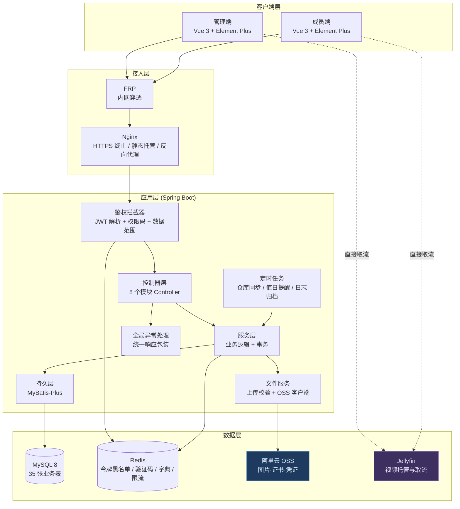
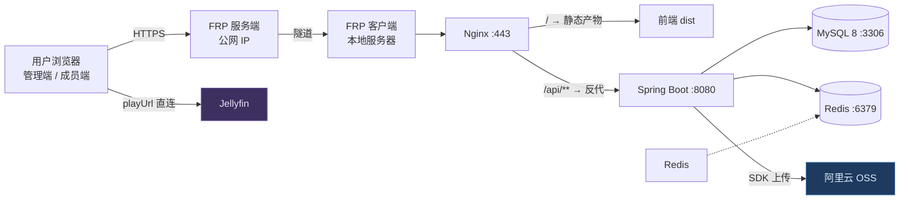
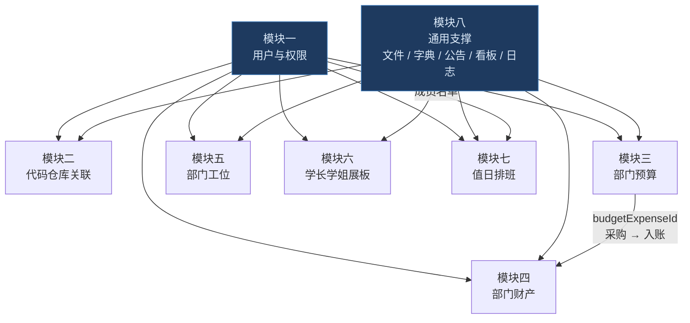
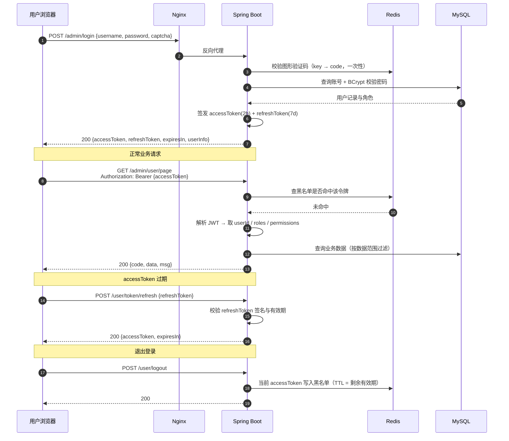
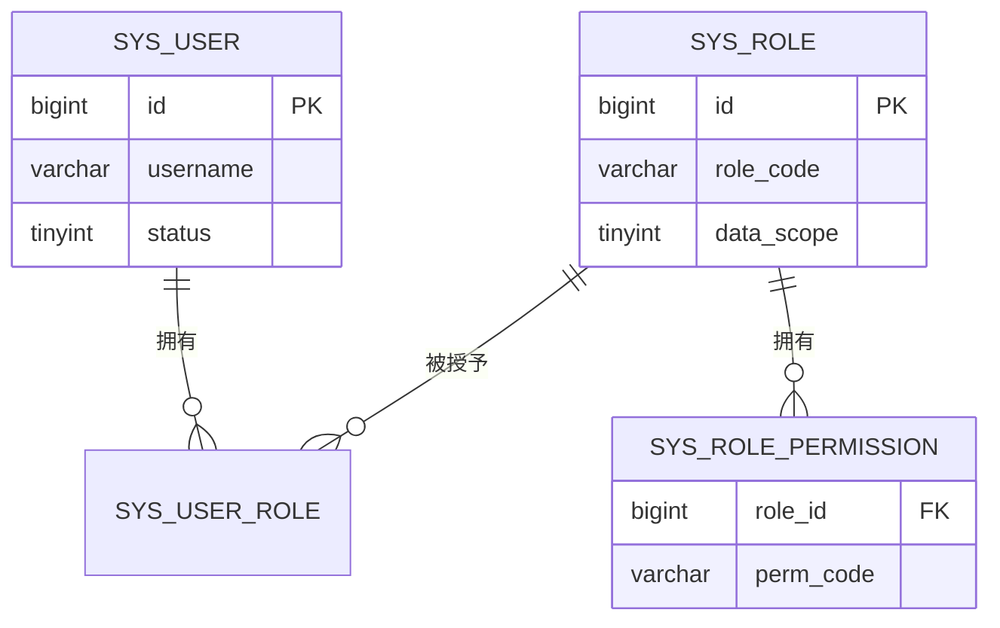
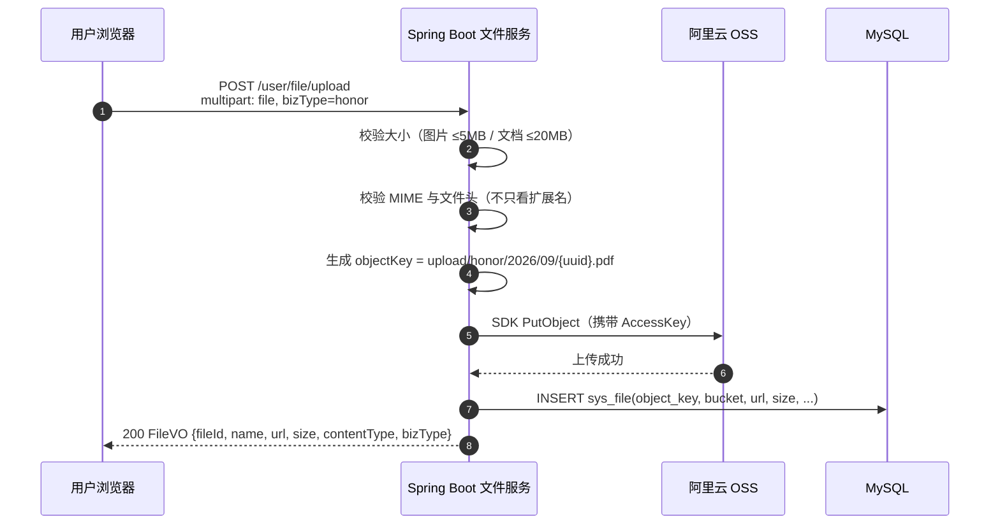
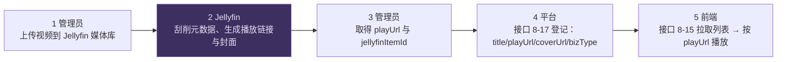
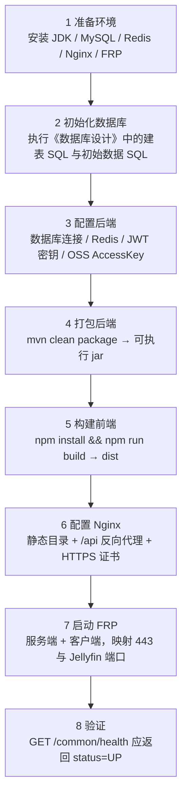

# IECMP 创业中心管理平台 · 项目介绍与技术架构设计

| 项目 | 内容 |
| --- | --- |
| 系统名称 | IECMP（Innovation & Entrepreneurship Center Management Platform）创业中心管理平台 |
| 建设单位 | 中原工学院软件学院创新创业中心 |
| 文档名称 | 项目介绍与技术架构设计 |
| 文档版本 | V1.2 |
| 编写日期 | 2026-09-22 |
| 编写人员 | 后端组 |
| 后端技术栈 | Spring Boot + MyBatis-Plus + MySQL 8 + Redis |
| 前端技术栈 | Vue 3 + Axios |
| 基础设施 | 阿里云 OSS（对象存储）+ Jellyfin（媒体服务）+ FRP（内网穿透）+ Nginx |
| 关联文档 | 《IECMP-接口开发文档-v1.6.md》《IECMP-数据库设计.md》 |

## 修订记录

| 日期 | 版本 | 说明 | 编写人 |
| --- | --- | --- | --- |
| 2026-09-22 | V1.0 | 首版：项目概述、技术选型、总体架构、关键设计（认证 / 权限 / 文件存储 / 视频接入 / 缓存 / 定时任务）、安全设计、非功能性设计、部署运维、演进规划 | 后端组 |
| 2026-09-24 | V1.3 | 交付可运行骨架：`backend/`（Spring Boot 3.3.8 + MyBatis-Plus 3.5.7 + Redis；540 个 Java 文件、54 个 Controller、186 个接口占位、36 套实体 / Mapper / Service）、`frontend/`（Vue 3 + Vite；83 个文件、48 个空壳页面、9 个接口模块清单）。实测：`mvn compile` 通过、应用启动成功并在 Swagger 输出 166 条路径 / 186 个操作、鉴权拦截器返回 401、初始密码哈希校验通过、`vite build` 与 `eslint` 通过 | 后端组 |
| 2026-09-24 | V1.2 | 交付两个可直接执行的 SQL 脚本（`IECMP-数据库建表脚本.sql` 36 张表、`IECMP-初始数据.sql` 角色 / 管理员 / 85 个权限码 / 23 类字典），1.5 节文档关系表补充对应说明；脚本已在 MySQL 8.0.44 真机执行验证（见《数据库设计》V1.2 与 5.5.1 节） | 后端组 |
| 2026-09-24 | V1.1 | 与接口文档 V1.4 对齐：接口总数 180 → **186**；模块五补充**管理端可拖拽平面图**能力、模块八补充**站内消息中心**、模块二明确**提交统计全自动采集（成员端无手动同步）**；4.6 定时任务补充「站内消息生成」一行；修正 `sys_sync_log` 笔误为 `repo_sync_log` | 后端组 |

> **文档定位**：本文档回答「这个系统是什么、由哪些技术组成、为什么这样选、关键机制怎么运转」。《接口开发文档》回答「每个接口怎么调」，《数据库设计》回答「数据怎么存」。三者以接口文档为接口契约的唯一权威来源。

---

## 目录

- [第 1 章 项目概述](#第-1-章-项目概述)
- [第 2 章 技术选型](#第-2-章-技术选型)
- [第 3 章 系统总体架构](#第-3-章-系统总体架构)
- [第 4 章 关键设计](#第-4-章-关键设计)
- [第 5 章 安全设计](#第-5-章-安全设计)
- [第 6 章 非功能性设计](#第-6-章-非功能性设计)
- [第 7 章 部署与运维](#第-7-章-部署与运维)
- [第 8 章 演进规划](#第-8-章-演进规划)
- [附录 A 技术栈与版本建议](#附录-a-技术栈与版本建议)
- [附录 B 术语表](#附录-b-术语表)

---

## 第 1 章 项目概述

### 1.1 项目背景

创新创业中心（以下简称「中心」）日常运营涉及大量**分散、纸质、口头传达**的事务：成员代码提交进度靠人工统计、部门经费靠表格记账、办公用品与设备借用靠登记本、工位与值日安排靠群内通知、毕业学长的荣誉材料靠文件夹收集。

这些事务共同的问题有三个：

1. **数据散落**：同一件事的信息存在群聊、表格、纸质记录三处，对不上账；
2. **过程不可追溯**：一笔经费从申请到支出、一件设备从采购到报废，中间经过谁的手无从查证；
3. **缺少公共展示面**：中心的成果（学长学姐去向、荣誉、活动视频）没有统一的对外展示窗口。

IECMP 的目标就是把这 8 类事务收进一个平台，**让每一笔资金、每一件资产、每一次排班都有据可查，让中心的成果有地方被看见**。

### 1.2 建设目标

| 目标 | 衡量方式 |
| --- | --- |
| 事务线上化 | 8 个模块的核心流程可在平台内闭环完成，不再依赖线下登记本 |
| 资金可追溯 | 预算申请 → 审核 → 支出 → 公示全链路留痕，任一笔支出可回溯到申请人、审核人与凭证 |
| 资产可盘点 | 一物一码，资产状态与存放位置实时可查，支持发起盘点并生成差异 |
| 进度可视化 | 成员代码提交量按 GitHub 风格热力图呈现，中心整体进度可一览 |
| 展示集中化 | 学长学姐展板 + 荣誉记录 + 视频资源形成统一的展示面 |
| 权限可控 | 一套账号体系 + 角色权限码，前后台分离，成员看不到管理功能 |

### 1.3 角色定义

平台只有**一套账号表**，通过角色区分权限。内置 4 个角色：

| 角色编码 | 角色名称 | 数据范围 | 典型职责 |
| --- | --- | --- | --- |
| `SUPER_ADMIN` | 超级管理员 | 全部数据 | 系统级配置、角色授权、账号体系维护 |
| `CENTER_HEAD` | 中心负责人 | 全部数据 | 预算管理、采购与支出登记、审核各类申请、分配工位 |
| `MINISTER` | 部长 | 全部数据（业务子集） | 协助管理本方向事务，如荣誉审核、值日排班 |
| `MEMBER` | 成员 | 本人数据 | 提交申请、查看公示、维护个人信息 |

> **数据范围**（`data_scope`）是权限的第二层控制：`1` 全部数据、`2` 本人数据。权限码控制「能不能调这个接口」，数据范围控制「调了能看到谁的数据」。

### 1.4 功能范围

平台划分为 8 个模块，共 **186 个接口**：

| 编号 | 模块 | 表前缀 | 核心能力 | 接口数 |
| --- | --- | --- | --- | --- |
| 模块一 | 用户与权限管理 | `sys_` | 账号、角色、权限码、登录认证、成员接入 | 29 |
| 模块二 | 代码仓库关联 | `repo_` | Gitee / GitHub 绑定、提交**自动采集**、进度与贡献度图表 | 17 |
| 模块三 | 部门预算管理 | `budget_` | 预算周期、科目、申请、审核、支出、公示 | 25 |
| 模块四 | 部门财产管理 | `asset_` | 资产台账、领用借用、变动流水、盘点 | 27 |
| 模块五 | 部门工位管理 | `seat_` | 区域平面图、工位坐标、申请分配、座位调换、**管理端平面图拖拽** | 26 |
| 模块六 | 学长学姐展板 | `honor_` | 学长信息与荣誉记录、成员提交与修改、管理员审核上板 | 19 |
| 模块七 | 值日排班管理 | `duty_` | 排班计划、自动排班、公示、换班、提醒 | 21 |
| 模块八 | 通用支撑 | `sys_file` 等 | 文件上传、数据字典、公告、看板、日志、视频资源、**站内消息** | 22 |

### 1.5 与相关文档的关系

| 文档 | 回答的问题 | 变更影响 |
| --- | --- | --- |
| 《IECMP-项目介绍与技术架构.md》（本文档） | 系统是什么、怎么搭、为什么这样选 | 架构调整时更新 |
| 《IECMP-接口开发文档-v1.6.md》 | 每个接口怎么调 | 字段 / 路径 / 错误码变更时**先改它**再改代码 |
| 《IECMP-数据库设计.md》 | 数据怎么存、DDL 是什么 | 表结构变更时更新 |
| 《IECMP-数据库建表脚本.sql》《IECMP-初始数据.sql》 | 直接可执行的建库脚本 | 由《数据库设计》**自动生成**的交付件，不手工编辑；改文档后重新生成 |
| 《接口文档-管理端.html》《接口文档-用户端.html》 | 由接口文档**自动生成**的浏览版 | 不手工编辑，重跑 `tools/gen-api-doc.py` |

---

## 第 2 章 技术选型

### 2.1 技术栈总览

| 层次 | 技术 | 用途 |
| --- | --- | --- |
| 前端 | Vue 3 + Vite + Axios + Vue Router + Pinia | 页面渲染、路由、状态管理、HTTP 请求 |
| 前端 UI | Element Plus（建议） | 表格、表单、弹窗等业务组件 |
| 前端图表 | ECharts | 提交趋势、贡献热力图、执行率看板 |
| 接入层 | Nginx | 静态资源托管、反向代理、HTTPS 终止 |
| 应用层 | Spring Boot + Spring MVC | REST 接口、参数校验、全局异常处理 |
| 持久层 | MyBatis-Plus | 单表 CRUD、分页插件、逻辑删除、乐观锁 |
| 数据库 | MySQL 8 | 业务数据持久化 |
| 缓存 | Redis | 令牌黑名单、验证码、字典缓存、限流计数 |
| 对象存储 | 阿里云 OSS | 图片、证书、凭证等文件存储 |
| 媒体服务 | Jellyfin | 视频托管与播放链接生成 |
| 内网穿透 | FRP | 将本地服务器映射到公网 |
| 构建 | Maven / npm | 后端打包、前端构建 |

### 2.2 后端选型说明

**为什么用 Spring Boot + MyBatis-Plus 而不是其他组合**

1. **团队熟悉度优先**：这是校内项目、4 周工期，选团队已经会用的技术能把时间花在业务而不是学习成本上。
2. **MyBatis-Plus 省掉大量样板代码**：8 个模块有 35 张表，绝大多数是标准的「分页 + 详情 + 增改删」。MyBatis-Plus 的 `BaseMapper`、分页插件、`@TableLogic`（逻辑删除）、`@Version`（乐观锁）刚好覆盖这些需求，SQL 依然可控。
3. **不引入 Spring Security 全家桶**：本项目的鉴权规则简单（前缀区分前后台 + 权限码 + 数据范围），用一个自定义拦截器 + 注解即可，比配置 Spring Security 更透明、更好排错。代价是需要自己处理令牌解析与黑名单，这部分逻辑集中在一个拦截器里，风险可控。
4. **不引入微服务**：8 个模块共享同一套账号与文件能力，数据强关联（如资产关联预算支出）。拆微服务会带来分布式事务、服务发现、链路追踪等一堆额外复杂度，而收益在一个校内平台上是零。

### 2.3 前端选型说明

1. **Vue 3 组合式 API**：模块多、表单多，组合式 API 把「一个业务逻辑」的代码聚在一起，比选项式更利于多人分工。
2. **Axios 统一封装**：在请求拦截器里注入 `Authorization: Bearer {token}`，在响应拦截器里统一处理 `code` 非 200 的分支（401 跳登录、403 提示无权限、其余弹 `msg`）。**前端不应在每个页面重复写令牌注入与错误处理**。
3. **ECharts 承担三类可视化**：提交趋势折线、贡献热力图（GitHub 风格日历热力）、预算执行率看板。
4. **平面图用「底图 + 百分比坐标」渲染**：不上 Canvas 引擎。工位坐标存成相对底图的百分比（`x_ratio` / `y_ratio`），前端用绝对定位按比例铺在底图上即可，实现成本最低且能自适应缩放。

### 2.4 数据与中间件选型说明

**MySQL 8 承担全部业务持久化**。选 8.x 的理由：原生支持窗口函数（预算执行率、贡献排行的分组统计）、CTE、更好的 JSON 支持（`asset_info.image_urls` 存 JSON 数组）。

**Redis 用在四个场景，都不是「为了用而用」**：

| 场景 | 数据结构 | 为什么必须用 Redis |
| --- | --- | --- |
| 令牌黑名单 | String + TTL | 退出登录 / 停用账号后要让令牌**立即失效**，而 JWT 本身无状态。黑名单条目随令牌自然过期，用 Redis TTL 最省事 |
| 图形验证码 | String + TTL 300s | 验证码是一次性、5 分钟过期的短命数据，写 MySQL 会产生大量垃圾行 |
| 数据字典缓存 | String(JSON) + TTL 1h | 字典被所有下拉框高频读取，缓存后避免每次查库；枚举变更时后端主动清缓存 |
| 限流计数 | String + INCR + TTL | 登录失败锁定、注册同 IP 每小时 3 次、验证码同 IP 每分钟 10 次，都是「计数 + 过期窗口」模型 |

**不用 Redis 做会话存储**：令牌是无状态的，会话状态不需要额外保存。

### 2.5 基础设施与第三方服务

**阿里云 OSS（对象存储）**

- **用途**：存放全部用户上传文件（9 类，见 4.3 节）。
- **上传链路**：**后端中转**——前端提交文件到后端，后端携带 AccessKey 上传 OSS，返回 URL。选它而不是 STS 直传的原因是**实现成本**：一个 multipart 接口即可，后端还能做严格的 MIME 与文件头校验（见 4.3 节的取舍说明）。
- **访问权限**：Bucket 为**公共读**，文件 URL 永久可直接访问，前端无需换取签名链接。

**Jellyfin（媒体服务）**

- **用途**：视频托管。视频文件放进 Jellyfin 媒体库，Jellyfin 生成播放链接（直链或 HLS），平台只登记链接。
- **平台不承担**：视频上传、转码、流媒体转发。平台不代理视频流量，前端直接向 Jellyfin 取流。

**FRP（内网穿透）**

- **用途**：把部署在本地服务器（或实验室机器）的服务映射到公网。
- **带来的约束**：上行带宽是稀缺资源。这直接影响两处设计——
  1. 文件上传选择「后端中转」时会占用这条带宽（当前取舍见 4.3 节）；
  2. 视频绝不能走后端转发，必须由 Jellyfin 直供（见 4.4 节）。
- **注意**：OSS 域名与 Jellyfin 域名都必须在 FRP 映射范围内，否则内网地址在公网无法访问。

**Nginx**

- **用途**：托管前端静态产物、反向代理后端接口、终止 HTTPS、统一跨域策略。

---

## 第 3 章 系统总体架构

### 3.1 架构分层

系统按四层划分，**上层只依赖下层的接口，不跨层调用**：

| 层 | 职责 | 组成 |
| --- | --- | --- |
| 客户端层 | 页面渲染、交互、本地状态 | 管理端（Vue 3）、成员端（Vue 3）、移动端浏览器 |
| 接入层 | 流量入口、协议转换、安全边界 | Nginx（HTTPS 终止、静态托管、反向代理）、FRP（公网映射） |
| 应用层 | 业务逻辑、鉴权、参数校验、事务 | Spring Boot：控制器 → 服务 → 持久层；自定义鉴权拦截器；全局异常处理器；定时任务 |
| 数据层 | 持久化、缓存、对象存储、媒体服务 | MySQL 8、Redis、阿里云 OSS、Jellyfin |

### 3.2 总体架构图



### 3.3 部署拓扑



**访问链路说明**

| 场景 | 链路 |
| --- | --- |
| 页面与接口 | 浏览器 → FRP → Nginx → 静态产物 / Spring Boot → MySQL / Redis |
| 图片展示 | 浏览器 → **OSS 域名**（不经过平台后端） |
| 视频播放 | 浏览器 → **Jellyfin 域名**（不经过平台后端） |
| 文件上传 | 浏览器 → FRP → Nginx → Spring Boot → OSS（后端中转） |

> **关键设计点**：图片与视频的**读取**都不经过平台后端。后端只在「上传」和「登记」时参与，日常浏览不会消耗 FRP 的上行带宽——这是内网穿透部署下必须守住的一条线。

### 3.4 模块依赖



| 依赖关系 | 说明 | 实现顺序影响 |
| --- | --- | --- |
| 模块一 → 全部 | 所有模块都需要账号与权限 | **最先实现** |
| 模块八 → 全部 | 文件上传被预算凭证、资产图片、学长头像、荣誉证书、平面图底图复用 | **最先实现** |
| 模块三 → 模块四 | 资产通过 `budget_expense_id` 关联预算支出，形成「采购 → 入账」闭环 | 模块三先于模块四 |
| 模块一 → 模块七 | 排班轮转依赖启用状态的成员名单 | 成员变动后需重生成排班 |
| 模块二 | 依赖外部平台（Gitee / GitHub）接口，不确定性最大 | 尽早做令牌技术验证 |

### 3.5 包结构约定

后端按「模块 + 分层」组织，便于多人并行开发时互不干扰：

```
com.iecmp
├── common/                     公共能力
│   ├── result/                 统一响应（Result / PageResult）
│   ├── exception/              业务异常与全局异常处理器
│   ├── interceptor/            鉴权拦截器
│   ├── annotation/             自定义注解（@RequiresPerm / @Log）
│   ├── config/                 配置类（Redis / MyBatis-Plus / OSS / CORS）
│   ├── enums/                  枚举与错误码
│   └── util/                   工具类（JWT / Captcha / IpUtil）
├── system/                     模块一：用户与权限
│   ├── controller/
│   ├── service/
│   ├── mapper/
│   ├── entity/
│   └── dto/ vo/
├── repo/                       模块二：代码仓库关联
├── budget/                     模块三：部门预算
├── asset/                      模块四：部门财产
├── seat/                       模块五：部门工位
├── honor/                      模块六：学长学姐展板
├── duty/                       模块七：值日排班
├── commonm/                    模块八：通用支撑（文件 / 字典 / 公告 / 日志 / 视频）
└── task/                       定时任务
```

> 命名约定：实体 `Xxx`、请求体 `XxxDTO`、响应体 `XxxVO`、查询条件 `XxxQuery`。每个模块的 Controller 按前台 / 后台拆为两个文件（如 `UserController` 与 `AdminUserController`），与 `/user/**`、`/admin/**` 路径前缀一一对应。

---

## 第 4 章 关键设计

### 4.1 认证与鉴权设计（JWT 双令牌）

**为什么用双令牌而不是单令牌**

单令牌方案下，「令牌有效期短」与「用户不用频繁登录」天然矛盾。双令牌把两件事分开：

| 令牌 | 有效期 | 存放位置 | 作用 |
| --- | --- | --- | --- |
| `accessToken` | 2 小时 | 前端内存 / localStorage | 每次请求放在 `Authorization: Bearer {token}` 中 |
| `refreshToken` | 7 天 | 前端 localStorage | **只能**用于调用 `1-04 刷新令牌`，换新的 accessToken |

`accessToken` 短命 → 即使泄露，暴露窗口只有 2 小时；`refreshToken` 长命但**只在 refresh 接口使用**，被拦截的概率与危害面都小。`refreshToken` 剩余有效期不足 1 天时，刷新接口会一并下发新的 `refreshToken`（滑动续期），用户只要 7 天内来过一次就不会掉线。

**认证流程时序**



**三个关键实现点**

1. **黑名单只针对 accessToken**。JWT 是无状态的，签发后无法撤回，因此退出登录 / 停用账号时必须往 Redis 写一条「令牌 → 已失效」记录，TTL 设为该令牌的剩余有效期（过期后条目自动清理，不占空间）。拦截器每次请求先查黑名单。
2. **停用账号要立即踢下线**。接口 `1-12 启用/禁用用户` 在把 `sys_user.status` 改为 0 的同时，将该用户**已签发但未过期的令牌**写入黑名单。否则「停用」只是一个数据库标记，用户手上的令牌还能继续用 2 小时。
3. **登录保护**。同一账号 5 分钟内连续失败 5 次，锁定 10 分钟（Redis 计数 + TTL），返回错误码 `10005`。

### 4.2 权限模型（RBAC + 数据范围）

采用**两级权限控制**，缺一不可：

**第一级：权限码（能不能调这个接口）**

格式 `模块:资源:操作`，全小写冒号分隔，例如 `system:user:list`、`budget:apply:audit`。模型是标准的 RBAC：



- 登录成功后，`1-01` / `1-02` 返回该用户的 `roles`（角色编码）与 `permissions`（**权限码并集**）；
- 前端据此渲染菜单与按钮；
- 后端在校验时**不信任前端的判断**，每个 `/admin/**` 接口都通过注解声明所需权限码，由拦截器比对令牌中携带的权限码集合，不足则返回 `403`。

> **为什么要前后端都判一次**：前端判是为了体验（不显示点不动的按钮），后端判是为了安全。前端判可被绕过，后端判才是真正的边界。

**第二级：数据范围（调了能看到谁的数据）**

`sys_role.data_scope` 取值 `1 全部数据` / `2 本人数据`。同是 `budget:apply:list`，`CENTER_HEAD` 能看到所有人的申请，`MEMBER` 只能看到自己的。实现方式是在服务层统一追加数据范围条件（如 `AND apply_user_id = {当前用户}`），**不依赖前端传参**。

**前台接口的特殊约定**

`/user/**` 接口不分配权限码，只要求登录。数据可见性由两条规则控制：

1. **本人数据**：`/my/**` 类接口（如 `3-06 我的预算申请分页`）只返回当前用户的数据；
2. **公示数据**：前端公示接口只返回已审核通过且已发布的数据（如模块六仅返回 `status=1 且 is_show=1`）。

### 4.3 文件存储设计（阿里云 OSS）

**存储范围**

平台共 9 类文件落在 OSS：

| # | 业务场景 | 落库字段 | 形态 |
| --- | --- | --- | --- |
| 1 | 用户头像 | `sys_user.avatar_url` | 图片 |
| 2 | 工位平面图底图 | `seat_area.plan_image_url` | 图片（最大） |
| 3 | 资产照片 | `asset_info.image_urls` | 图片，多张 |
| 4 | 学长学姐头像 | `honor_alumni.avatar_url` | 图片 |
| 5 | 荣誉证书 | `honor_record.certificate_url` | 图片 / PDF |
| 6 | 预算申请附件 | `budget_apply.attach_file_id` | 图片 / 文档 |
| 7 | 支出凭证（发票） | `budget_expense.voucher_file_id` | 图片 / PDF |
| 8 | 公告正文插图 | `sys_notice.content` 内嵌 `` | 图片 |
| 9 | 视频封面 | `sys_video.cover_url` | 图片 |

**两个例外**（不上 OSS）：第三方头像（`repo_account.avatar_url`）直接用平台外链；视频本体走 Jellyfin（见 4.4 节）。

**对象键命名约定**

```
upload/{bizType}/{yyyy}/{MM}/{uuid}.{ext}

示例：upload/avatar/2026/09/9f2c1a7b.png
      upload/honor/2026/09/3e8b02f1.pdf
```

- `bizType` 取值：`avatar` / `asset` / `honor` / `budget` / `seat` / `notice` / `video` / `common`
- 文件名强制用 **UUID** 并保留原始扩展名 —— 按年月分目录是为了避免单目录对象过多，用 UUID 是为了**防止通过文件名枚举他人文件**。

**上传方式：后端中转（当前取舍）**



**这个选择的代价与补偿**

选后端中转而不用 STS 直传，理由是**实现成本**：一个 multipart 接口即可完成，且后端能拿到文件原始字节，可以做严格的 MIME 与文件头校验（STS 直传时后端拿不到文件内容，只能靠前端与 OSS 侧策略限制）。

代价是**文件流量经过后端两遍**（前端 → 后端 → OSS），会占用 FRP 的上行带宽。在本项目的约束下（图片 ≤5MB、文档 ≤20MB、团队规模数十人），这个代价可接受。补偿措施：

1. **上传接口做并发与大小硬限制**，避免单次大文件阻塞；
2. **读取不经后端**：OSS 公共读，图片展示由浏览器直连 OSS 域名，日常浏览不消耗 FRP 带宽（这一点比上传更重要）；
3. **预留演进路径**：如需切换为 STS 直传，只需新增一个「凭证签发」接口并调整前端上传逻辑，`sys_file` 表结构与文件 URL 形式均不变。

**访问方式：Bucket 公共读**

- 文件 URL 形如 `https://{bucket}.{endpoint}/upload/{bizType}/{yyyy}/{MM}/{uuid}.{ext}`，**永久有效**，前端可直接用于 ``；
- 业务表只存 `file_id` 与 `url`，`sys_file` 存 `object_key` 与 `bucket` —— 这样将来更换 Bucket 或迁移存储时，可以按 `object_key` 批量重算 URL，不必改动业务表。

**删除策略**

接口 `8-03 文件删除` 有两条硬约束：

1. **只能删本人上传的文件** —— 校验 `sys_file.upload_user_id`；
2. **被业务引用的文件禁止删除** —— 需检查该 `file_id` 是否仍被业务表引用（如 `honor_alumni.avatar_url` 指向的文件），被引用则返回 `80005`。

删除时按 `object_key` 精确删除 OSS 对象，再逻辑删除 `sys_file` 记录。

### 4.4 视频接入设计（Jellyfin）

**职责边界**

| 环节 | 谁负责 |
| --- | --- |
| 视频文件存储 | Jellyfin 媒体库（**不是 OSS**） |
| 视频转码、生成播放链接 | Jellyfin |
| 上传视频文件 | 管理员在 Jellyfin 侧完成 |
| 登记播放链接、封面、排序 | 平台（接口 `8-17`） |
| 展示与播放 | 平台前端直接向 **Jellyfin 域名**取流 |

**平台不承担**：视频上传、转码、流媒体转发。平台只保存元数据与播放地址，**不做任何视频流量代理** —— 这是内网穿透部署下的硬约束，否则 FRP 带宽会被视频瞬间打满。

**接入流程**



**两个必须留意的细节**

1. **域名一致性**：`playUrl` 中的域名必须在 FRP 映射范围内。若 Jellyfin 生成的是内网地址（如 `http://192.168.x.x:8096/...`），公网用户无法播放。建议在 Jellyfin 配置中设置对外访问地址。
2. **链接可能带令牌或有效期**：若 Jellyfin 生成的链接会过期，则**保存 `jellyfin_item_id`**，在展示时由平台按配置模板拼接 URL。平台字段同时保留 `jellyfin_item_id` 与 `play_url`，两种做法都支持 —— 这正是当初两个字段并存的原因。

**播放器**：若 Jellyfin 返回 HLS 播放列表（`.m3u8`），前端需引入支持 HLS 的播放器（如 `hls.js`）；若为直链 MP4，原生 `<video>` 即可。

### 4.5 缓存设计（Redis）

| Key 模式 | 数据结构 | TTL | 用途 | 失效时机 |
| --- | --- | --- | --- | --- |
| `iecmp:token:blacklist:{token}` | String | 令牌剩余有效期 | 令牌黑名单 | 自然过期 |
| `iecmp:captcha:{captchaKey}` | String | 300 秒 | 图形验证码 | 一次性使用后立即删除 |
| `iecmp:dict:{dictType}` | String(JSON) | 1 小时 | 数据字典缓存 | 枚举变更时后端主动删除 |
| `iecmp:login:fail:{username}` | String(计数) | 600 秒 | 登录失败锁定 | 登录成功后清零 |
| `iecmp:limit:register:{ip}` | String(计数) | 3600 秒 | 注册申请同 IP 限流（3 次/小时） | 自然过期 |
| `iecmp:limit:captcha:{ip}` | String(计数) | 60 秒 | 验证码同 IP 限流（10 次/分钟） | 自然过期 |

**设计原则**

1. **缓存只放「读多写少 + 可容忍短暂不一致」的数据**。字典是典型；预算金额、资产状态这类涉及资金与实物的数据**不缓存**，每次查库，避免脏读。
2. **计数类 Key 一律带 TTL**，用 `INCR` + `EXPIRE` 组合实现固定窗口限流，避免 Key 无限增长。
3. **缓存失效要主动**：字典变更后由后端删除对应 Key（`8-04` 的说明中「枚举变更时由后端主动清理缓存」即指此事），不依赖 TTL 自然过期。
4. **Redis 不可用时的降级**：黑名单查不到时**放行**会造成安全漏洞，因此 Redis 故障时鉴权应**直接失败**（返回 500），宁可拒绝服务也不放行未校验的令牌。

### 4.6 定时任务设计

| 任务 | 建议频率 | 职责 | 幂等性保障 |
| --- | --- | --- | --- |
| 代码仓库同步 | 每日凌晨 1 次 | 遍历启用状态的 `repo_account`，拉取所有分支的提交写入 `repo_commit` | 以 `commit_sha` 去重 |
| 值日提醒 | 每分钟扫描 | 查 `duty_reminder_config`，到点向站内消息表写入提醒 | 以「计划 + 日期 + 接收人」去重 |
| 站内消息归档 | 每月 1 次 | 清理 12 个月前的 `sys_message`（可选，视数据量启用） | 按 `create_time` 范围操作 |
| 资产逾期检查 | 每日 1 次 | 将超过 `expect_return_time` 未归还的借用记录置为「已逾期」 | 仅更新状态为已通过的记录 |
| 操作日志归档 | 每月 1 次 | 将 12 个月前的 `sys_oper_log` 归档或清理 | 按 `create_time` 范围操作 |
| 邀请码过期清理 | 每日 1 次 | 将过期邀请码置为「已作废」 | 仅更新 `status=1` 且 `expire_time < now()` |

**实现要点**

1. **单机部署用 `@Scheduled` 即可**，不必上分布式调度（XXL-JOB 等）。但必须保证**同时只有一个实例在跑**——若将来多实例部署，需引入分布式锁（Redis `SETNX`）或改用调度中心。
2. **采集任务要限流**：模块二首次全量采集需遍历仓库所有分支，耗时较长，须按仓库维度串行 + 间隔，并写入 `repo_sync_log` 记录耗时与结果，便于排查（成员端不提供手动同步入口，接口文档 `2-06` 只读同步状态）。
3. **外部接口调用必须设超时与重试上限**，避免 Gitee / GitHub 不可用时任务线程被长时间挂起。

### 4.7 统一响应与全局异常处理

**统一响应结构**（详见接口文档 2.3 节）：

```json
{ "code": 200, "data": {}, "msg": "success" }
```

**四类异常的统一出口**

| 异常类型 | 处理方式 | 返回 code |
| --- | --- | --- |
| 参数校验失败（`@Valid` 不通过） | 由 `MethodArgumentNotValidException` 处理器捕获，取第一条字段错误信息 | 400 |
| 业务异常（自定义 `BusinessException`） | 携带模块错误码抛出，处理器直接取出 | 10001 ~ 89999 |
| 鉴权异常（未登录 / 权限不足） | 由鉴权拦截器抛出 | 401 / 403 |
| 未知异常（`Exception`） | 兜底处理器捕获，**记录完整堆栈到日志** | 500 |

**两条关键约定**

1. **HTTP 状态码统一返回 200**，业务结果全部由响应体 `code` 表达。这样前端只需在一个响应拦截器里处理，不必同时判断 HTTP 状态与业务码两套逻辑。
2. **未知异常绝不把堆栈或 SQL 泄露给前端**。`msg` 统一返回「系统繁忙，请稍后重试」，真实原因只进日志（含 `traceId` 便于定位）。

### 4.8 接口访问日志与审计

`/admin/**` 的**写操作**（POST / PUT / DELETE）统一通过注解 + AOP 记录操作日志到 `sys_oper_log`：

| 记录项 | 说明 |
| --- | --- |
| `module` / `operation` | 模块标识与操作类型（add / edit / remove / audit） |
| `request_uri` | 请求地址 |
| `request_param` | 请求参数摘要，**超长截断（≤2000 字符），敏感字段脱敏** |
| `response_msg` | 返回信息摘要 |
| `operator_id` / `operator_name` / `ip` | 操作人与来源 IP |
| `cost_ms` | 耗时（毫秒） |
| `status` | 0 失败 / 1 成功 |

**为什么只记写操作**：读操作量级大、价值低，全量记录会迅速把日志表撑爆。审计真正关心的是「谁改了什么」。

**脱敏与保留**：密码、令牌、手机号、邮箱等字段在入库前脱敏；日志保留 12 个月，超期归档；数据量增长快时按月分表。

---

## 第 5 章 安全设计

### 5.1 传输安全

1. **生产环境全量 HTTPS**（Nginx 终止 TLS），开发环境允许 HTTP。
2. **不做参数签名验签**：本平台不采用第三方接口常见的 `sign = MD5(字段+密钥)` 方案。原因是该方案主要解决「第三方调用时防篡改与防抵赖」，而本项目是自有前后端、走 HTTPS，签名带来的收益很小，反而增加前端复杂度。防篡改依赖 TLS 与令牌校验。
3. **不自行实现前端加密**：登录密码以明文经 HTTPS 提交，服务端 BCrypt 加盐存储。自行实现前端 RSA/AES 加密是常见但无实际收益的做法（密钥同样要下发前端）。

### 5.2 账号安全

| 措施 | 实现 |
| --- | --- |
| 密码存储 | BCrypt 加盐哈希，**不可逆**；禁止明文或可逆加密存储 |
| 密码强度 | 6~32 位，需包含字母与数字 |
| 修改密码 | 校验原密码；修改成功后**当前令牌立即失效**，强制重新登录 |
| 登录失败锁定 | 同账号 5 分钟内失败 5 次锁定 10 分钟 |
| 管理员重置 | 重置后用户需重新登录；初始密码仅返回一次 |
| 账号离场 | 用「停用」而非删除：停用即踢下线、令牌失效，但历史数据保留可追溯 |

> **为什么用停用代替删除**：成员离场后，他历史提交的预算申请、借用记录、值日记录仍需可查。物理删除会破坏这些关联数据，导致历史记录出现"无主"引用。仅当账号从未产生任何业务数据时才允许物理删除（接口 `1-14`）。

### 5.3 防滥用与限流

| 场景 | 限制 | 返回码 |
| --- | --- | --- |
| 注册申请 | 需图形验证码；同 IP 每小时最多 3 次 | 10030 |
| 图形验证码获取 | 同 IP 每分钟最多 10 次 | 429 |
| 登录 | 同账号 5 分钟失败 5 次锁定 10 分钟 | 10005 |
| 仓库同步 | 按仓库维度限流，避免触发第三方平台风控 | - |

**邀请码防滥用**：邀请码一次性使用、可设有效期与使用次数，使用后立即失效；同一学号全局唯一，重复提交**覆盖旧申请**而不新增记录（防止刷量）。

### 5.4 越权与数据隔离

越权是最常见的 Web 漏洞，本项目从四个层面设防：

| 越权类型 | 防护措施 |
| --- | --- |
| **水平越权**（看到同角色他人的数据） | 服务层强制追加数据范围条件（`data_scope=2` 时追加本人条件）；`/my/**` 接口的服务方法显式带入当前 `userId` |
| **垂直越权**（普通成员调用管理接口） | 所有 `/admin/**` 接口声明权限码，拦截器统一校验；前端隐藏按钮只是体验优化，不作为安全边界 |
| **参数篡改**（改 id 访问他人资源） | 涉及归属校验的接口在服务层核对 `user_id`，例如文件删除校验 `upload_user_id`、预算申请撤销校验 `apply_user_id` |
| **路径/对象越权**（伪造 OSS 路径） | 文件删除按 `object_key` 精确删除，且只允许删除 `sys_file` 中登记过的对象 |

### 5.5 密钥与配置管理

| 密钥 | 存放位置 | 纪律 |
| --- | --- | --- |
| 阿里云 AccessKey | 后端配置（环境变量或配置中心） | **严禁下发前端、严禁提交进代码仓库** |
| JWT 签名密钥 | 后端配置 | 同上；泄露等于令牌可伪造 |
| MySQL / Redis 密码 | 后端配置 | 同上 |
| 第三方平台 AccessToken | 数据库（AES 加密存储） | 成员绑定的 Gitee / GitHub 令牌加密落库，接口返回时脱敏 |

**三条硬性纪律**

1. **密钥不进 Git**。用 `.env` 或环境变量注入，`.env` 写入 `.gitignore` 并提交一份 `.env.example` 供他人参考。
2. **生产与开发使用不同密钥**，避免开发环境泄露波及生产。
3. **日志不打印密钥与令牌**，请求参数入库前脱敏。

---

## 第 6 章 非功能性设计

### 6.1 性能设计

**必须做索引的字段**（无索引会导致全表扫描，详见《数据库设计》）

| 类型 | 字段 | 说明 |
| --- | --- | --- |
| 唯一索引 | `sys_user.username`、`sys_user.student_no`、`sys_invite_code.code`、`asset_info.asset_no` | 业务唯一性 + 查询加速 |
| 普通索引 | 所有 `user_id` / 外键类字段、`status`、`create_time` | 列表筛选与排序的主力 |
| 联合索引 | `(period_id, item_id)`、`(project_id, commit_time)`、`(duty_date, user_id)` | 高频组合查询 |
| 唯一索引 | `repo_commit(project_id, commit_sha)` | **同步去重的关键**，防重复插入 |

**分页与查询**

1. 一律使用 MyBatis-Plus 分页插件，**禁止把全量数据查出来在内存分页**。
2. `pageSize` 上限 100，防止一次拉取过多。
3. 列表接口禁止 `SELECT *` 返回无用大字段（如 `sys_notice.content` 富文本仅在必要时返回）。
4. 排序字段设白名单，避免 `orderBy` 拼接造成注入。

**接口聚合**

模块八的前台首页看板（`8-10`）与后台统计看板（`8-11`）都是**聚合接口**，一次请求返回首页所需的全部摘要数据，避免前端发起 6~8 次串行请求。这类接口的统计口径要固定，避免每次请求都做全表聚合（数据量增长后可引入日汇总表）。

**数据量增长预案**

| 表 | 增长风险 | 预案 |
| --- | --- | --- |
| `repo_commit` | 高（提交明细持续累积） | 引入 `repo_commit_daily` 日汇总表，热力图与趋势图改查汇总表 |
| `sys_oper_log` | 中高 | 保留 12 个月，超期归档；量大时按月分表 |
| `budget_expense` / `asset_record` | 低 | 校内规模，无需特殊处理 |

### 6.2 可用性与容错

1. **外部依赖降级**：Gitee / GitHub、Jellyfin、OSS 任一不可用时，**不得阻塞其他模块**。同步任务失败只写 `repo_sync_log` 并重试，不影响成员正常使用平台。
2. **Redis 故障策略**：鉴权相关（黑名单）Redis 不可用时**直接拒绝**（安全优先），其余缓存不可用时**回源查库**（可用性优先）。
3. **文件上传失败可重试**：后端中转上传失败时不写 `sys_file`，前端可重新提交，不产生垃圾记录。
4. **数据库备份**：至少每日一次逻辑备份（`mysqldump`），保留 7 天；重大操作前手动备份。

### 6.3 可维护性

1. **契约先行**：任何字段、路径、错误码变更，**先更新《接口开发文档》再改代码**，并在修订记录登记。这是本项目最重要的一条协作纪律。
2. **错误码分段管理**：按模块分配号段（10001~89999），新增错误码在所属号段内顺延，避免冲突。
3. **枚举集中定义**：状态类字段的取值集中在后端枚举类，并通过接口 `8-04` 下发给前端，**前端不硬编码枚举**。
4. **文档自动生成**：HTML 版接口文档由 `tools/gen-api-doc.py` 从 Markdown 生成，**不手工编辑 HTML**，避免两边不一致。

### 6.4 兼容性

1. **浏览器**：支持 Chrome / Edge 最新两个大版本；移动端浏览器可用（响应式布局）。
2. **响应式**：管理端以桌面为主；成员端需适配手机（查看值日、提交申请、看展板）。
3. **接口版本**：如需不兼容变更，在统一前缀后追加 `/v1`，不在业务路径中体现版本号。

---

## 第 7 章 部署与运维

### 7.1 环境要求

| 组件 | 建议版本 | 说明 |
| --- | --- | --- |
| JDK | 17（若用 Spring Boot 3.x）或 8（若用 2.7.x） | **需与 Spring Boot 版本匹配**，启动前确认 |
| MySQL | 8.0+ | 需支持窗口函数与 JSON 类型 |
| Redis | 6.0+ | 需支持 TTL 与 INCR |
| Node.js | 18 LTS+ | 前端构建 |
| Nginx | 1.20+ | 静态托管 + 反向代理 + HTTPS |
| FRP | 0.5x | 服务端装公网机器，客户端装本地服务器 |

### 7.2 部署步骤概览



**启动顺序**：MySQL / Redis → 后端 jar → Nginx → FRP。

**上线前检查清单**

- [ ] `GET /common/health` 返回 `status=UP`，且 `mysql` / `redis` 均为连通
- [ ] 生产环境 HTTPS 生效，HTTP 自动跳转
- [ ] `.env` 未提交进仓库，`.gitignore` 已生效
- [ ] 数据库已建索引，初始角色 / 权限码 / 管理员账号已写入
- [ ] OSS Bucket 权限为公共读，对象键前缀可正常访问
- [ ] Jellyfin 的 `playUrl` 使用公网域名（非内网 IP）
- [ ] 定时任务已启用，日志中无异常堆栈
- [ ] Nginx 已配置前端路由 history 模式的 fallback（否则刷新页面 404）

### 7.3 配置项清单

| 配置项 | 示例 | 说明 |
| --- | --- | --- |
| `spring.datasource.url` | `jdbc:mysql://127.0.0.1:3306/iecmp?useUnicode=true&characterEncoding=utf8mb4` | 数据库连接 |
| `spring.datasource.username` / `password` | - | 数据库账号 |
| `spring.redis.host` / `port` / `password` | `127.0.0.1` / `6379` | 缓存连接 |
| `jwt.secret` | 32 位以上随机串 | JWT 签名密钥 |
| `jwt.access-token-expire` | `7200` | accessToken 有效期（秒） |
| `jwt.refresh-token-expire` | `604800` | refreshToken 有效期（秒） |
| `oss.endpoint` | `oss-cn-hangzhou.aliyuncs.com` | OSS 接入点 |
| `oss.bucket` | `iecmp-upload` | 存储桶名称 |
| `oss.access-key-id` / `access-key-secret` | - | **仅后端持有** |
| `oss.url-prefix` | `https://iecmp-upload.oss-cn-hangzhou.aliyuncs.com` | 拼接文件访问 URL |
| `upload.max-image-size` | `5242880` | 图片大小上限（字节） |
| `upload.max-doc-size` | `20971520` | 文档大小上限（字节） |
| `jellyfin.base-url` | `https://jellyfin.xxx.com` | 拼接播放链接用 |
| `server.servlet.context-path` | `/api` | 统一前缀（前端拼接，文档中不重复书写） |

### 7.4 常见故障排查

| 现象 | 可能原因 | 排查方向 |
| --- | --- | --- |
| 登录后立刻提示未登录 | 令牌未正确注入请求头 / 黑名单误判 | 看浏览器请求头是否有 `Authorization`；查 Redis 黑名单 Key |
| 上传成功但图片 404 | OSS URL 前缀配置错误 / objectKey 拼接错误 | 直接访问返回的 `url` 验证；核对 `oss.url-prefix` |
| 视频能登记但播放不了 | `playUrl` 是内网地址；或 HLS 未引入播放器 | 用公网直接访问 `playUrl`；确认前端是否引入 `hls.js` |
| 页面刷新后 404 | Nginx 未配置 history fallback | Nginx 加 `try_files $uri $uri/ /index.html;` |
| 定时采集无数据 | 第三方令牌失效 / 超出频率限制 | 查 `repo_sync_log.error_msg` |
| 列表查询很慢 | 缺索引 / 未用分页 / 返回大字段 | 用 `EXPLAIN` 看执行计划；核对是否命中索引 |
| 中文乱码 | 连接串缺 `characterEncoding=utf8mb4` / 表字符集不是 `utf8mb4` | 检查连接串与建表语句 |

---

## 第 8 章 演进规划

### 8.1 v1.0 交付范围

**必须完成（P0）**

| 优先级 | 内容 | 理由 |
| --- | --- | --- |
| P0 | 模块一 用户与权限 | 所有模块的基础，不可缺 |
| P0 | 模块八 基础部分（文件上传、字典、验证码） | 被其他模块复用 |
| P0 | 模块三 部门预算 | 核心业务，涉及资金追溯 |
| P0 | 模块四 部门财产 | 与预算联动，形成采购闭环 |
| P0 | 模块七 值日排班 | 使用频率最高 |
| P1 | 模块五 部门工位 | 平面图工作量中等 |
| P1 | 模块六 学长学姐展板 | 展示类，可靠性要求低 |
| P2 | 模块二 代码仓库关联 | 依赖外部平台，不确定性最大，放最后做技术验证 |

**4 周工期建议**

| 周次 | 内容 |
| --- | --- |
| 第 1 周 | 环境搭建 + 数据库建表 + 模块一 + 模块八基础 |
| 第 2 周 | 模块三、模块四 |
| 第 3 周 | 模块七、模块五 |
| 第 4 周 | 模块六、模块二、前后端联调、文档收尾 |

### 8.2 v1.1 及以后

| 事项 | 说明 | 影响范围 |
| --- | --- | --- |
| 消息中心 | 值日提醒、审核结果通知统一走消息中心，支持邮件扩展 | 新增 `sys_message` 表与接口 |
| 提交统计汇总表 | 引入 `repo_commit_daily`，支撑大时间跨度热力图 | 仅新增表，接口结构不变 |
| 视频自动同步 | 对接 Jellyfin API 自动同步播放链接与元数据 | 新增同步任务，接口不变 |
| 托管平台 OAuth | 模块二在 AccessToken 基础上兼容 Gitee / GitHub OAuth 授权 | 新增授权接口 |
| Excel 批量导入导出 | 成员名单、资产台账、学长信息批量导入；预算执行报表导出 | 新增接口 + 文件流处理 |
| 菜单与权限点维护 | 将权限码升级为可维护的菜单 / 按钮表 | 新增表与界面 |
| 操作日志审计增强 | 日志详情查看、登录日志独立查询 | 新增接口 |
| 文件存储切换 STS 直传 | 大文件上传不再占用平台带宽 | 新增凭证接口 + 前端改造 |
| 多实例部署 | 引入分布式锁或调度中心，避免定时任务重复执行 | 部署架构调整 |

### 8.3 已知技术债

| 技术债 | 当前状态 | 偿还时机 |
| --- | --- | --- |
| 文件上传走后端中转 | 占用 FRP 带宽，但实现简单 | 大文件场景变多时切换 STS 直传 |
| 热力图直接查 `repo_commit` | 数据量增长后聚合变慢 | 提交记录超过百万级时引入日汇总表 |
| 权限码硬编码在后端枚举 | v1 为只读，不可在线维护 | 需要业务方自助配置权限时改造 |
| 单机定时任务 | 多实例部署会重复执行 | 上多实例前必须处理 |
| 无接口自动化测试 | 依赖人工联调 | 核心链路（认证、预算审核）应补测试 |

---

## 附录 A 技术栈与版本建议

> **说明**：下表版本为**建议值**，请团队在首次搭建环境时确认并统一，避免各成员本地版本不一致导致「我这能跑你那儿跑不了」。确认后请回填本文档。

| 分类 | 组件 | 建议版本 | 确认状态 |
| --- | --- | --- | --- |
| 语言 | JDK | 17（Spring Boot 3.x）/ 8（Spring Boot 2.7.x） | 待确认 |
| 后端框架 | Spring Boot | 3.x 或 2.7.x | 待确认 |
| 持久层 | MyBatis-Plus | 3.5.x | 待确认 |
| 数据库 | MySQL | 8.0.x | 待确认 |
| 缓存 | Redis | 7.x | 待确认 |
| 连接池 | Druid / HikariCP | 随 Spring Boot 默认 | 待确认 |
| 认证 | jjwt / java-jwt | 0.11.x / 4.x | 待确认 |
| OSS SDK | aliyun-sdk-oss | 3.17.x | 待确认 |
| 构建 | Maven | 3.9.x | 待确认 |
| 前端框架 | Vue | 3.4.x | 待确认 |
| 构建 | Vite | 5.x | 待确认 |
| 运行时 | Node.js | 18 LTS | 待确认 |
| HTTP | Axios | 1.x | 待确认 |
| 路由 / 状态 | Vue Router 4 / Pinia 2 | 4.x / 2.x | 待确认 |
| UI 组件 | Element Plus | 2.x | 待确认 |
| 图表 | ECharts | 5.x | 待确认 |
| 网关 | Nginx | 1.20+ | 待确认 |
| 内网穿透 | FRP | 0.5x | 待确认 |
| 媒体服务 | Jellyfin | 10.8+ | 待确认 |

## 附录 B 术语表

| 术语 | 含义 |
| --- | --- |
| IECMP | Innovation & Entrepreneurship Center Management Platform，本项目系统名 |
| 中心 | 中原工学院软件学院创新创业中心 |
| 前台 / 成员端 | 面向部门成员的页面，接口前缀 `/user/**` |
| 后台 / 管理端 | 面向负责人、管理员的页面，接口前缀 `/admin/**` |
| 公共接口 | 无需登录的接口，前缀 `/common/**` |
| RBAC | Role-Based Access Control，基于角色的访问控制 |
| 权限码 | 形如 `模块:资源:操作` 的权限标识，如 `system:user:list` |
| 数据范围 | 角色的数据可见范围：1 全部数据 / 2 本人数据 |
| accessToken | 短期访问令牌，2 小时有效 |
| refreshToken | 长期刷新令牌，7 天有效，仅用于换取 accessToken |
| 令牌黑名单 | Redis 中记录已失效令牌的集合，用于实现「退出即失效」 |
| objectKey | 对象在 OSS 中的唯一键，形如 `upload/avatar/2026/09/{uuid}.png` |
| Bucket | OSS 中的存储桶，本项目为公共读 |
| 一物一码 | 每件资产单独一条记录、单独一个编号的资产管理方式 |
| Jellyfin | 自建媒体服务器，负责视频托管与播放链接生成 |
| FRP | 内网穿透工具，将本地服务映射到公网 |
| DDL | Data Definition Language，建表语句 |

---

> **文档定位**：本文档描述系统的整体设计与技术决策。若与《IECMP-接口开发文档》存在冲突，**以接口文档为准**（它是接口契约的唯一权威来源）；若与《IECMP-数据库设计》存在冲突，以数据库设计文档中的 DDL 为准。
>
> 文档版本：V1.2　|　最后更新：2026-09-24　|　编写：后端组
